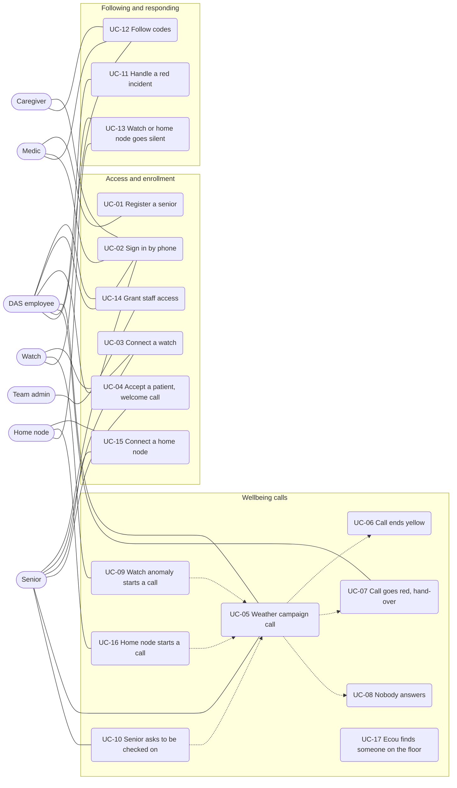
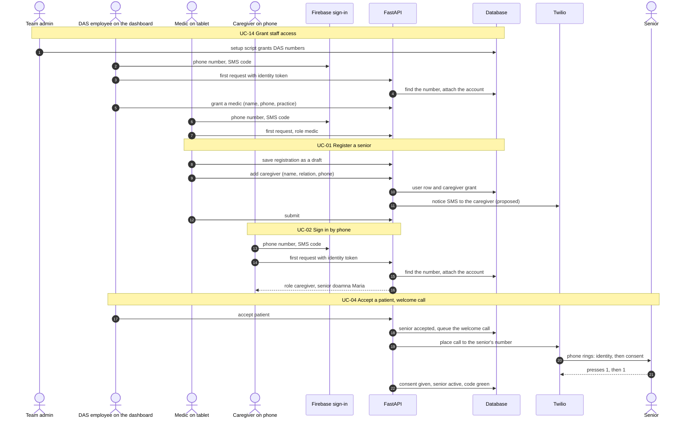
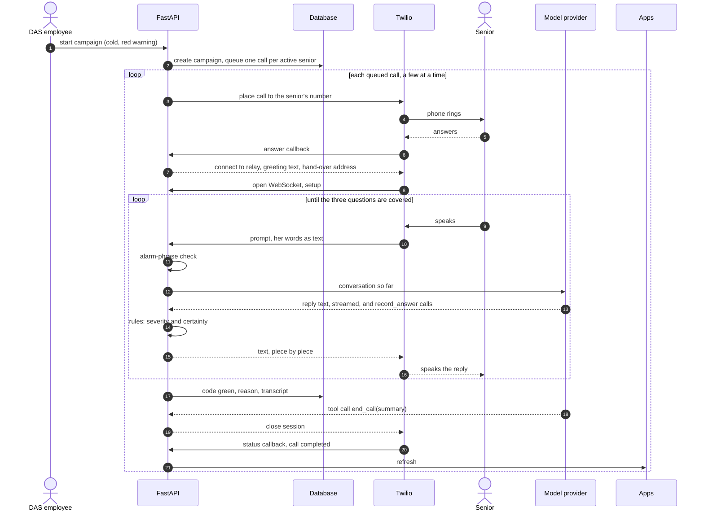
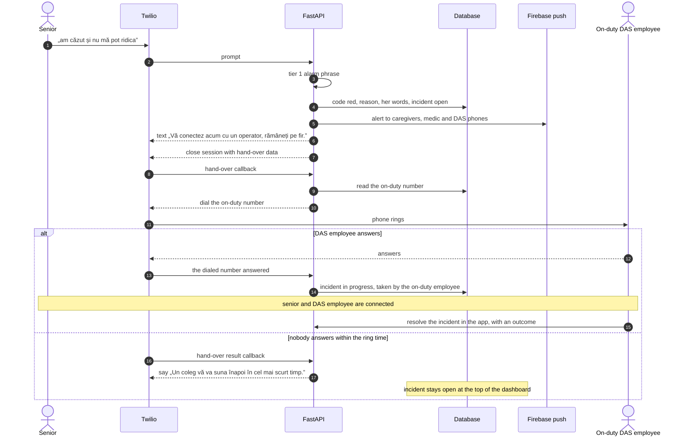
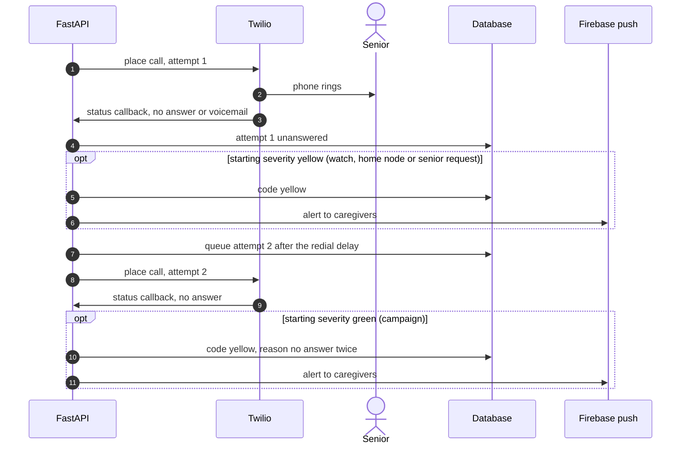
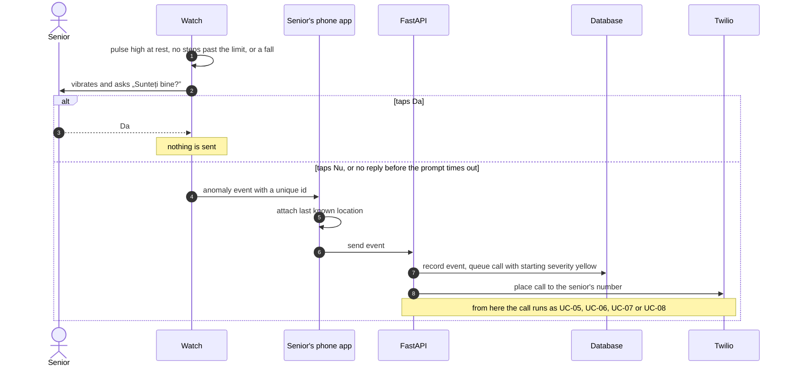
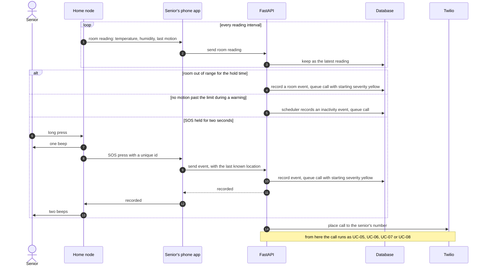
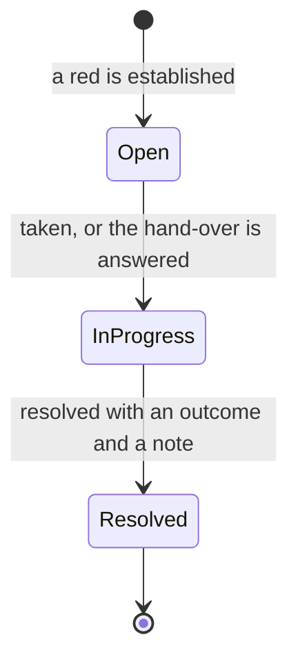

# 02 · Use cases

Part of the [EchoCare specification](README.md). Each use case names who is involved, what starts it, the steps, and what is true afterwards. The channels and interface names used here are defined in [01-architecture.md](01-architecture.md) and [04-interfaces.md](04-interfaces.md); how a call becomes a code is in [03-status-model.md](03-status-model.md).

In the sequence diagrams, "Database" stands for PostgreSQL, which only FastAPI reaches.

## 1. Actors

| Actor | Uses | Role in the system |
|---|---|---|
| Senior | Any phone. Optionally a Wear OS watch, a home node and the Android app on an Android phone | Receives calls and talks with the agent |
| Caregiver | Android app on a phone | Follows one or more seniors; is notified at yellow and red |
| Medic | Android app on a tablet (and optionally a phone) | Registers seniors and their caregivers; follows their own patients; is notified at red |
| DAS employee | Web dashboard at the desk; the Android app's DAS role on a phone, which is also the hand-over phone when on duty | Grants medics, accepts patients, starts campaigns, takes and resolves red incidents |
| Team admin | The setup script | Grants the first DAS employees |
| Watch | Device actor, through the senior's phone | Detects anomalies, reports check-ins |
| Home node **(P20, proposed)** | Device actor, through the senior's phone over Bluetooth | Reports room readings and motion, carries an SOS button, shows the code on a light |

## 2. Overview

Dotted arrows mean "continues as": a watch or home node anomaly, or a senior's request, starts the same call a campaign does, and that call ends in one of three ways.

## 3. Access and enrollment

### UC-14 Grant staff access

| | |
|---|---|
| Actors | Team admin, DAS employee |
| Starts when | Before the event (team admin), or a DAS employee opens "Personal" on the dashboard |
| Before | For a DAS employee: they are signed in |
| After | A user row with a DAS or medic grant exists for the number; that person can sign in |

1. The setup script grants the first DAS employees: name and phone number for each.
2. A DAS employee signs in to the dashboard (UC-02) and opens "Personal".
3. They add a medic (name, phone number, practice) or another DAS employee (name, phone number).
4. The person signs in with that number and sees the screens for their role.

A DAS employee's phone number is also their hand-over number when they are on duty (D8, P10).

### UC-01 Register a senior

| | |
|---|---|
| Actors | Medic; the senior or a caregiver, if present |
| Starts when | The medic opens "Pacient nou" on the tablet |
| Before | The medic is signed in |
| After | A senior exists in state `submitted`, with caregiver grants, waiting for DAS |

1. The medic enters the senior's name, form of address („doamna Maria”), phone number and preferred call window. Whether the number is a landline is worked out from the number itself.
2. The medic enters the address with access details: street and number, block, staircase, floor, apartment, intercom code, who has a key, and a landmark (G13).
3. The medic enters one or two caregivers: name, relation, phone number. Each number becomes a caregiver grant for this senior. If the senior's own number is a mobile, it becomes the senior's grant.
4. If a caregiver is present, they sign in on the spot (UC-02); seeing doamna Maria on their phone confirms the number. Otherwise FastAPI sends a short notice SMS to the number **(proposed)**, so that a wrong number is noticed.
5. If the senior is present, they may sign on the tablet. This is optional: consent is recorded on the welcome call (G7).
6. The medic submits. The senior moves from `draft` to `submitted`. A submit needs the street and the street number; caregivers are optional ([seniors-and-enrollment.md](../seniors-and-enrollment.md) SE4).

Variations:
- **The senior cannot come to the practice.** A caregiver comes alone, or the medic fills the form on a home visit. Nothing changes: consent is the senior's own, given on the welcome call.
- **The medic attaches the fișa medicală (optional).** While registering, or later from the senior's page, the medic may attach it as a PDF. It is analyzed after DAS accepts the senior, and the medic reviews and confirms the questions it suggests before any call uses them (design 2026-11-13).
- **Form left unfinished.** The draft is saved. DAS cannot see it until it is submitted; the medic sees it, and so do the caregivers and the senior whose numbers it already grants (step 4).

Nothing rings and no code exists yet.

### UC-02 Sign in by phone

| | |
|---|---|
| Actors | Any person: senior, caregiver, medic, DAS employee |
| Starts when | They open the Android app for the first time, or after signing out. A DAS employee does the same on the dashboard |
| Before | The app is installed, or the dashboard is open in a browser |
| After | The app or dashboard is signed in and shows the screens for a granted role |

1. The person enters their phone number.
2. Firebase sends an SMS code. The app reads it automatically when it can; otherwise the person types it.
3. The app calls FastAPI with its identity token.
4. FastAPI normalizes the number, finds its user row, attaches the Firebase account on first sign-in, and returns the grants.
5. All grants one role: the app opens that role's screens. Several roles: the app asks which role, listing only the granted ones.
6. The app saves the device's push token.

Variations:
- **Number not granted.** „Numărul nu este înregistrat. Contactați medicul de familie." Nothing is stored.
- **The code does not arrive.** The app offers to resend after a short wait. The demo uses Firebase test numbers, which need no SMS.
- **Sign out.** The app removes its push token. Signing in again is this same flow.

### UC-03 Connect a watch

| | |
|---|---|
| Actors | Senior, or a caregiver helping |
| Starts when | The Wear OS app is installed on a watch paired with the senior's phone |
| Before | The senior's Android phone has the app, signed in as the senior (UC-02) |
| After | The watch reports through the phone app |

1. The watch is paired with the senior's phone through Wear OS's own companion app. This is the operating system's pairing, not ours.
2. The EchoCare Wear OS app finds the phone app over the Data Layer and starts monitoring.
3. The phone app shows „Ceas conectat” and the latest pulse.

Variations:
- **Watch replaced.** Pair the new watch with the phone; there is nothing to unbind.

There are no pairing codes and no device tokens (G5). The watch belongs to whoever's phone it is paired with.

### UC-15 Connect a home node

**(P20, proposed)**

| | |
|---|---|
| Actors | Senior, or a caregiver helping |
| Starts when | The home node is plugged in at the senior's home and its light blinks slowly |
| Before | The senior's Android phone has the app, signed in as the senior (UC-02), with Bluetooth on |
| After | The node reports through the phone app; its light shows the senior's code |

1. In the senior's role, the app's settings offer „Conectează senzorul din casă”.
2. The app scans for devices advertising the EchoCare service and lists them by the last four characters of their address, which are also printed on the box.
3. The senior or the caregiver picks the box. The phone bonds with it; the node accepts one bonded phone at a time.
4. The app shows „Senzor din casă conectat” with the room temperature, and starts relaying readings.

Variations:
- **Node replaced, or a new phone.** Holding the node's button while plugging it in clears its bond; then bond again from the app.
- **Phone out of range or off.** The node keeps its last SOS press and resends it on reconnection; readings are simply missed. FastAPI marks the node `offline` (UC-13).

There are no pairing codes typed by the medic and no device tokens, as for the watch. The node belongs to whoever's phone it is bonded with.

### UC-04 Accept a patient, welcome call

| | |
|---|---|
| Actors | DAS employee, senior |
| Starts when | A DAS employee opens "Cereri de înrolare" on the dashboard |
| Before | The senior is `submitted` |
| After | The senior is `active` with code green, `refused`, `wrong_number` or `unreachable` |

1. The DAS employee reviews the registration and presses "Acceptă". The senior becomes `accepted` and the welcome call is queued.
2. **Identity.** „Bună ziua. Sunt asistentul automat al DAS Timișoara. Vorbesc cu doamna Maria Popescu? Dacă da, apăsați 1 sau spuneți «da». Dacă doamna nu poate veni acum la telefon, apăsați 2. Dacă ați primit acest apel din greșeală, apăsați 3.”
3. **Consent.** A fixed text, approved by DAS and versioned: what the calls are for, who sees what is said (medic, family, DAS), that a medical record the medic has added shapes the questions, and that the senior can stop at any time („Dacă medicul a adăugat fișa medicală, o folosim ca să vă punem întrebări potrivite. Puteți renunța oricând.”). „Dacă sunteți de acord, apăsați 1 sau spuneți «da». Dacă nu, apăsați 2 sau spuneți «nu». Ca să ascultați din nou, apăsați 0.”
4. **Anti-scam close.** „Vă rugăm să salvați acest număr. Nu vă vom cere niciodată bani sau date.”

| Answer | Result |
|---|---|
| Identity 1, consent 1 | Consent given, senior `active`, code green |
| Identity 1, consent 2 | Consent refused, senior `refused`; the medic sees it |
| Identity 1, consent unclear twice | One more welcome call later; if still unclear, `unreachable`: the medic follows up in person, or presses „Sună din nou” |
| Identity 2 (not available now) | One more welcome call after the redial delay; if the second ends the same way, `unreachable`, as above |
| Identity 3 (wrong number) | Senior `wrong_number`; the medic checks the number, corrects it if needed, and presses „Sună din nou” |
| Not answered, or silent twice, or hung up partway through | One redial; if still unanswered, `unreachable`, as above |

„Sună din nou” ([04-interfaces.md](04-interfaces.md) section 2) works from `wrong_number` and `unreachable`: the senior goes back to `accepted`, a new welcome call is queued and the retries start over. The number is not checked, so a correct number can come back `wrong_number` again.

The call is a fixed script whose answers are keys or short spoken words (G7). If a dedicated agent runs it instead, the server still records consent only on key 1 or an exact „da” / „sunt de acord” in the transcript.

A welcome call never changes a code; the code is created when consent is given.

**The scheduler dials the call when the senior's number is on `DIAL_ALLOWLIST`; otherwise the mock card answers it.** Step 1 queues the welcome call. A dialed call runs the steps above (#48). Each question takes one key or speech in `ro-RO`, and is asked once more, opened by „Nu v-am auzit.”, after silence or an unclear answer. Speech counts only as a whole answer once punctuation and diacritics are removed: „da” for identity; „da”, „sunt de acord” or „da, sunt de acord” for consent, „nu” or „nu sunt de acord” for a refusal. The consent is recorded with method `call`, text version `v2`, and the key or the words with Twilio's confidence. Every ending says a Romanian goodbye, then hangs up. The rows that retry apply to the first attempt; a second attempt that ends the same way makes the senior `unreachable`. A call that is not answered, fails, reaches voicemail or is hung up before consent counts as not answered. A senior DAS withdrew during the call is left as they are. A call the scheduler does not dial shows in the senior's own app as a card with the consent text (version `v2-app`, which leaves out the key instructions) and „Da” / „Nu”. „Da” stores the consent with method `app`, makes the senior `active` and starts the code green; „Nu” stores a refusal and makes the senior `refused`. The identity question, `wrong_number`, `not_available` and the retries are not part of the mock. A landline senior has no app, so their call is placed only if the number is on the allowlist (and Twilio is set up); otherwise it waits. The card is refused in production ([06-operations.md](06-operations.md) section 3).

A senior who later withdraws consent becomes `withdrawn`. The medic or DAS records it; the senior leaves the campaigns and gets no more calls. There is no way back yet.

## 4. Wellbeing calls

### UC-05 Weather campaign call (green path)

| | |
|---|---|
| Actors | DAS employee, senior |
| Starts when | A DAS employee presses "Simulează avertizare" on the dashboard and chooses heat or cold |
| Before | At least one active senior |
| After | Every active senior has been called once; each has a fresh code. A warning is active for the campaign's period |

1. FastAPI creates the campaign, marks a warning active for its period, and queues one wellbeing call per active senior, with starting severity green. Seniors with an open or in-progress incident, or with a call already queued or live, are skipped. The campaign is one round, started immediately **(P16, proposed)**.
2. The dialer places a few calls at a time.
3. When the senior answers, Twilio connects the call to the agent. The greeting names the senior and the warning: „…azi e cod roșu de ger”.
4. Each thing the senior says arrives as text. FastAPI checks it for alarm phrases, then passes the conversation to the model, and streams the reply back to be spoken.
5. The agent covers the three questions: how they feel, what day of the week it is, whether they have water and a warm place (cold) or a cool place (heat). After each, the model records the answer. If the senior has a summary of past calls, the agent also asks its first follow-up question once, after the feeling answer and before the last question; that reply counts as an answer only for what the senior says now.
6. The rules give green with high certainty. FastAPI writes the code.
7. The agent closes the call with a short piece of advice.

The other endings are UC-06, UC-07 and UC-08.

**The scheduler dials each call whose senior's number is on `DIAL_ALLOWLIST`; otherwise the mock card answers it.** Step 1 queues the calls and the dialer places them at step 2, only to allowlisted numbers and with Twilio set up. For a call the scheduler does not dial, the senior's own app shows it as a card: the greeting that names the warning, then the three questions as buttons. The answers go through the same rules and the same ending step as a real call (steps 5 to 7), so a code is set and a red opens an incident. „Nu acum” counts as unanswered (UC-08): the redial comes after the redial delay. A landline senior has no app, so their call is placed only if the number is on the allowlist (and Twilio is set up); otherwise it waits until the campaign ends or its warning lapses, and is then canceled. The card is refused in production ([06-operations.md](06-operations.md) section 3).

### UC-06 Call ends yellow

| | |
|---|---|
| Actors | Senior, caregiver, medic |
| Starts when | During a wellbeing call, the rules give yellow, or the call ends uncertain |
| After | Code yellow; caregiver notified; medic sees a warning |

1. The rules give yellow (one worrying answer), or green without high certainty, or the model raises a yellow concern.
2. If certainty is not high and fewer than two re-asks have been used for the question whose answer was unclear, the agent asks it again, up to twice (#49).
3. FastAPI writes code yellow with the reason and the senior's words. For a worrying answer this happens when it is recorded; for an uncertain green it happens when the call ends.
4. The notifier sends an alert to the caregivers' devices. The medic's app shows a warning on that patient, with no alert.
5. The call continues to its normal close.

Nothing follows up if the caregiver does not open the app **(P5, proposed)**.

### UC-07 Call goes red, hand-over

| | |
|---|---|
| Actors | Senior, on-duty DAS employee, caregiver, medic |
| Starts when | A tier 1 alarm phrase is heard; a tier 2 phrase is confirmed or its confirmation goes unanswered; the rules give red; or the model raises a red concern |
| Before | A DAS employee is marked on duty |
| After | Code red; an incident is open or in progress; senior connected to a person at DAS |

1. Red is established by one of the four routes above. A tier 1 phrase acts before the model sees the sentence.
2. FastAPI writes code red immediately, opens an incident, and sends alerts to the caregivers, the medic and the DAS role's phones. The dashboard shows the incident at the top on its next re-read, with an audible cue.
3. The agent tells the senior they are being connected to a person. For a self-harm phrase the wording is „Vă fac legătura acum cu cineva cu care puteți vorbi.”
4. FastAPI closes the agent session with hand-over data. Twilio asks FastAPI what to do next; FastAPI answers "dial the on-duty number".
5. The on-duty phone rings. On answer, the incident is taken by the on-duty employee automatically, and the senior and the DAS employee are talking directly. The DAS app on that same phone already shows the incident: the reason, the senior's words, the transcript so far, the address with access details, a landline badge or the last known location, "Deschide în Hărți", and buttons to call the senior or a caregiver.

**A tier 2 phrase** („am leșinat”, „mi-e rău de tot”, „tremur tot”) does not act at once. The server, not the model, asks a fixed question naming what was said: „Ați spus că v-ați simțit leșinată. Aveți nevoie de ajutor acum? Spuneți «da» sau apăsați 1. Dacă nu, spuneți «nu» sau apăsați 2.” Yes, silence, an unclear answer or a hang-up means red and the steps above. A clear no returns the conversation to the model, with the phrase stored for review.

Variations:
- **Senior asks for a person, or presses 9.** Same hand-over; the code becomes at least yellow, and an incident opens as for a red (G16).
- **On-duty phone not answered.** The senior hears that someone will call back. The incident stays open at the top of the dashboard, with its audible cue, until someone takes it.
- **Nobody is on duty.** No dial is attempted; same message to the senior; the dashboard shows the open incident with a "nobody on duty" warning.
- **Red with no call left to hand over.** Happens if the line drops between the red and the hand-over. The incident opens as usual and DAS phones the senior.

**Hand-over triggers (#48, #49).** Key 9 and a tier 1 phrase start the hand-over at any point in a wellbeing call. Before the session closes, one step writes the status report, the code, the incident (or joins the senior's unresolved one) and the call's `handed_over`, so a line lost at step 3 keeps them. A second 9 changes nothing. A confirmed or unanswered tier 2 phrase, the rules' red, the model's red concern and a request for a person (or the agent judging the conversation cannot go on) start it too (04 §4.3, §5). The on-duty number is dialed only if it is on `DIAL_ALLOWLIST`; otherwise the senior hears the call-back message. An incident someone took from the dashboard before the phone was answered stays theirs. No push alerts are sent yet. Test calls (`place_call.py`) never hand over.

### UC-08 Nobody answers

| | |
|---|---|
| Actors | Senior, caregiver |
| Starts when | A wellbeing call is not answered, is busy, or reaches voicemail |
| After | One redial has been made; if still unanswered, code yellow |

1. Twilio reports the outcome. Voicemail detection runs in the background so that a person who answers does not hear silence; if a machine answered, the call is ended and counted as unanswered.
2. If the trigger carried a starting severity of yellow, the code becomes yellow now and the caregivers are alerted.
3. One redial is queued after the redial delay.
4. If the redial is also unanswered and the code is still green, it becomes yellow with the reason "no answer twice".

If the redial is answered, the call proceeds as UC-05, UC-06 or UC-07, and its result replaces the yellow from step 2 under the usual rules.

### UC-09 Watch anomaly starts a call

| | |
|---|---|
| Actors | Senior, watch, senior's phone app |
| Starts when | The watch detects a pulse well above the wearer's resting level while they are not moving, or no steps for longer than the inactivity limit, or a fall **(P19, proposed)**, or the senior taps "Nu mă simt bine" (G14) |
| Before | The watch is connected (UC-03) and worn |
| After | A wellbeing call has been queued with starting severity yellow |

1. The watch compares the pulse with the wearer's own resting level and with movement. A high pulse during a walk is ignored. It also counts steps; a long stretch without any is an inactivity anomaly.
2. The watch also watches the accelerometer for a fall **(P19, proposed)**: an impact above 2 g, then at least 7 seconds with almost no movement (within 0.1 g of 1 g). Free fall is not required: at the wrist it is often missing in a real fall and present in ordinary movement. Walking, climbing stairs, slapping a table and sudden gestures do not match; sitting down hard or lying down quickly can, and the wrist prompt catches those. Measured in [spike-results.md](spike-results.md), S13.
3. The watch vibrates and asks „Sunteți bine?” with Da and Nu. After a fall the prompt times out sooner and also beeps.
4. Da ends it. Nu, or no reply before the prompt times out, sends an anomaly event to the phone app.
5. The "Nu mă simt bine" button skips the prompt and sends the event at once.
6. The phone app attaches its last known location and forwards the event to FastAPI.
7. FastAPI records the event and queues a wellbeing call. The code does not change yet (P8).
8. The senior's phone rings, and the call also shows on the wrist, which Wear OS does without any work from us.

Variations:
- **Inactivity outside an active warning.** Recorded, and starts no call. Inactivity counts only while a heat or cold warning is active.
- **No connection.** The watch keeps the event until it reaches the phone; the phone keeps it until it reaches FastAPI. Both send the time it was measured. An event older than the stale limit is recorded and starts no call.
- **A call is already queued or live for this senior, or one just ended.** The event is attached to that call; no second call is started.
- **Same event delivered twice.** Ignored by its id.

The watch never places a call. It tells the phone app, the phone app tells FastAPI over the internet, and FastAPI asks Twilio to ring the senior's phone number.

### UC-10 Senior asks to be checked on

| | |
|---|---|
| Actors | Senior |
| Starts when | The senior taps "Sunați-mă" in the Android app |
| Before | The senior is signed in (UC-02) |
| After | A wellbeing call has been queued with starting severity yellow |

1. The app sends a `manual_request` event, with its last known location, to FastAPI.
2. FastAPI records it and queues a wellbeing call, exactly as for a watch anomaly.
3. The call proceeds as UC-05, UC-06, UC-07 or UC-08.

This is also the demo trigger and the fallback for UC-09: it enters the same path, so it exercises the same code (D9).

### UC-16 Home node starts a call

**(P21, proposed)**

| | |
|---|---|
| Actors | Senior, home node, senior's phone app |
| Starts when | The room stays below the cold limit or above the heat limit for the hold time, or the node sees no motion for longer than the inactivity limit during an active warning, or the senior holds the node's SOS button |
| Before | The node is connected (UC-15) |
| After | A wellbeing call has been queued with starting severity yellow |

1. The phone app relays every room reading to FastAPI. FastAPI keeps only the latest one, and notes when the temperature first went out of range.
2. If the temperature is still out of range after the hold time, FastAPI records a `room_cold` or `room_heat` event and queues a wellbeing call. Unlike inactivity, this needs no active warning: a cold room is itself the warning.
3. During an active warning, the scheduler records an `inactivity` event from the node when the last motion is older than the inactivity limit, as for the watch.
4. A two-second press of the SOS button sends an `sos_button` event through the phone, like the watch's button. The node beeps once on the press and twice when FastAPI has recorded it.
5. The call proceeds as for a watch anomaly. The code does not change yet (P8). On the call, the latest room reading is also checked against the senior's answer about a warm or cool place ([03-status-model.md](03-status-model.md) section 3).

Variations:
- **A senior with both a watch and a node.** Each sends its own events; the cooldown attaches the second to the call the first one started.
- **Room back in range before the hold time.** Nothing is recorded.
- **Phone out of range.** Readings are missed and the node is marked `offline` (UC-13). An SOS press waits on the node until the phone is back.

The node never places a call and never reaches the internet. It tells the phone app, the phone app tells FastAPI, and FastAPI decides.

### UC-17 Ecou finds someone on the floor

**(P24, proposed)** With Ecou, the home node built as a robot ([08-ecou.md](08-ecou.md)): when it has lost track of everyone for the search delay, it sweeps the floor; an object lying still for the lying hold time makes it ask „BINE?” with a countdown. A wave cancels; a palm or no answer sends a `fall` with the sweep, which queues a yellow call with trigger `home_node`, and DAS sees where on a map. Steps, variations and the sequence diagram are in [08-ecou.md](08-ecou.md) §4.

## 5. Following and responding

### UC-11 Handle a red incident

| | |
|---|---|
| Actors | DAS employee, at the dashboard or in the DAS app |
| Starts when | A red opens an incident (UC-07) |
| After | The incident is resolved with an outcome and a note; the senior is back in campaigns |

1. The incident appears at the top of the dashboard with an audible cue, and in the DAS app's list on every DAS phone. Both show the reason, the senior's words, the transcript, whether the hand-over was answered, the address with access details, and the location if one came with the event.
2. A DAS employee presses "Preiau" (take). The incident becomes `in_progress`, showing who took it. Answering the hand-over does this automatically. The audible cue stops.
3. They handle it: talk to the senior, call a caregiver, send a team, or, as the dispatcher, call 112.
4. They press "Rezolvat" and choose an outcome (senior OK, team sent, 112 called, could not reach, false alarm) and add a short note.
5. The incident becomes `resolved`. The senior stays shown as red, marked resolved, until the next wellbeing call gives a new result (P9), and campaigns include them again.

Variations:
- **Someone else already took it.** "Preiau" is refused and shows who has it.
- **A new red while an incident is still open or in progress.** No second incident: the new call and its reason are added to the existing one.

Taking and resolving record what DAS did; neither changes the code.

### UC-12 Follow codes

| | |
|---|---|
| Actors | Caregiver, medic, DAS employee |
| Starts when | They open the app or the dashboard, or tap a notification |
| After | They have seen the current code and its reason |

| Role | Sees |
|---|---|
| Caregiver | Their senior's code, the reason in a sentence, short call history, the watch's state, the home node's state and latest room reading |
| Medic | A panel of all their patients with codes, yellow and red highlighted; per patient: registration details, enrollment and consent state, call history, full transcripts, the watch's state, the home node's state and latest room reading |
| DAS employee, dashboard | All active seniors, red first; incidents by status; enrollment requests; staff and who is on duty; the campaign button; per senior: code, reason, call history, full transcripts, address and access details, the watch's state and its last 24 hours of pulse ([ADR-006](../../adr/ADR-006-das-sees-watch-health.md)) |
| DAS employee, Android app | Red incidents only, open and in progress first, each with its status and who took it; per incident: full senior data, address and access details, location, the call and its transcript, "Deschide în Hărți", call buttons |

Open Android screens update when a refresh arrives, with a slow timed re-read as the backstop. The dashboard re-reads every few seconds. A call that is ringing or live shows a "call in progress" badge.

### UC-13 Watch or home node goes silent

| | |
|---|---|
| Actors | Watch, home node, caregiver, medic |
| Starts when | No check-in has arrived for longer than the silence limit, or a check-in says the watch is not worn. For a home node: no room reading for longer than its silence limit |
| After | The watch's state is `offline` or `not_worn`, or the home node's state is `offline`, visible as a device warning |

1. The scheduler notices the missing check-ins and marks the watch `offline`. This also happens when the phone app, not the watch, has lost its connection. A check-in that reports "not worn" marks it `not_worn`.
2. The caregiver and the medic see a device warning beside the senior. There is no alert and the code does not change.
3. The next normal check-in sets the state back to `ok`.
4. A home node with no room reading past its silence limit is marked `offline` the same way, and the next reading sets it back to `ok`. An offline node's last reading is not used on calls (P22).

A silent watch or node is not evidence about the senior; it is evidence about the device. Weather campaigns still reach that senior by phone.
