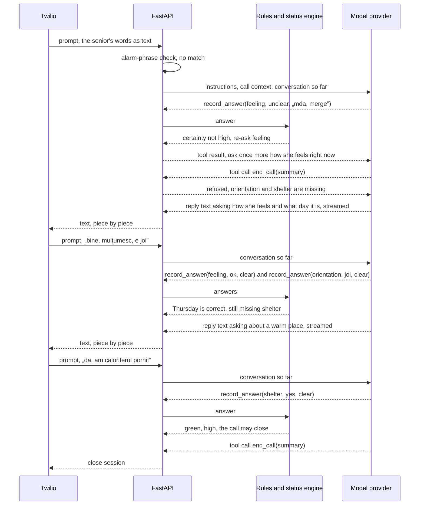

# 04 · Interfaces

Part of the [EchoCare specification](README.md). This file lists every interface between parts: what it is called, who may use it, what goes in and what comes out. Channel numbers refer to [01-architecture.md](01-architecture.md) section 4.

Names and addresses are indicative. They fix the shape of each interface, not its final spelling.

## 0. Conventions

- **Format.** JSON everywhere except the phone network.
- **Identity.** Every request from the Android app or the dashboard carries its Firebase identity token as `Authorization: Bearer <token>`. FastAPI verifies it, reads the phone number and loads the caller's grants. A request without a valid token is refused. The caller may do what any of their grants allows ([auth-layer.md](../auth-layer.md) AL2).
- **One API for every client.** The dashboard uses the same endpoints as the Android app. Browser requests are accepted only from the dashboard's own address.
- **Phone numbers.** Normalized to the international format (+40…) on every write and every lookup.
- **Ids.** Unique ids are generated by whoever creates the thing: the database for rows, the watch, the home node or the phone app for events, and FastAPI for the events it derives from room readings (P21).
- **Time.** UTC. Devices send the time a reading was taken; FastAPI adds the time it arrived.
- **Repeat-safe.** Every command and every event can be sent twice without a second effect, except `POST /seniors`, which makes a second draft, `POST /seniors/{id}/signature`, which adds a second consent record (the latest counts), `PUT /seniors/{id}/medical-record`, where a repeat replaces the file and starts the analysis over, and `POST /seniors/{id}/medical-record/reanalyze`, where a repeat answers 409 `wrong_state`. Commands that queue a call return the existing call if one is already queued or live for that senior. `POST /campaigns` answers the running campaign of the same kind and level, with 200, instead of making a second one; `POST /campaigns/{id}/end` answers the same on a repeat.
- **Refusals.** A refused request says why in a short machine-readable reason, as `{"detail": {"reason": "…"}}`: `not_signed_in` (401), `not_registered` (403, a number with no grant), `not_allowed` (403), `not_found` (404, also for a senior outside the caller's reach), `wrong_state` and `already_done` (409), `phone_taken` (409, a mobile number that already signs in as another senior), `call_live` and `incident_open` (409, an erasure while a call is live or an incident unresolved), `too_large` (413, a medical record over 10 MB), `not_pdf` (415, a medical record that is not a PDF), `storage_unavailable` (503, the file store did not answer), `unknown_status` (422, a status filter naming no known status), `not_medic` (422, a practice given for someone who holds no `medic` grant), `incomplete` (422, a registration submitted without what DAS needs, or a mock answer without what its call needs, with `missing` naming it), `auth_unavailable` (503, sign-in cannot be checked right now). [auth-layer.md](../auth-layer.md) §3.2 says what a client does with each.

## 1. Apps → FastAPI: reads (channel 3)

Each read is scoped by the caller's grants as in [01-architecture.md](01-architecture.md) section 6.

| Read | Indicative address | Who | Returns |
|---|---|---|---|
| My profile | `GET /profile` | Any number with a grant | Display name, phone number, and one entry per grant: role, and the senior for caregiver and senior grants with the senior's form of address, and the relation for a caregiver; das first, then medic, caregiver, senior. Also `warning_active`, true while any campaign's warning has not ended, for every caller ([auth-layer.md](../auth-layer.md) §3.3) |
| Seniors | `GET /seniors` | Medic: seniors they registered, drafts included. Caregiver: seniors linked to them. Senior: themselves. DAS: seniors submitted or further along | Per senior, by name: id, name, form of address, phone number and landline or not, enrollment state, and when it was registered, submitted and accepted (`created_at`, `submitted_at`, `accepted_at`; the last two null until then). `?role=` narrows the list to what one of the caller's roles reaches, for an app's home per role: it grants nothing, and a role the caller does not hold gives an empty list. The current code (`green`, `yellow` or `red`), its reason and since when, as `code`, `reason` and `since`: all three are null until the senior's first result, and for any senior who is not `active`, so a withdrawn senior's old code does not read as being watched. The submit, accept and consent-withdrawn answers carry the same fields. The watch state as `watch_state` (`ok`, `not_worn`, `offline`), for the senior's caregivers, their registering medic and DAS (UC-12, ADR-006), null for anyone else and before the first check-in, as in `GET /seniors/{id}`; the submit, accept and consent-withdrawn answers leave it null. The medical record's state as `medical_record_state` (`pending`, `review`, `confirmed`, `failed`), for the senior's registering medic only, null for anyone else and when no record is attached (design 2026-11-13); the submit, accept and consent-withdrawn answers leave it null. Added with their work: acknowledged or not, call in progress or not. For every role, the home node state and latest room temperature if there is a node **(proposed)** |
| One senior | `GET /seniors/{id}` | Same scoping | Registration details with the call window, enrollment state, address and access details, landline or not, the medic who registered them (name, practice), caregivers (user id, name, number, relation). The same for every role. `created_at`, `submitted_at` and `accepted_at` as in `GET /seniors`. The current code, reason and since when (`code`, `reason`, `since`, on the senior only: the copy of the senior inside an incident carries none), null as in `GET /seniors`. `call_in_progress`, true while one of the senior's calls is ringing or in progress, a test call aside, for the "call in progress" badge (UC-12); only this read sets it, other answers carrying the senior leave it null. `watch_state` (`ok`, `not_worn`, `offline`) and `last_pulse` (0 to 300), for the senior's caregivers, their registering medic, DAS (ADR-006) and the senior themselves on their own page (UC-03, UC-12); both null for anyone else, before the first check-in, and on the other answers carrying the senior. `consent`, the latest consent record with method `call`, `app`, `medic` or `das`, as `{decision, method, at}` (`decision` is `given`, `refused` or `withdrawn`), or null; a signature is not a consent decision (G7, UC-01), so records with method `signature` are left out. `consent_given_at`, when the latest `given` record from method `call` or `app` was made, kept after a later withdrawal, or null. `signed_at`, when the latest signature was recorded, or null. Added with their work: latest event location (caregiver and DAS). For every role, the home node and its latest room reading **(proposed)** |
| Calls | `GET /seniors/{id}/calls` | Same scoping | Newest first, queued calls included, test calls (`trigger` `test`, 05 §1) left out; no pagination. Per call: id, trigger, state (`canceled` for a queued call canceled when its campaign ends or lapses, or when consent is withdrawn), due time, start and end time, final severity and certainty, reason, summary |
| Transcript | `GET /calls/{id}/transcript` | The senior's registering medic; DAS for a senior past `draft`. A caregiver or the senior reaches the calls but not what was said, and gets `not_found` like a stranger | The call as on the incident page, with its turns and status reports, plus its answers (field, value, clear or not, the senior's words, when) in time order. The turns are the whole call in the order it was said, each with its speaker: `senior`, `agent`, `system`, or `das` for the DAS employee after a hand-over (§4.4). Test calls are served too |
| Summary | `GET /seniors/{id}/summary` | The senior's registering medic; DAS for a senior past `draft`. A caregiver or the senior gets `not_found` like a stranger | The latest summary version (design §5 B): `content` (`follow_ups`, `how_to_talk`, `trends`, `narrative`), `call_id` of the call it follows, `created_at`. `204` when there is none yet or the stored content no longer fits the shape |
| Medical record | `GET /seniors/{id}/medical-record` | The senior's registering medic; DAS for a senior past `draft`. Anyone else gets `not_found` | `state` (`pending`, `review`, `confirmed`, `failed`), `uploaded_at`, `analyzed_at`, `confirmed_at`, `items` (`condition`, `question`, `worrying`, `evidence`, `included`) and `pdf_url`, a presigned link valid for 10 minutes (null when the file store is down). DAS gets `items` and `pdf_url` only once `confirmed`, otherwise null. `204` when no record is attached (design 2026-11-13 §5.4) |
| Watch | `GET /seniors/{id}/watch` | Same scoping; the content only for whoever sees the watch state (01 §6: caregivers, registering medic, DAS, the senior) | The latest check-in (UC-13, ADR-006): `state` (`ok`, `not_worn`, `offline`), `last_check_in_at`, and `battery`, `worn`, `last_pulse`, `resting_pulse`, `steps_today`, `minutes_without_steps`, each null when the watch did not send it. `204` before the first check-in, or when the caller does not see the watch |
| Watch readings | `GET /seniors/{id}/watch/readings` | As `GET /seniors/{id}/watch` | The check-ins of the last 24 hours (05 §4), oldest first, in 5-minute buckets: `at` (bucket start), `pulse` (average, rounded), `battery` (lowest), `worn` (false if any check-in in the bucket said so), `steps_today` (highest). Empty when there are none, or when the caller does not see the watch |
| The mock call **(demo only, refused in production)** | `GET /profile/mock-call` | A number with a `senior` grant | The caller's senior's oldest queued call that is due, to show as a card in their app: a `campaign`, `watch` or `manual` call while the senior is `active` (the last two so an event reaches a code with no phone line, UC-09, UC-10), or a `welcome` call while they are `accepted`. Per call: `call_id`, `trigger`, and for a campaign call the campaign's kind and level (`campaign_kind`, `campaign_level`), for a welcome call the consent text and its version (`consent_text`, `text_version`). The app shows exactly what the server sends, so a recorded `text_version` matches what the senior read. The card has its own text, version `v1-app`: the phone call's `v1` tells the senior to press keys. Answers 204 when no call is due. A call the scheduler has dialed (`dialed_at` set, 05 §1) is never offered. In production `not_found`; a number with no `senior` grant `not_allowed`. Stands in for the phone line for a call the scheduler does not dial ([06-operations.md](06-operations.md) §2, §3) |
| Incidents | `GET /incidents?status=open,in_progress` | DAS | Per incident: senior's name and form of address, status, who took it and when, reason, when it opened, whether the hand-over was answered on any of its calls. The DAS app asks for open and in progress; the dashboard for any status. Resolved incidents are listed for 24 hours after resolving |
| One incident | `GET /incidents/{id}` | DAS | The incident, the senior's full data with address and access details and landline or not, the location from the triggering event if any, the latest room reading if there is a home node **(proposed)**, for a fall found by the home node its `source`, `object_angle_deg`, `object_distance_m` and `scan` on the event (P24; null for any other event), the calls with their transcripts, the caregivers' names and numbers. The calls are the senior's calls from the first attempt behind the opening call until the incident was resolved, so redials and a later red added to it are included. Served without the home node fields until their tables exist. Also the senior's latest summary as optional `summary` (the shape of the summary read, `null` when there is none), for the DAS briefing |
| Enrollment requests | `GET /enrollments` | DAS | Seniors in `submitted`, by `submitted_at`, requests from before it was recorded first, then `created_at`, then `id`, each as one row of `GET /seniors` |
| Campaigns | `GET /campaigns` | DAS | Newest first (start time, then id), no pagination. Per campaign: id, kind, level, the name of who started it, when it started, when its warning ends, whether it is active (`active`, the warning has not ended), and its `progress`: `total`, `waiting`, `green`, `yellow`, `red`, `canceled`. Progress counts each senior the campaign queued once, by their latest attempt in it: `waiting` is a queued call (a first attempt that went unanswered, with its redial queued, is waiting); `green`, `yellow` and `red` are ended calls by their final severity; `canceled` is a canceled call. A lapsed campaign's queued calls are canceled before the list is built (section 2) |
| Staff | `GET /staff` | DAS | DAS employees and medics, once per person, by name: id, display name, phone number, practice, roles (`das` before `medic`), on duty or not |
| System health | `GET /system/health` | DAS | System health: status (`ok` or `degraded`), environment (`env`), database connectivity & latency (`database`), UTC timestamp; extensible for active telemetry |

## 2. Apps → FastAPI: data entry and commands (channel 3)

A command answers as soon as its work is stored or queued. Results show up through the reads in section 1, prompted by a refresh push.

| Request | Indicative address | Who | Effect | Refused when |
|---|---|---|---|---|
| Grant staff | `POST /staff` | DAS | Display name, phone number (a mobile: staff sign in by SMS), role `medic` or `das`, and the practice for a medic. Creates the user row if the number has none, keeping an existing name, and the grant ([auth-layer.md](../auth-layer.md) §3.4) | The number already has that grant (`already_done`); nothing changes |
| Edit staff | `PATCH /staff/{userId}` | DAS | Display name and practice; a field left out stays. The phone number cannot change, because it is how they sign in. Answers one row of `GET /staff` | The person holds neither `das` nor `medic` (`not_found`). A practice for someone without `medic` (`not_medic`) |
| Remove a staff role | `DELETE /staff/{userId}/roles/{role}` | DAS | Deletes that `das` or `medic` grant; a DAS employee may remove their own. Removing `das` also takes the person off duty. An incident they hold stays theirs, and any DAS employee can resolve it. Answers 204, also when the person has no such grant. Another role is FastAPI's 422 | It would leave no DAS employee (`wrong_state`) |
| Set on duty | `PUT /staff/on-duty` | DAS | Marks one DAS employee on duty (`user_id`) and clears all others (P10). Answers 204, also on a repeat | The person is not a DAS employee (`not_allowed`) |
| Clear on duty | `DELETE /staff/on-duty` | DAS | Nobody is on duty; the hand-over then speaks a message and hangs up (section 4.2). Answers 204 | n/a |
| Save senior draft | `POST /seniors`, `PUT /seniors/{id}` | Medic creates. The registering medic, or DAS for a senior past `draft`, replaces | Creates a senior in `draft`, or replaces the whole registration in any state; a submitted request stays submitted and keeps its place. Answers the senior as `GET /seniors/{id}`. Landline or not is worked out from the number. A mobile number for the senior creates the senior grant (AL7, SE10); a changed number moves it and queues no call. Anyone else may not edit (`not_allowed`, or `not_found` outside their reach). DAS edits only what it reaches as DAS: a DAS employee who sees a draft only as its caregiver gets `not_allowed` | A mobile that already signs in as another senior (`phone_taken`), on create and when an edit changes the number. Past `draft`, a body without the street or its number (`incomplete`, with `missing`) |
| Delete a draft | `DELETE /seniors/{id}` | Medic, own senior | Deletes the senior with its consents, grants and medical record, and the record's PDF from the file store (design 2026-11-14; a store that fails leaves the file, logged, and still answers 204). Answers 204; a repeat is `not_found`, the row being gone | The senior is past `draft` (`wrong_state`). A call or any other record still refers to the senior (`wrong_state`); nothing is deleted |
| Add or remove a caregiver | `POST /seniors/{id}/caregivers`, `DELETE /seniors/{id}/caregivers/{userId}` | The registering medic, or DAS for a senior past `draft` | Name, relation and a mobile number (caregivers sign in by SMS). Creates the user row if the number has none and the caregiver grant, answering the caregiver as in `GET /seniors/{id}`. Remove deletes the grant and answers 204, also on a repeat. On add, sends the notice SMS **(proposed)** | Add: the number already cares for this senior (`already_done`). Remove: past `draft`, the last caregiver (`incomplete`, `missing` naming `caregiver`) |
| Edit a caregiver | `PATCH /seniors/{id}/caregivers/{userId}` | The registering medic, or DAS for a senior past `draft` | Relation and name; one left out stays. The name is on the person's user row, so it changes wherever they appear. Answers the caregiver as in `GET /seniors/{id}` | The person is not this senior's caregiver (`not_found`). A name for someone who holds `das` or `medic` (`not_allowed`, nothing changes): staff names change only through `PATCH /staff/{userId}` |
| Save signature | `POST /seniors/{id}/signature` | Medic, own senior | The text version, which must be one the server knows (today only `v1-semnatura`), and the strokes: at least one, each a list of at least one `[x, y]` point from 0 to 1, at most 5,000 points in all. The text is the one version `v1-semnatura` stands for, a server constant (`SIGNATURE_CONSENT_TEXT`): „Vă vom suna în zilele cu vreme extremă sau când ceasul semnalează ceva neobișnuit. Ce spuneți în apel văd medicul de familie, familia și DAS. Puteți renunța oricând. Semnând mai jos, sunteți de acord.” The app carries the same text, and a change to it is a new version. Stores them as a consent record `given` with method `signature` and who recorded it (optional, G7). The latest signature counts, so a second post adds a second record. Answers 204 | The senior is not `draft`, `submitted` or `accepted` (`wrong_state`). A bad body, an unknown text version included, is FastAPI's 422 |
| Submit enrollment | `POST /seniors/{id}/submit` | Medic, own senior | `draft` → `submitted`; DAS can see the senior from now on. Answers the senior as one row of `GET /seniors` | Already `submitted` (`already_done`), past it (`wrong_state`). Required fields missing (`incomplete`, with `missing` naming any of `street`, `street_number`, `caregiver`: the address and at least one caregiver) |
| Attach medical record | `PUT /seniors/{id}/medical-record` | Medic, own senior | The PDF as the raw request body, at most 10 MB, starting with `%PDF`. Replaces any earlier record: state back to `pending`, items and confirmation cleared, the old file deleted. Answers the record as in the read | The senior is `refused` or `withdrawn` (`wrong_state`). Over 10 MB (`too_large`). Not a PDF (`not_pdf`). File store down (`storage_unavailable`) |
| Confirm medical record | `POST /seniors/{id}/medical-record/confirm` | Medic, own senior | `items`: one `{included, question, worrying?}` per stored item, in order; `question` and `worrying` 1 to 200 characters, `worrying` omitted keeps the stored one. Optional `analyzed_at`, the profile the medic reviewed. Keeps the stored `condition` and `evidence`, sets `confirmed`. Allowed again from `confirmed`. Answers the record | The senior is not `accepted` or `active`, the record is not `review` or `confirmed`, the item count differs from the stored, or `analyzed_at` is not the stored one (`wrong_state`) |
| Re-analyze medical record | `POST /seniors/{id}/medical-record/reanalyze` | Medic, own senior | Back to `pending` from `review`, `confirmed` or `failed`: items cleared, the extracted text kept. Answers the record | The senior is not `accepted` or `active`, or the record is `pending` (`wrong_state`) |
| Accept patient | `POST /seniors/{id}/accept` | DAS | `submitted` → `accepted`; queues the welcome call (`trigger` `welcome`, due now) in the same step. A senior whose number is a landline gets the call too. The scheduler dials it when the senior's number is on `DIAL_ALLOWLIST` ([06-operations.md](06-operations.md) §2); otherwise it stays queued, and a landline senior has no app to show it as a card. A mobile senior's app answers it as a mock card (`GET /profile/mock-call`, `POST /calls/{id}/mock-answer`). Answers like submit | Already `accepted` (`already_done`), any other state (`wrong_state`). A draft is outside DAS's reach (`not_found`) |
| Call again | `POST /seniors/{id}/welcome-call` | Medic, own senior | Moves the senior to `accepted` and queues a welcome call (attempt 1, due now) in one step; the number is not checked; answers like submit; a repeat (already `accepted` with a welcome call queued or live) answers the same and queues nothing | Any other state (`wrong_state`). Another live call for the senior, which leaves no room for the welcome call (`wrong_state`, nothing changes) |
| Record withdrawal | `POST /seniors/{id}/consent-withdrawn` | The registering medic, or DAS for a senior past `draft` | `active` → `withdrawn`, with a consent record `withdrawn` (method `medic` or `das`, and who recorded it) in the same step; the senior leaves campaigns, and their queued calls become `canceled` in that step ([03-status-model.md](03-status-model.md) section 9), so the card goes. Answers like submit | Already `withdrawn` (`already_done`), any other state (`wrong_state`) |
| Erase a senior | `POST /seniors/{id}/erase` | The registering medic, or DAS for a senior past `draft` | GDPR erasure (Art. 17, design 2026-11-14), in any state. Deletes the senior and every row about them: calls, transcripts, answers, status reports, the code, events, incidents, consents, summaries, watch data, the medical record and its PDF, their grants, and the users of the senior and caregivers left with no grant, except one another row still names (a former medic or DAS employee), who stays. In our database and file store, only a log line with the senior's id and who erased it remains; Twilio's call logs, database backups and the Firebase sign-in account are outside it (05 §5). A queued call not yet handed to Twilio is deleted too. No push: open apps get `not_found` on their next read. Answers 204; a repeat is `not_found` | A call for the senior is `ringing`, `in_progress`, or `queued` and already dialed, or one of its calls is being written at that moment (`call_live`). An incident for the senior is `open` or `in_progress` (`incident_open`). Nothing is deleted on a refusal. A draft is outside DAS's reach (`not_found`) |
| Take an incident | `POST /incidents/{id}/take` | DAS | `open` → `in_progress`, with who and when. Changes nothing else. Answers the incident as one row of `GET /incidents`; a repeat by the person who has it answers the same | Taken by someone else: `already_done`, with `taken_by_name` naming who has it. Resolved: `wrong_state` |
| Resolve an incident | `POST /incidents/{id}/resolve` | DAS | Outcome (`senior_ok`, `team_sent`, `called_112`, `not_reached`, `false_alarm`) and a short note. `in_progress` → `resolved`; any DAS employee may resolve. The code is unchanged; the senior returns to campaigns. Answers like take; an exact repeat answers the same | Still `open`: `wrong_state`. Already resolved by someone else or with another outcome: `already_done` |
| Start campaign | `POST /campaigns` | DAS | Body: `kind` (`heat` or `cold`) and `level` (`yellow` or `red`), nothing else. Creates the campaign with an active warning of 24 hours from the start ([06-operations.md](06-operations.md) §3, the same in demo mode); queues one wellbeing call per `active` senior (`trigger` `campaign`, attempt 1, starting severity green, due now), skipping seniors with an open or in-progress incident and seniors with a call already queued or live. Answers one campaign as in `GET /campaigns`: 201 for a new one. While a campaign of the same kind and level has an active warning, answers that campaign with 200 and creates nothing; another kind or level starts a new one. Two presses at once make one campaign. The scheduler dials each call whose senior's number is on `DIAL_ALLOWLIST`; the senior's app answers any other as a mock card | Never, for a DAS caller. A body with another kind or level is FastAPI's 422 |
| End campaign | `POST /campaigns/{id}/end` | DAS | Ends the warning now: `warning_until` becomes the earlier of itself and now, so a lapsed warning keeps its end. Moves the campaign's `queued` calls, redials included, to `canceled`, in one step. The codes and the calls already answered stay. After it a new campaign can start, of the same kind and level too. Answers the campaign as in `GET /campaigns`; a repeat answers the same, unchanged | No such campaign (`not_found`) |
| Answer the mock card **(demo only, refused in production)** | `POST /calls/{id}/mock-answer` | The senior whose call it is | Walks the call through the states a real call passes (`queued` → `ringing` → `in_progress` for an answer, `queued` → `ringing` → `unanswered` for „Nu acum”) and ends it by the same step a Twilio call will use ([03-status-model.md](03-status-model.md) sections 6 and 8). The transcript opens with a system line saying the call was simulated. Body by trigger. **`campaign`, `watch` and `manual`:** `feeling` (`ok` or `unwell`), `day` (a weekday in Romanian, or `unknown`) and `shelter` (`yes` or `no`), or `{"declined": true}` for „Nu acum”. All three answers are clear, so the rules give a code and a reason, and a red opens an incident; it ends `completed`, not `handed_over`, since no line is there to hand over. „Nu acum” ends the call `unanswered`: a first one queues the redial, due after the redial delay (06 §3) and changing no code; a second ends the call at yellow, „Nu a răspuns de două ori”. **`welcome`:** `consent` (`true` or `false`). `true`: the senior becomes `active`, a consent record `given` with method `app` and text version `v1-app` is stored, and the code starts green, reason „Consimțământ dat”. `false`: the senior becomes `refused`, with a consent record `refused`, and no code. Answers 204 | In production (`not_found`). A call that is not this senior's, or does not exist (`not_found`). A call already `completed` or `unanswered` (`already_done`). Any other state, `canceled` included, a call not due yet, a call the scheduler has dialed, or a senior no longer in the state the card needs: `wrong_state`, and nothing changes. A body without what its trigger needs (`incomplete`, with `missing`) |
| Save push token | `PUT /profile/push-tokens/{token}`, `DELETE …` | Any number with a grant | Stores this device's push token for the caller; a token another user held moves to the caller, as on a shared tablet. Delete removes it only if it is the caller's. Both answer 204 | A token over 512 characters (FastAPI's 422) |

**A lapsed warning ends its campaign.** A campaign's calls live only as long as its warning. When `warning_until` passes without an `end`, the campaign's queued calls become `canceled`, exactly as `end` would make them. The scheduler ([06-operations.md](06-operations.md) §2) does it on its tick. The next `POST /campaigns`, `GET /campaigns`, `GET /profile/mock-call` or `POST /calls/{id}/mock-answer` also does it first, as a fallback for when the scheduler is off. Only calls not yet dialed are canceled: a call already dialed ends through Twilio, so a ringing phone is never marked `canceled`. A lapsed campaign's seniors are then free for the next campaign, and their cards are gone.

## 3. Senior's phone app → FastAPI, the watch and the home node (channels 1, 3 and 12)

### Watch ↔ phone app (Wear OS Data Layer)

| Message | Direction | Content |
|---|---|---|
| Event | Watch → phone | Event id generated on the watch, type (`high_pulse_at_rest`, `inactivity`, `sos_button`, or `fall` **(P19, proposed)**), time measured, snapshot (pulse, resting baseline, moving or not, minutes without steps, battery; for a fall also the lowest and the peak acceleration in g and the seconds of stillness) |
| Check-in | Watch → phone | Time measured, battery, worn or not, last pulse; added (ADR-006): resting pulse, steps since local midnight, minutes without steps. Each added field may be missing |
| Received | Phone → watch | The event id, once FastAPI has recorded it. Until then the watch keeps the event and sends it again |

### Home node ↔ phone app (Bluetooth Low Energy, P20, proposed)

The node is a GATT server with one EchoCare service; the phone app is the client. Values are small JSON texts, so the firmware and the app share no binary format.

| Characteristic | Direction | Content |
|---|---|---|
| Room reading | Node → phone, notify every reading interval | Temperature in °C (one decimal, moving average), relative humidity in %, seconds since the last motion, seconds since the node started |
| Motion | Node → phone, notify when motion starts | Nothing more; the phone uses it to refresh its own view. FastAPI learns motion from the next room reading |
| SOS press | Node → phone, notify | Press id generated on the node, seconds since the press. Resent after every reconnection until acknowledged |
| Acknowledge | Phone → node, write | The press id, once FastAPI has recorded the event. The node beeps twice and forgets the press |
| Light | Phone → node, write | `green`, `yellow`, `red`, or `call` (blue, while a call is ringing or live). The phone writes it whenever it reads the senior's code |

The node's clock is not set. It reports ages in seconds; the phone turns them into times measured before forwarding.

Ecou (P23–P26, proposed) keeps every characteristic above and adds a fall, a room state and a forecast in the room reading: [08-ecou.md](08-ecou.md) §3. The GATT UUIDs are those of spike S14 (`ecou/spikes/s14_ble_node.py`): the service `ec0f0000-7765-4f56-abaf-af4938f246ad`, and the characteristics `ec0f0001-…` to `ec0f0007-…` in the order room reading, motion, SOS press, acknowledge, light, fall, room state.

### Phone app → FastAPI

| Request | Indicative address | Who | Input | Output |
|---|---|---|---|---|
| Send event | `POST /me/events` | Senior | `id` (a UUID the device generates, so a resend is a duplicate), `type` (`manual_request`, `fall`, `high_pulse_at_rest` or `inactivity`), `measured_at` (with an offset: a naive time is 422). Optional: `source` (`watch`, `phone` or `home_node`), `snapshot` (`pulse`, `resting_baseline`, `moving`, `minutes_without_steps`, `battery`; a fall from the watch adds `lowest_acceleration_g`, `peak_acceleration_g`, `seconds_of_stillness`; a fall from the home node (P24) adds `object_angle_deg` (0 to 180), `object_distance_m` and `seconds_still`, and `scan`, up to 73 distances in metres (0 to 10) from 0° to 180°), and the phone's last known location (`latitude`, `longitude`, `location_accuracy_m`). Each location field is independent: an app can send what it has | `{queued, call_id}`: `queued` is true when this event queued a call; `call_id` is the call it started or joined, null when none (stale, or the senior is not `active`). 200 also for a duplicate, with the stored event's call. The call is `watch` for an event with `source` `watch`, so it says why it rings (§4.2), otherwise `manual`; starting yellow, due now. Its first attempt unanswered sets the code to yellow at once (03 §6): the dialer takes it on its next tick (06 §3) |
| Send check-in | `POST /me/check-ins` | Senior | The watch's check-in, as relayed: `measured_at` (with an offset), and optional `battery` (0 to 100), `worn` (true or false), `last_pulse` (0 to 300), `resting_pulse` (0 to 300), `steps_today` (0 to 100000) and `minutes_without_steps` (0 or more) | 204. Keeps the latest as the senior's one watch state and every check-in of the last 24 hours as a reading, a resent one (same `measured_at`) once (05 §4): the watch state becomes `not_worn` when `worn` is false, otherwise `ok`, which also brings an `offline` watch back (UC-13). A `measured_at` in the future is stored as the time the check-in arrived, so a wrong watch clock cannot hide a silent watch. One measured before the stored one is acknowledged and kept as a reading, but leaves the watch state unchanged, since the phone resends held-back check-ins. Stored whatever the senior's enrollment state; starts no call. The scheduler marks a watch `offline` when its latest check-in is older than the silence limit ([06-operations.md](06-operations.md) §3) |
| Send room reading | `POST /me/room-readings` **(P21, P26)** | Senior | `measured_at` (with an offset: a naive time is 422) and `temperature` in °C, as relayed from the home node. Optional: `humidity` (0 to 100), `last_motion_at`, and `forecast_60m`, the node's prediction of the room in an hour in °C (P26) | `{room_state, queued, call_id}`. `room_state` is `cold` or `hot` while the reading is past a room limit, `cold_soon` or `hot_soon` while it is within them and `forecast_60m` is past one, otherwise `ok`; the phone writes it to the node. `queued` and `call_id` as for an event: whether this reading's room event queued a call, and the call it started or joined. Only the latest reading is kept; one measured before it changes nothing, and one in the future is stored as the time it arrived. A forecast starts no call |

**Intake rules**

Built so far, for `manual_request`: duplicates, cooldown, stale events and not active. The cooldown is 10 minutes, 30 seconds in demo mode, and a canceled call does not count; the stale limit is 30 minutes (06 §3).

| Rule | Behaviour |
|---|---|
| Duplicates | An event id seen before is acknowledged and ignored |
| Cooldown | While a call is queued or live for the senior, or within the cooldown after one ended, a new event is attached to that call and starts no second call |
| Stale events | An event measured longer ago than the stale limit is recorded and starts no call **(proposed)** |
| Inactivity outside a warning | An `inactivity` event while no warning is active is recorded and starts no call (G14) |
| Not active | An event for a senior who is not `active` is recorded and starts no call |
| Room out of range **(P21, proposed)** | A room reading below the cold limit or above the heat limit starts the hold time, unless it is already running. A reading back in range stops it. When a reading arrives after the hold time has passed, FastAPI records a `room_cold` or `room_heat` event with source `home_node`, the reading as its snapshot, and its own event id; the usual rules (cooldown, not active) then apply. One room event per out-of-range stretch |
| Implausible reading | A temperature outside −10 to 50°C is recorded as a device warning and used for nothing |
| Inactivity from the home node | Recorded by the scheduler when the last motion is older than the inactivity limit during an active warning, with source `home_node`; one per warning, until motion is seen again |

## 4. FastAPI ↔ Twilio (channels 5, 6, 7)

The wellbeing-call design is v3 §7 and §12. Exact parameter and field names are to be confirmed against Twilio's documentation at implementation, as v3 notes.

### 4.1 Placing a call (channel 5)

FastAPI asks Twilio's Voice API to place a call with:

`POST https://{TWILIO_API_HOST}/2010-04-01/Accounts/{AccountSid}/Calls.json`, a form, with the account SID and auth token as basic auth. The host is `api.twilio.com` by default; `api.dublin.ie1.twilio.com` places and processes the calls in Twilio's Ireland region, and `TWILIO_AUTH_TOKEN` then holds that region's token, since credentials are per region ([06-operations.md](06-operations.md) §4). The same host serves the hang-up and the sweep's read:

| Parameter | Twilio's name | Value |
|---|---|---|
| To | `To` | The senior's phone number |
| From | `From` | The project's Twilio number (`TWILIO_FROM_NUMBER`) |
| Answer callback | `Url`, `Method=POST` | The welcome-call address or the wellbeing answer address, carrying the call id as `?call=<id>` |
| Status callback | `StatusCallback`, `StatusCallbackMethod=POST`, `StatusCallbackEvent` = `initiated`, `ringing`, `answered`, `completed` | FastAPI's status address, carrying the call id |
| Voicemail detection | `MachineDetection=Enable`, `AsyncAmd=true`, `AsyncAmdStatusCallback`, `AsyncAmdStatusCallbackMethod=POST` | On, in the background, reporting to its own address, carrying the call id |
| Ring time limit | `Timeout` | 30 seconds |
| Call length limit | `TimeLimit` | 180 seconds (06 §3) |

The Twilio variables and the calls the scheduler may place are in [06-operations.md](06-operations.md) §2: nothing is dialed without the account SID, token and number, or to a number off `DIAL_ALLOWLIST`. Twilio answers with the call's `sid`, stored as `twilio_call_id`. Every callback address carries our call id, so a callback that arrives before that answer still finds its call. Ending a call early, as for a machine, is `POST …/Calls/{sid}.json` with `Status=completed`.

**Signatures.** Twilio signs each callback with `X-Twilio-Signature`: HMAC-SHA1 with the auth token over the full address it called followed by every POST parameter, name then value, sorted by name, in base64. FastAPI rebuilds the address from `PUBLIC_BASE_URL`, since behind Railway's proxy the request's own address differs. The WebSocket connect is signed the same way over its `wss://` address with no parameters. A missing or wrong signature is refused with 403, and without `TWILIO_AUTH_TOKEN` every callback is.

### 4.2 Callbacks (channel 6)

All are signed by Twilio and verified by FastAPI.

| Callback | Indicative address | Twilio calls it when | FastAPI answers with |
|---|---|---|---|
| Answer | `POST /voice/answer` | A call is picked up | By the call's trigger (#48). A welcome call gets the welcome answer below. Any other call is connected to ConversationRelay: the WebSocket address, language `ro-RO`, the voice, the greeting text, and the hand-over address as the `<Connect>` action. A test call keeps the S1 greeting and never hands over. An unknown call, or a database that cannot be read, hears the Romanian apology, then a hang-up |
| Welcome answer | `POST /voice/welcome` | A welcome call is picked up | Marks the call `in_progress` (a skip ahead from `ringing`), then asks UC-04's identity question in a `<Gather>`: one key or speech, `ro-RO`, in the relay's voice, an empty answer still reported. Its action is the identity address with the try number (`&ask=1`). Kept as its own address, since calls dialed by an older copy point here |
| Welcome identity | `POST /voice/welcome/identity` | The identity question has an answer, or timed out | Key 1 or „da”: the consent text in a `<Gather>`. Key 2 or 3: a goodbye, ending `not_available` or `wrong_number`. Anything else: the question once more (`&ask=2`), then a goodbye ending `no_answer`. Every ending marks the call `completed` before the goodbye, so Twilio's later `completed` leaves it so, then makes the senior `wrong_number` or runs UC-04's retry rule |
| Welcome consent | `POST /voice/welcome/consent` | The consent question has an answer, or timed out | Key 1 or 2, or an exact spoken yes or no (UC-04): records the consent through the step the mock card uses, with method `call`, the consent text version, and the key or words with Twilio's `Confidence` in `evidence`; then the anti-scam close. Key 0: the text again. Anything else: once more, then a goodbye and the retry rule. A call no longer in progress, as on a repeated callback, hears the apology and nothing is recorded |
| Status | `POST /voice/status` | The call rings, is answered, completes, is not answered, is busy, or fails | Nothing (204). Updates the call record from `CallStatus`: `ringing` → `ringing`, `in-progress` → `in_progress`, `completed` → `dropped`, `busy`, `no-answer` and `canceled` → `unanswered`, `failed` → `failed`. A callback may skip a lost one ahead, never moves a call back, and leaves an ended call as it ended. Twilio says `completed` whoever ended the call; our side marks a call `completed` (or `handed_over`) before it sends `end`, so a `completed` that still finds the call live is a hang-up or a lost line (03 §9). An unanswered or failed result of a real call runs the redial rule (03 §5): a first attempt queues the redial and changes no code, a second ends at yellow, „Nu a răspuns de două ori”. A repeated callback that moves nothing concludes nothing. A welcome call that ends unanswered, failed or dropped gets `welcome_outcome` `no_answer` and runs UC-04's retry rule instead (#48). Test calls are moved but never concluded |
| Voicemail detection | `POST /voice/amd` | Detection finishes, shortly after pickup | Nothing (204). If `AnsweredBy` is `machine_…` or `fax`, FastAPI ends the call and counts it as unanswered, so the redial rule runs as for no answer |
| Hand-over | `POST /voice/handoff` | The relay session ended (the `<Connect>` action) | With hand-over data naming this call: `<Start><Transcription>` of both tracks (`ro`, Deepgram's code for Romanian, which refuses `ro-RO`; model `nova-3`; named `handover`) reporting to the hand-over transcript address, then a `<Dial>` to the on-duty number from the project's number, ringing 30 seconds (15 in demo mode), with the result address as its action and the answered address as `<Number url>`. Nobody on duty, or an on-duty number off `DIAL_ALLOWLIST`: „Un coleg vă va suna înapoi în cel mai scurt timp.”, stored as the agent's turn unless the senior has hung up (`CallStatus` `completed`), then hang up. Without hand-over data the session ended normally: hang up |
| Hand-over answered | `POST /voice/handoff-answered` | The on-duty phone picked up, before the two are connected | Nothing to say; connect. Takes the senior's open incident for the employee rung, named in the address (`&user=<id>`); one already taken from the dashboard stays with its taker. Sets the call's `handover_answered`. Connects even if the database cannot be written |
| Hand-over result | `POST /voice/handoff-result` | The dial to DAS finished | `DialCallStatus` `completed`: hang up. Anything else: sets `handover_answered` false unless an answer already set it, stops the transcription, so our sentence is not put down as DAS's, says that someone will call back, stored as the agent's turn unless the senior has hung up (`CallStatus` `completed`), then hangs up. The incident stays open on the dashboard |
| Hand-over transcript | `POST /voice/handoff-transcript` | Real-Time Transcription reports an event | Nothing (204). A final `transcription-content` sentence is stored as the next turn, with `TranscriptionData`'s confidence: the inbound track is the senior, the outbound track the DAS employee, since it runs on the senior's leg. Partials, other events and empty sentences store nothing. A `transcription-error` is logged with its code and stored as a `system` turn, „Convorbirea cu DAS nu a putut fi transcrisă (eroare Twilio <code>).”, so the transcript says why the talk is missing |

**The greeting** is built per call from the senior's form of address, the trigger and, for campaigns, the warning. Example for a cold campaign: „Bună ziua, doamna Maria. Sunt asistentul DAS Timișoara. Vă sun pentru că azi e cod roșu de ger. Nu vă cer niciodată bani sau date. Cum vă simțiți azi?” A watch call says „Vă sun pentru că ceasul a semnalat ceva neobișnuit.” instead, and a manual call „Vă sun pentru că ați cerut să vorbim.”, both ending „Cum vă simțiți?”.

**The transcript is the whole call.** The relay stores what the senior says and what the agent answers (§4.3). The welcome callbacks store each question they ask and the answer that came back, as a key or as words with Twilio's `Confidence`; silence stores nothing. After a hand-over, the hand-over transcript callback stores both sides of the conversation with DAS. Twilio keeps no audio of any of it (06 §4).

**The welcome call's wording** is in [02-use-cases.md](02-use-cases.md) UC-04. The consent text carries a version, stored with every consent record.

### 4.3 WebSocket messages (channel 7)

One WebSocket per live wellbeing call. FastAPI never receives or sends audio.

| Direction | Message | Meaning | FastAPI's reaction |
|---|---|---|---|
| Twilio → FastAPI | `setup` | Session opened; carries Twilio's call id as `callSid` | Binds the session to the call record and loads the senior's context |
| Twilio → FastAPI | `prompt` | What the senior said, as text in `voicePrompt` | Stores the turn and checks alarm phrases. One with `last: false` comes only at the hang-up (partial prompts are off): it is stored and not answered. Tier 1: red and hand-over. Tier 2: sends the confirmation question and waits for its reply. Otherwise, or after a clear "no", passes the conversation to the model |
| Twilio → FastAPI | `dtmf` | A key was pressed, in `digit` | Key 9 starts a hand-over. During a tier 2 confirmation, 1 means yes and 2 means no |
| Twilio → FastAPI | `interrupt` | The senior spoke over the agent; `utteranceUntilInterrupt` is what they heard | Stops sending the current reply and records how much of it was heard |
| Twilio → FastAPI | `error` | A problem on Twilio's side, in `description` | Logged; if the session cannot continue, the call counts as dropped |
| FastAPI → Twilio | `text` | A piece of the agent's reply, or a fixed sentence, in `token`; the last piece has `last: true` | n/a |
| FastAPI → Twilio | `end` | Close the session, optionally with hand-over data in `handoffData` | n/a |

The WebSocket is `/voice/relay?call=<id>`, the one-time call id of 01 §4 channel 7. The answer callback names it in `<Connect action=…><ConversationRelay url=… language="ro-RO" ttsProvider=… voice=… welcomeGreeting=… dtmfDetection="true" reportInputDuringAgentSpeech="any" echoPromptFiltering="true" transcriptionProvider="Deepgram" speechModel="nova-3-general" hints=… speechTimeout="1200" events="speaker-events tokens-played" debug="debugging"/></Connect>`; the voice comes from `TWILIO_TTS_PROVIDER` and `TWILIO_VOICE`, by default ElevenLabs and Twilio's own `ro-RO` voice, which `<Say>` speaks with too, and the action is the hand-over address. `reportInputDuringAgentSpeech="any"` delivers what the senior says or presses while the agent is still speaking: Twilio's default, `none`, drops it, so an answer over the greeting, or key 9 pressed during it, would be lost. `echoPromptFiltering` drops the agent's own words heard back through a speakerphone, which otherwise interrupt it and come back as the senior's. Speech-to-text is named, not left to the account default: Deepgram `nova-3-general`, Twilio's documented `ro-RO` default, with hints for the answers' words (da, nu, bine, rău, the day names). `speechTimeout="1200"` ends a turn 1.2 seconds after the senior stops speaking; with `auto` the provider decides, and on a noisy line it sent nothing until the hang-up. `events` and `debug="debugging"` make Twilio report when each side speaks, what was played and its own debug messages; the session logs them without the words, next to each model round's time to its first text, so a silence can be traced to its side. Control characters in the agent's text, line breaks included, are sent as spaces. A `setup` whose `callSid` is not the call's closes the session.

**The agent loop (#49).** On a wellbeing call, one `prompt` that passes the alarm-phrase check starts a turn: the model gets the instructions, the call context, the conversation and the tools, and its reply streams to Twilio piece by piece as `text` messages. Tool calls are run through the server rules in §5. A turn makes at most 3 model calls: a reply with text ends the turn, and one with only tool calls goes round again; a third round with no text gets a fixed short sentence. The session keeps reading Twilio's messages while a turn streams, so an `interrupt`, key 9 or a hang-up acts at once. Text that looks like tool-call JSON is never sent. Key 9 and a tier 1 phrase start the hand-over (§4.4) on every call but a test call. A tier 2 phrase sends the confirmation question and waits 8 seconds; 1 or „da”, silence, an unclear reply or a hang-up means red and a hand-over, and 2 or a clear „nu” passes the sentence to the model. If the model fails, or sends nothing within 10 seconds of the request, the agent says one fixed sentence and the call ends `dropped`. The call is closed when the rules allow it (§5) or at the 180 second limit. A test call (`place_call.py`) keeps the echo of S1's session, hands over nothing, and key 0 ends it `completed`.

### 4.4 Hand-over, step by step

1. FastAPI writes the status report, the code, the incident and the call's `handed_over` in one transaction, then sends a last `text` telling the senior they are being connected. A call no longer in progress starts nothing.
2. FastAPI sends `end` with hand-over data: JSON naming the call id and the reason, `{"call": "<id>", "reason": "alarm" | "key_9" | "agent"}`, where `agent` is any hand-over that comes out of the conversation: a red `raise_concern`, `request_human`, or a red from the rules.
3. Twilio calls the hand-over callback.
4. FastAPI looks up the on-duty DAS employee's phone and answers with a dial instruction to that number, after starting a live transcription of the senior's leg.
5. Twilio rings the number and, on answer, fetches the hand-over answered address, the `<Number url>`, before it connects the two. FastAPI marks the incident `in_progress`, taken by the on-duty employee, and Twilio connects the two parties. Each sentence either of them finishes reaches the hand-over transcript callback and is stored as the senior's or the DAS employee's turn.
6. When the dial finishes, Twilio calls the hand-over result callback.

### 4.5 Caregiver notice SMS (channel 5, proposed)

When a medic adds a caregiver, FastAPI sends one SMS from the project's number: „Ați fost adăugat ca aparținător pentru [form of address] în EchoCare. Instalați aplicația și intrați cu acest număr.” It carries no health details. It depends on spike S10; without it, the caregiver signs in on the spot.

## 5. FastAPI ↔ model provider (channel 8)

**The provider is DeepInfra (#49, spike S4)**, through its OpenAI-compatible API (`https://api.deepinfra.com/v1/openai`, Pydantic AI's `OpenAIChatModel`, key in `DEEPINFRA_API_KEY`). The model is the `AGENT_MODEL` setting, `deepseek-ai/DeepSeek-V4-Pro` by default; `google/gemma-4-31B-it-turbo` is the faster alternative (06 §6). Requests stream, with `temperature` 0.3, `max_tokens` 1000 and reasoning off (`extra_body`). The call loop uses Pydantic AI at the model layer only: one `model_request_stream` per round, the four tools' schemas from Pydantic models, and the conversation as Pydantic AI messages. The turn loop, the tool rules and the timeouts are the server's; no agent graph runs the call (01 §8).

### What the model is given on every turn

| Part | Content |
|---|---|
| Fixed instructions | Who it is (the DAS Timișoara phone assistant), tone (warm, slow, simple Romanian, at most two short sentences on one line), the three questions in fixed Romanian wording („Cum vă simțiți azi?”, „Ce zi a săptămânii este azi?”, „Este destul de cald la dumneavoastră în casă?”, or „răcoare” in a heat warning), how to record answers and when an answer counts as clear (any sign of feeling unwell, such as „amețit” or „nu prea bine”, is a clear `unwell`), when to raise a concern, and the limits below. A recorded answer goes in the same reply as the next sentence, never in a silent round of its own: each such round added 1 to 3 seconds of silence |
| Call context | The senior's form of address, the trigger and why the call is happening, the kind of weather warning (heat or cold), and the latest room temperature if a home node reported it recently **(proposed)**. The agent may mention it („senzorul din casă arată 14 grade”); the server, not the model, applies it to the shelter answer (P22). On a wellbeing call it also has the notes from past calls: the latest summary's first follow-up question and its how-to-talk notes, as data after the instructions. The model asks at most that one question and records nothing from the notes; trends and narrative never reach it, and a failed read means no notes. The notes data line also has `medical_check` (`question`, `worrying`) or null: one included item of the senior's confirmed medical record, `n % len(items)` for `n` answered, ended wellbeing calls so far, read in the same guarded step. Its rules: ask it once, word for word (the medic's wording, while the follow-up is in the model's own words), after the feeling answer and before any follow-up; never record it with `record_answer`; a reply matching `worrying`, or doubt about medication, raises a yellow concern with the fixed reason „Problemă cu medicația de azi”, never naming a condition or medication in a reason or summary; acute symptoms follow the usual rules, red included; never a dose, diagnosis or medication advice (design 2026-11-13 §5.5) |
| Conversation | Everything said so far, including how much of an interrupted reply was heard |
| Tool results | What the server answered to each tool call |

**Limits written into the instructions** (from v3 §8.6): no medical advice beyond water, shade or warmth, and rest; no promises; never ask for money, codes or personal data; ask for confirmation when an answer could be either value; if the person asks for a human, request a hand-over. Also: never say that someone has been notified or called, and never give itself a name.

### Tools

| Tool | Input | Meaning | Server's rule |
|---|---|---|---|
| `record_answer` | Field (`feeling`, `orientation`, `shelter`), value, clear or not, the senior's exact words | "This is what they said about this question" | Stored as an answer. The rules recompute severity and certainty ([03-status-model.md](03-status-model.md) section 3). A clear answer cannot be overwritten. Red from the rules acts immediately. While an unclear answer has used fewer than 2 re-asks, the tool result names the question to ask again; the third unclear record of a question is final |
| `raise_concern` | Level (yellow or red), a short reason, the senior's exact words | "Something serious outside the three questions" | Raises the call's severity, never lowers it. Red acts immediately; a yellow takes effect when the call ends (03 §6) |
| `request_human` | A short reason | "The senior asked for a person, or the agent judges the conversation cannot go on" (she cannot hear, cannot follow, or is distressed) | Starts a hand-over, reason `agent`. The code becomes at least yellow |
| `end_call` | A one-sentence summary | "The conversation is finished" | Refused until all three fields are recorded and no unclear answer has a re-ask left, or the call length limit is reached. A refusal names the missing question or the one to ask again. The server also closes the call by itself after a turn once the same condition holds |

### One conversation, as messages

The exchange below shows the three interfaces working together: Twilio's messages (channel 7), the model's tool calls (channel 8), and the rules' answers. It includes a refused `end_call` and one re-ask.

### What the server enforces regardless of the model

| Rule | Effect |
|---|---|
| Alarm phrases | Checked on every `prompt` before the model sees it. Tier 1 forces red and starts the hand-over; tier 2 asks the fixed confirmation |
| Orientation | The server decides whether the named day is correct |
| Room reading | The server decides whether the room contradicts a "yes" to the shelter question (P22) |
| Key 9 | Starts a hand-over at any time |
| Call length limit | 180 seconds from `setup`. At the limit a fixed goodbye is sent, the call is concluded with the answers so far and closed; the rules' last result is final |
| Severity never falls within a call | Clear answers cannot be overwritten; `raise_concern` only raises |
| Recipients | Chosen by the server from the code; the model has no tool that notifies anyone |

### The summary agent

A second, post-call use of the model provider (design 2026-11-08 §4). It never runs during a call.

- **Input**: the previous summary version (or none), the call just ended (its trigger, campaign kind, Bucharest date, state, final severity and certainty, reason, transcript turns and answers), and the answers of the senior's previous 5 answered wellbeing calls, newest first.
- **Output**: `SummaryContent`: `follow_ups` (topic, question, citation), `how_to_talk`, `trends` (note, direction, two to four citations, from at least two different calls) and `narrative`. Every quote is checked against the senior's own words in the cited call, with up to 2 retries.
- **When it runs**: a scheduler step (06 §2) starts it after the call has ended; the version is stored in `senior_summaries`, one per call.
- **Who reads it**: the next call's agent (`follow_ups`, `how_to_talk` only) and DAS and the registering medic (the whole content).

## 6. FastAPI → Firebase push → Android app (channel 4)

| Field | Alert | Refresh |
|---|---|---|
| Visible notification | Title „EchoCare”; text „O persoană pe care o urmăriți are nevoie de atenție.” | None |
| Data | Type `code_changed` (or `incident` for DAS), the senior's id, and the incident's id for DAS | Type `refresh`, what changed (`senior`, `incidents`), the senior's or incident's id |

Messages carry no name, no code and no reason **(P18, proposed)**. Tapping an alert opens the senior's page, or for DAS the incident, which the app reads from FastAPI.

Pushes go to Android devices only. The dashboard re-reads on a timer and receives none.

| Change | Alert goes to | Refresh goes to |
|---|---|---|
| Code into yellow | The senior's caregivers | The medic |
| Code into red, incident opened | The senior's caregivers, the medic, every DAS employee's phone | n/a |
| Incident taken or resolved | Nobody | Every DAS employee's phone |
| Code into green, a call starting or ending, a watch or home node state change | Nobody | The senior's caregivers, the medic, the senior |
| A caregiver grant made or removed | Nobody | The medic |
| A medical record's analysis is ready for review | Nobody (a notice, below) | n/a |

A message goes to every device token stored for each recipient. A token that Firebase reports as invalid is removed.

How the API applies the table (`backend/app/notify/`):

- **Sent after the commit.** Each package notes a change as it writes it; once the transaction commits, the pushes go out in a task of their own. A rollback sends nothing, and a failed send changes nothing in the database.
- **"Into" means a change of code.** The same code again, from a later call, is a refresh to the caregivers, the medic and the senior, not a second alert (P5).
- **Every incident that opens alerts DAS,** a yellow hand-over's included (UC-07): each one waits for a dispatcher. A red that joins an unresolved incident opens none (G16) but alerts DAS as well, unless the code was red already, with the same `incident` message.
- **One message per device and change.** An alert stands in for a refresh about the same senior or incident to the same device.
- **The alert channel** is `alerts`, created by the app at start. An alert is a high-priority notification message; a refresh is a data-only message at normal priority that Firebase does not keep for a device it cannot reach: past 100 messages waiting for one device it discards them all, alerts included. A closed app that gets one has no screen to update.
- **A medical record's notice** goes to the registering medic only, once the analysis reaches `review`: a visible notification with the text „O fișă medicală e gata de verificat.” at normal priority on the `updates` channel, and data of type `medical_record` and the senior's id. Like every push it carries no name, no condition and no text from the record (P18).
- **Test calls tell nobody.** A scripted test call (05 §1) moves without a refresh.
- **A watch state change** is one that changes `state`: a watch checking in as before sends nothing.
- **The credential** is `FIREBASE_PUSH_CREDENTIALS`, the JSON of a Google credential allowed to send Cloud Messaging. Without it, as locally, no push is sent and screens rely on the timed re-read.

## 7. FastAPI → Firebase sign-in (channel 11)

| Use | When |
|---|---|
| Verify an identity token and read its phone number | On every request from the Android app or the dashboard |

FastAPI never sets roles or claims in Firebase. Roles live in FastAPI's own grants. The setup script writes user rows and grants to the database only; the matching Firebase account is created the first time that number signs in.
