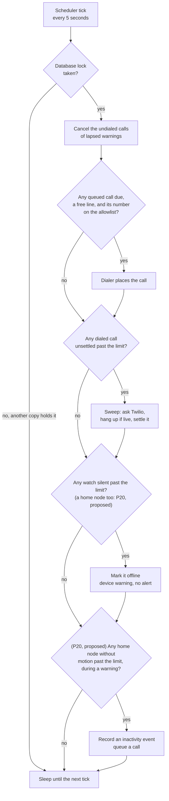

# 06 · Operations

Part of the [EchoCare specification](README.md). What happens when things fail, the timers and how demo mode shortens them, security and privacy, how each part is tested, and what to try before the hackathon.

## 1. Failure handling

One principle covers most rows: **a failure is treated as uncertainty, and uncertainty only moves a code up.** A call that could not happen or could not finish is never recorded as fine.

| Failure | What the system does | What people see |
|---|---|---|
| Twilio cannot place the call | Twilio refusing the request marks the attempt failed, and it counts as unanswered: the redial rule applies. A timeout or a lost connection leaves the call dialed and queued, since Twilio may have placed it; its callbacks settle it, or the sweep (section 2) | Same as "nobody answers" |
| No answer, busy, or voicemail | Redial rule ([03-status-model.md](03-status-model.md) section 5) | Yellow per the matrix |
| Senior hangs up, or the connection to Twilio drops mid-call | The call is marked dropped and counts as answered with low certainty | Usually yellow |
| Model provider fails or is too slow during a call | The agent says a fixed apology, the call is closed and counts as dropped. Alarm phrases and their confirmation do not depend on the model and keep working until then | Usually yellow; the failure is logged |
| A tier 2 confirmation gets no reply | Red and hand-over | Red, as for any red |
| Red, but nobody is marked on duty | No dial is attempted; the senior hears a fixed message; the incident stays open | Open incident at the top of the dashboard with a "nobody on duty" warning; alerts to DAS phones |
| On-duty phone does not answer the hand-over | After the ring time the senior hears that someone will call back; the incident stays open | Open incident at the top of the dashboard, audible cue continues |
| Two DAS employees take the same incident | The first take wins; the second is refused | The second sees who has it |
| The dashboard's browser blocks sound | Browsers play sound only after a click on the page | The dashboard asks for one click after sign-in („Pornește alertele sonore”) and shows a warning until it gets it |
| A push cannot be delivered | An invalid token is removed; there is no retry | Open screens catch up at the next backstop re-read |
| FastAPI restarts | Queued calls and redials are database rows with a due time, so they resume. A call already dialed keeps its `dialed_at` and is never dialed again; one whose dial or callbacks were lost is settled by the sweep (section 2). Live calls drop and count as dropped | A short gap; affected calls usually end yellow |
| A deploy runs two copies for a few seconds | The scheduler's advisory lock in the database lets one copy tick at a time, so no call is dialed twice. Live calls on the old copy drop. No deploys after the freeze | As for a restart |
| Database unreachable | No new calls are placed. Twilio callbacks get a safe answer: a polite message, then hang up. The health check fails | Apps show the last data with a „Fără conexiune” banner |
| A callback or event arrives twice | Ignored by its id | Nothing |
| The watch cannot reach the phone | The watch keeps events and resends them; missed check-ins mark the watch offline | A device warning, no alert |
| The phone app has no connection | The app keeps events and sends them later with their measured time. Stale ones start no call | A device warning if check-ins stop |
| Watch is not worn | The check-in says so; thresholds are not evaluated | A device warning, no alert |
| An identity token has expired | The Firebase library renews it; a refused request is retried once with the new token | Nothing |
| The SMS code does not arrive | The app offers to resend after a short wait. The demo uses Firebase test numbers | A short delay at sign-in |
| A number signs in with no grant | Refused; nothing is stored | „Numărul nu este înregistrat. Contactați medicul de familie.” |
| The medic mistyped a caregiver's number | The caregiver present cannot sign in, or the notice SMS does not arrive; the medic corrects the number. Removing the grant cuts access at once | Noticed at the practice |
| An inactivity event arrives with no active warning | Recorded; no call | Nothing |
| The home node cannot reach the phone (out of range, unplugged, phone off) | Readings are missed; past the silence limit the node is marked offline and its last reading is no longer used on calls. An SOS press waits on the node and is resent on reconnection | A device warning, no alert; the node's light blinks slowly |
| The room sensor gives an implausible value | The node smooths readings and drops values outside −10 to 50°C; FastAPI ignores any that still arrive | A device warning if it persists |
| The fall detector fires on an ordinary movement | The wrist prompt catches it: „Da” ends it. If the senior does not answer, the call does | Usually nothing; a needless call at worst |

## 2. The scheduler

Every timer in the system is a row with a due time. The scheduler is a short loop inside FastAPI that looks for rows that have come due. Nothing is waiting only in memory.

Built so far (#47): the lock, the lapsed warnings, the dialer, the sweep and the watch's silence step. The home node's silence and inactivity steps are proposed with the node (P20).

- **The lock** is a Postgres advisory lock held for the whole tick, so during a deploy one copy works. A step that fails is logged and the others still run. A tick logs a line only when a step did something.
- **Lapsed warnings** (04 §2): the queued calls of a campaign whose warning has passed are canceled, undialed ones only.
- **The dialer** hands due calls to Twilio up to the free lines, in this order, and in id order within each group: a watch or "Sunați-mă" call, then a redial (a senior already not reached), then a campaign's first attempt, then a welcome call. The order matters only when more calls are due than there are lines, as during a campaign. It uses no risk score and no medical data (03 §11). A call is stamped `dialed_at` and committed before Twilio is asked, so it is dialed once at most (05 §1). It dials only numbers on `DIAL_ALLOWLIST`: empty, the default, dials nobody in every environment, production included, and `*` dials everyone. A call it will not dial stays queued, so the mock card keeps working. Without the Twilio variables it does nothing.
- **The sweep** settles a dialed call still live after the ring time, the call length limit and a minute (section 3). It asks Twilio for the call, hangs up if Twilio still has it live, and applies Twilio's final status as a status callback would (04 §4.2). A call with no Twilio id, whose dial timed out and which no callback reached, becomes `failed`. A machine that answered, per Twilio's record, ends the call `unanswered`, as voicemail detection would. A Twilio id Twilio no longer knows (after a change of region or account) ends the call `failed`, or `dropped` if it was answered. Each call it settles is logged at warning level.
- **The watch's silence** (UC-13): a watch in `ok` or `not_worn` whose last check-in is older than the silence limit (section 3) becomes `offline`. No alert; its next check-in (04 §3) brings it back.

"A free line" is the limit on calls in progress at once. It keeps a campaign from opening more conversations than the model provider and the Twilio account allow. It is a cap in our code, not a number of Twilio numbers.

## 3. Timers and demo mode

Demo mode is one setting on FastAPI and one on each client. It shortens waits so that a full story fits in three minutes; it changes no logic.

| Timer | Normal | Demo mode |
|---|---|---|
| Redial delay, and the welcome-call retry | 20 minutes | 20 seconds |
| Call length limit | 3 minutes | 3 minutes |
| Tier 2 confirmation wait | 8 seconds | 8 seconds |
| Wrist prompt timeout | 2 minutes | 15 seconds |
| Inactivity limit during a warning **(proposed)** | 4 hours | 60 seconds |
| Watch check-in interval | 15 minutes | 30 seconds |
| Watch counted as silent after | 45 minutes | 90 seconds |
| Wrist prompt timeout after a fall **(P19, proposed)** | 30 seconds | 15 seconds |
| Home node reading interval **(P20, proposed)** | 1 minute | 5 seconds |
| Home node counted as silent after | 5 minutes | 30 seconds |
| Room cold limit **(P21, proposed)** | below 16°C | below 16°C |
| Room heat limit | above 30°C | above 30°C |
| Room hold time before a call | 30 minutes | 30 seconds |
| Backstop re-read of an open Android screen | 30 seconds | 10 seconds |
| Dashboard re-read | 5 seconds | 2 seconds |
| Cooldown between calls to one senior | 10 minutes | 30 seconds |
| Stale event limit | 30 minutes | 30 minutes |
| Active warning after a campaign | 24 hours | 24 hours |
| On-duty phone ring time | 30 seconds | 15 seconds |
| Calls in progress at once | 3 | 3 |
| Scheduler tick | 5 seconds | 5 seconds |
| Sweep: a dialed call counts as stuck after | 4.5 minutes (ring time 30 seconds, call length limit 3 minutes, and 1 minute) | 4.5 minutes |

All values are proposals. The 20-minute redial and the 3-minute call limit come from v3; the inactivity limit is within v3's 4–6 hours. The room limits are orientative, have no medical value, and await a medical mentor (README open question 11); the inactivity limit applies to the home node's motion as to the watch's steps.

**Demo controls**

| Control | Where | Stands in for |
|---|---|---|
| "Simulează avertizare", heat or cold | DAS dashboard | A real weather warning |
| "Sunați-mă" | Senior's phone app | A watch anomaly, if the watch misbehaves on stage (D9) |
| The mock card, which shows a queued welcome or campaign call and takes the senior's answers on screen | Senior's phone app, on their own home | The phone line, for a call the scheduler does not dial (a number not on `DIAL_ALLOWLIST`, or no Twilio variables). A call the scheduler has dialed is never shown as a card. The answers go through the same rules and the same ending step as a real call, so a code, an incident or a consent is stored as for a real call. Refused by the API in production (`GET /profile/mock-call`, `POST /calls/{id}/mock-answer`, [04-interfaces.md](04-interfaces.md)), where a fake call must never give a code, an incident or a consent |
| A hidden "force anomaly" action, for pulse, for inactivity and for a fall | Wear OS app | Waiting for a real reading, or a real fall |
| An ice pack or a hair dryer next to the home node's sensor | On the table | A cold or hot room; the temperature moves live on every screen |
| The home node's SOS button | On the table | Its own trigger; also a fallback if the watch misbehaves |
| Firebase test phone numbers | Every demo device and the dashboard | A real SMS at sign-in |

## 4. Security and privacy

**Access**

| Measure | Detail |
|---|---|
| Every caller is identified | People by a Firebase identity token that FastAPI verifies; the watch and the home node only through the senior's signed-in phone app, the node over a bonded Bluetooth link; Twilio by request signature. Nothing is open |
| Roles are granted, never chosen | A number gets a role only when someone allowed to grant it enters the number (G6). A number with no grant can do nothing and leaves nothing stored |
| One place checks permissions | Every FastAPI endpoint checks the caller's grants and that the grant covers the senior concerned |
| Phone numbers normalized | One international format everywhere, so a lookup cannot miss or mismatch |
| Secrets | Twilio, model provider and Firebase service credentials live in Railway's variables, never in an app or the dashboard |
| Browser requests | The API accepts browser requests only from the dashboard's own address |
| The on-duty number | The on-duty DAS employee's own phone, read at hand-over time; only a DAS user can change who is on duty |
| Logs | A refusal is logged with its reason and the user id, or a masked number (`+40700***009`). Tokens are never logged ([auth-layer.md](../auth-layer.md) AL15) |

**Data**

| Measure | Detail |
|---|---|
| Consent | The senior's own, given on the welcome call by key or voice, against a versioned text; a signature is optional when present. A withdrawal is recorded by the medic or DAS in the MVP |
| Minimum per role | The caregiver sees the code, a reason and the address, not the transcript ([01-architecture.md](01-architecture.md) section 6) |
| No audio stored | Speech stays inside Twilio; FastAPI handles text only. The hand-over's conversation with DAS reaches it as Twilio's live transcription, never as a recording |
| Minimal watch data | Only the latest check-in is kept; there is no pulse history |
| Minimal home data | Only the latest room reading is kept; there is no history of temperature or motion. The node has no camera and no microphone |
| Location only with events | The phone attaches its last known location when it sends an event; there is no tracking |
| Push carries no health details | Generic text and an id (P18) |
| Region | Database and FastAPI on Railway, EU West. Twilio places and processes the calls in its Ireland region (IE1), by choice of `TWILIO_API_HOST` |
| Demo data | Fictitious people only |

**Honest limits for a real pilot.** Transcripts pass through the model provider, speech passes through Twilio, phone numbers pass through Firebase, and the database sits on Railway. Twilio's processing is now in the EU by region choice (IE1); the model provider and Firebase are still outside it. A pilot needs data-processing agreements with all four and a named data controller (v3 §14 assigns this to the medic and DAS). DAS must also confirm that a recorded spoken „da” counts as explicit consent for health data (README open question 7). None of that is needed to demo with fictitious data.

**Telephony constraints** follow v3 §12 apart from the number and the region: Romania enabled in geographic permissions, the AI features addendum accepted, and a test on each mobile network for how the number is displayed and whether it is flagged as spam.

- **The number is Romanian (+40)**, not the US number that v3 §12 and spike S11 assumed.
- **Twilio runs in Ireland (IE1).** `TWILIO_API_HOST` is `api.dublin.ie1.twilio.com` (default `api.twilio.com`) and `TWILIO_AUTH_TOKEN` holds the IE1 auth token, since credentials are valid only in their region.
- **Two IE1 behaviours are not confirmed in Twilio's documentation.** That IE1 signs callbacks with the IE1 token (a 403 on every callback says no), and that voicemail detection runs there. One test call with `scripts/place_call.py` checks both.
- **The number's own incoming-call webhook** in the Twilio Console is not used: every outbound call carries its own callback addresses (04 §4.1).

## 5. Testing

| What | How | Needs |
|---|---|---|
| Rules and status engine | A table of cases: every severity and certainty rule, the orientation check against a fixed date, the overwrite rule, every cell of the matrix, every row of the combining table, every lifecycle rule, every worked example in [03-status-model.md](03-status-model.md) section 10 | Nothing outside the module |
| Alarm phrases | Every phrase against its recorded transcripts from spike S2; a list of harmless sentences that must not reach tier 1 | The transcripts |
| Call session | A scripted stand-in for Twilio's messages and a scripted stand-in for the model. Scripts: green, yellow, red by rules, tier 1, tier 2 confirmed, tier 2 denied, tier 2 silent, raised concern, key 9, interruption, hang-up, model failure, call length limit | No phone, no model |
| Welcome call | Each answer combination in UC-04 replayed against the welcome callbacks | Recordings from spike S1 |
| Twilio callbacks | Recorded real requests replayed against FastAPI, including one with a bad signature | Recordings from spike S1 |
| Endpoints and permissions | Each endpoint called as each role, as a number with no grant, and signed out; the refused combinations are asserted. Identity tokens are replaced by a stand-in verifier | A local FastAPI and database |
| Database constraints | Two live calls for one senior, two on-duty employees, a duplicate event, two unresolved incidents for one senior, two takes of one incident: each must be refused | A local database |
| Incident lifecycle | Open on red; taken by hand or by an answered hand-over; resolved with each outcome; a campaign skipping and then including the senior | A local FastAPI and database |
| Watch | The threshold logic fed synthetic readings: high at rest, high while walking, no steps, not worn | An emulator or the watch |
| Watch to phone to FastAPI | An event from the watch reaches FastAPI with the phone's location, with the phone app in the background | The watch and a phone |
| Fall detection **(P19)** | Recorded accelerometer traces replayed against the detector; then 20 to 30 controlled trials each of a fall onto a mattress, sitting down hard, walking and climbing stairs. The false-alarm and missed-fall rates are written down | The watch |
| Room reading rules **(P21, P22)** | Part of the rules engine's table: in range, out of range shorter and longer than the hold time, back in range, offline node, implausible value, a "yes" to the shelter question with a cold room | Nothing outside the module |
| Home node to phone to FastAPI | Readings and an SOS press reach FastAPI with the phone app in the background; the press survives the phone going out of range and coming back | The node and a phone |
| Home node measurements | The SHT31 against a reference thermometer at three temperatures; the time from an SOS press to the alert on a caregiver's phone (target under 5 seconds); readings lost at the edge of Bluetooth range | The node, a phone, a thermometer |
| Whole system | A rehearsal of the demo with real phones on each network, with the latency of every agent turn logged (v3 §8.9) | Everything deployed |

The first two rows cover the logic that decides a person's code. They run without any outside service, so they can run on every change.

## 6. Spikes to run before the hackathon

Each is a small experiment whose answer changes the plan. They are ordered by how much depends on them.

| ID | Question | If the answer is no |
|---|---|---|
| S1 | Does a first ConversationRelay call in `ro-RO` with the chosen voice work end to end from our service? Record the callbacks for replay tests | Fall back to v3's question-by-question call flow |
| S2 | How does Twilio transcribe each alarm phrase, said by three different people? | Not a yes-or-no spike: the transcripts become the test fixtures and the source of the final patterns |
| S3 | Does `<Gather>` with speech in `ro-RO` reliably hear „da” and „nu” on the welcome call? | Keys only on the welcome call |
| S4 | Which model gives natural Romanian with the shortest wait before the first word, and how much do an EU and a US region add? | Use more fixed sentences for routine turns; consider a US region for the demo |
| S5 | On the team's watch, how often does background sampling deliver heart rate and step counts, and what does it cost in battery? | Demo with the monitoring screen open; treat the background case as best-effort |
| S6 | Does a watch event reach the phone app and FastAPI while the phone app is in the background, and can the app read its location then? | Keep the phone app in the foreground on the demo phone; send events without location |
| S7 | Does a push reach the demo phones and tablets when the app is closed, including after idle, and how fast does a refresh arrive when the app is open? | Exempt the app from battery saving on the demo devices; shorten the backstop re-read |
| S8 | Does Railway hold a WebSocket for a full call, stay running between calls, and keep the scheduler single during a deploy? | Host on a small EU virtual machine |
| S9 | Does Firebase phone sign-in deliver SMS codes to Romanian numbers on each network, and do test numbers work on the demo devices and in the dashboard's browser, reCAPTCHA included? | Test numbers only for the demo; the medic's practice signs people in |
| S10 | Does an SMS from the project's Twilio number reach Orange, Vodafone and Digi phones? | Drop the caregiver notice; the caregiver signs in on the spot |
| S11 | How does the project's Romanian number appear on Orange, Vodafone and Digi phones, and is it flagged as spam? | Call a team phone in the demo, as v3 §12.5 already plans |
| S12 | Does the phone app keep its Bluetooth connection to the home node, and relay readings, while it is in the background for an hour? | Keep the phone app in the foreground on the demo phone; a foreground service in the app |
| S13 | Can the Wear OS app read the accelerometer fast enough (about 50 readings a second) in the background to see a fall, and what does it cost in battery? | Fall detection only while the monitoring screen is open; the hidden "force fall" action for the demo |

**S1 and S8, how to answer them.** The telephony edge for both is built (#15): `scripts/place_call.py <number>` dials a registered senior's number with a scripted ConversationRelay call that repeats what it hears and ends on key 0. Run it on staging through `railway ssh -s api -e staging` with the Twilio variables set (the script follows `DIAL_ALLOWLIST` too), then write here. The same call answers the two IE1 questions of section 4:

| Spike | Answer | Date |
|---|---|---|
| S1 | **Yes, on the local stack** (#48, seven calls through the ngrok tunnel to team phones; staging not run yet). Every callback verified under the IE1 token. Voicemail detection runs in IE1, but answered `unknown` for each of the seven people, never `human`; only `machine_…` and `fax` act, so nothing is lost. `ro-RO` connects with Google `ro-RO-Wavenet-A`, and speech comes back as text: „Am căzut.” matched tier 1 and handed over. The relay's barge-in cut the greeting after „Bună” when the senior said „alo”, heard as „Cu ce e așa?”. The project's number shows as a Romanian caller (`FromCountry` `RO`). The welcome, answer, status, voicemail and hand-over bodies are saved over `backend/tests/voice/fixtures/twilio_callbacks.json`, numbers and SIDs replaced. Still to record: how the voice sounds, „Mă simt bine” and a second alarm phrase, an unanswered call and a badly signed callback on staging | 2026-10-29 |
| S3 | **Yes, keep speech on the welcome call** (#48). On one phone, five „da” (identity and consent) and three „nu” (consent) all came back right on the first try. Twilio's `Confidence` is not a usable score in `ro-RO`: it came back only as 0.0, 0.71 or 0.91882896, so it is stored as evidence but decides nothing. Once the identity question heard its own prompt through the phone's speaker („Albert Timișoara”); it matched nothing and was asked again, as designed. Fewer tries than planned, to keep the cost down; a second voice and a noisy room are still untried | 2026-10-29 |
| S8 | *Not run yet.* Record: whether one call holds its WebSocket for three minutes, and what a redeploy during a call does to it | |
