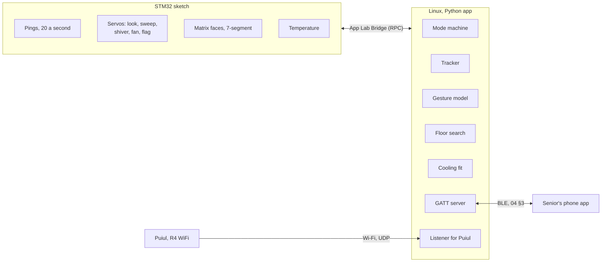
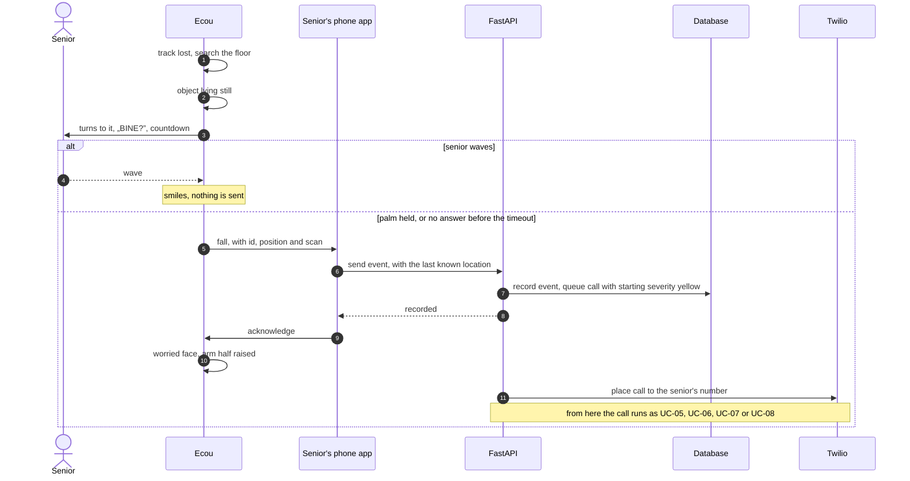

# 08 · Ecou, the home node as a companion (P23–P27, proposed)

**Status:** proposal for the hackathon · 2026-11-14
**Builds on:** the home node (P20–P22): [01-architecture.md](01-architecture.md) §11, UC-15 and UC-16 in [02-use-cases.md](02-use-cases.md), [04-interfaces.md](04-interfaces.md) §3.

Ecou is a different build of the home node. Its role is unchanged: it talks only to the senior's phone app over Bluetooth Low Energy, it has no identity of its own, and FastAPI decides every code. Instead of a box on a shelf, it is a small robot head. Two ultrasonic "eyes" on a pan and tilt mount follow the senior around the room. A face on an LED matrix shows the senior's code. The robot shivers when the room is getting cold and fans itself when it is hot. When it can no longer find anyone, it searches the floor.

It answers three needs:

- **A fall in a home without a watch.** Ecou finds something lying on the floor, asks, and reports a `fall` with a map of where it found it (P24).
- **An answer without a phone or a button.** Waving at Ecou means „sunt bine”. Holding a palm still in front of it is an SOS (P25).
- **A warning a senior understands without reading.** The robot's body shows what the room is doing and what is about to happen to it (P26).

Ecou has no camera and no microphone. Only distances, a temperature and gestures are measured, and nothing but events and readings leaves the house.

## 1. Hardware

The team has: one Arduino UNO Q, one Arduino UNO R4 WiFi, one HC-SR04, one DHT11, two SG90 servos and a 5641AS 4-digit display. Nothing is ordered. The two servos make the neck, pan and tilt; the arm and Puiul's HC-SR04 are missing, so heat and a red code show only on the face, and Puiul has only its foil pad. With one servo, Ecou is built low (§1.1).

| Part | Board | Job |
|---|---|---|
| Arduino UNO Q | Ecou | Linux (Qualcomm, quad Cortex-A53) runs the signal processing, the models and the BLE link. The STM32 microcontroller times the pings and drives the servos, the display and the built-in 8×13 LED matrix |
| HC-SR04 ultrasonic | Ecou | The eyes: tracking, gestures, the floor search |
| 2 SG90 servos on a pan and tilt mount | Ecou | The neck. Card and tape do if there is no bracket |
| 1 SG90 servo with a paper fan, red on the back | Ecou | The arm: fans when hot, raised as a red flag on a red code |
| DHT11 | Ecou | The room reading (P21). It is off by up to ±2°C: fine for the demo, while the real node keeps the SHT31 (01 §11) |
| 5641AS, 4-digit 7-segment, common cathode, and seven 1 kΩ resistors | Ecou | Room temperature in large digits. During a prompt, the seconds left |
| Arduino UNO R4 WiFi | Puiul (kitchen) | Ecou's companion. Talks only to Ecou (P27) |
| HC-SR04 ultrasonic | Puiul | Across the kitchen doorway: someone passed |
| Aluminium foil under card, about A5 | Puiul | A large touch pad for SOS, on a capacitive touch pin |
| 5 V supply of 2 A or more for the servos | Ecou | Only with two or three servos. A phone charger with a cut USB cable, or a breadboard power module |

**Wiring, Ecou.** Drawn in [ecou/docs/wiring.html](../../../ecou/docs/wiring.html), with the checks to make before power-on.

| Part | Pin | UNO Q |
|---|---|---|
| HC-SR04 | VCC, GND | 5V, GND |
| | Trig | D7 |
| | Echo | D8, through a divider (1 kΩ from Echo, 2 kΩ to GND). The UNO Q's pins are 3.3 V |
| Pan, tilt, arm servos | signal | D9, D10, D6 (the sketch's `PIN_TILT` and `PIN_ARM` are `-1` until fitted) |
| | VCC, GND | One or two servos: the board's 5V and GND, with 100–470 µF across them if there is one; if the board resets when they move (S17), the separate 5 V supply. Three: always the separate supply, **its GND joined to the board's GND** |
| DHT11 or DHT22 | data, VCC, GND | D4, 3V3, GND |
| 5641AS segments A, B, C, D, E, F, G | display pins 11, 7, 4, 2, 1, 10, 5, each through 1 kΩ | D2, D3, D5, D11, D12, D13, A0 |
| 5641AS digits 1 to 4 | display pins 12, 9, 8, 6 | A1, A2, A3, A4 |
| 5641AS decimal point | display pin 3 | not connected |

With more than one servo, servos never draw from the board. Three SG90s starting together can pull more than an amp, and a dip in voltage reboots the Linux side in the middle of the demo (S17).

The display's pins are counted with its face up and the decimal points at the bottom: 1 to 6 along the bottom from the left, 7 to 12 along the top from the right. The sketch lights one digit at a time from a 1 ms timer.

### 1.1 With one servo

Ecou sits low, 20–30 cm above the floor, and the one servo turns its head left and right. At that height the beam sees legs, which is enough to track someone, and a person lying on the floor shows as a wide object that does not move, so the floor search (§2.4) needs no tilt. It shivers on the same servo. Without the arm, heat and a red code show only on the face. On the demo table the table top is the floor. A tilt servo, then a second HC-SR04 for Puiul, then the arm, are worth borrowing in that order.

**Wiring, Puiul**

| Part | Pin | UNO R4 WiFi |
|---|---|---|
| HC-SR04 | VCC, GND, Trig, Echo | 5V, GND, D7, D8 (the R4 is 5 V, no divider) |
| Foil pad | one wire | a pin the `Arduino_CapacitiveTouch` library supports on the R4 WiFi (check its pin table) |
| LED matrix | | built in |

## 2. Inside Ecou

The sketch has no logic of its own. It runs commands from the Python app: ping at these angles, look there, show this face, shiver for two seconds. All decisions are made on Linux, where the code can be changed and tested without flashing.

### 2.1 Modes

| Mode | Head | What runs | Leaves when |
|---|---|---|---|
| **Look** | Level, on the tracked person | Tracker; gesture model when something is 10–40 cm away | The track is lost for the search delay: **Search**. A prompt is due: **Ask** |
| **Search** | Tilted down at the floor, sweeping | Floor search | A person is tracked again: **Look**. Something lying is found: **Ask** |
| **Ask** | On what it found, or on the person | Gesture model; countdown on the 7-segment display; the matrix scrolls „BINE?” | Wave: back to **Look**, nothing sent. Palm, or the timeout: event sent, back to **Look** |
| **Quiet** (22:00–07:00) | Still, the face dimmed | A floor sweep every quiet interval, since the servos are loud | Morning, or a gesture |

### 2.2 Tracker

Every sweep is compared with a baseline of the empty room, one distance per 5° step. A step much nearer than its baseline is a candidate. The tracker keeps one target, the nearest candidate that moves, and follows it with a constant-velocity Kalman filter on angle and distance. While it has a target it only pings a window of ±15° around it, so the head turns smoothly instead of sweeping. The baseline is relearned slowly from steps where no target has been for a while, so a moved chair stops counting.

A target that moves counts as motion for the room reading's `seconds since the last motion` (04 §3), together with Puiul's doorway passes.

### 2.3 Gestures (P25)

The model sees 2 seconds of distances at 20 a second, while something is 10–40 cm from the eyes.

| Class | What it looks like | Means |
|---|---|---|
| `wave` | Distance jumping between the hand and the background several times a second | „Sunt bine”: during **Ask** it cancels. Otherwise Ecou only smiles back |
| `palm` | A steady distance, within 2 cm, for 3 seconds | SOS, at any time. Sent as the node's SOS press (04 §3), so FastAPI treats it like the button |
| `pass` | One dip that comes and goes: someone walking past | Nothing |
| `none` | Background only | Nothing |

The model is trained in Edge Impulse on samples recorded through its data forwarder: each team member records 50 of each class, from different distances and angles. It is exported for Linux and run by the Python app. **Fallback: two rules** (zero crossings for `wave`, variance for `palm`). Write these first, so the demo works before the model does.

### 2.4 Floor search (P24)

From shelf height, with the head tilted down, the beam meets the floor about 1.5–2.5 m away. Ultrasound at that angle mostly bounces off a hard floor and away, so an empty floor returns only distant echoes. A body on it returns an echo close to where the floor would be. The search compares each floor sweep with a floor baseline and looks for an object that:

- is lower than a seated person (it only appears when tilted down),
- is at least 3 steps (15°) wide,
- does not move for the lying hold time.

When it finds one, Ecou turns its head to it and goes to **Ask**. The sweep that found it is kept: 37 distances from 0° to 180°, and the angle and distance of the object.

### 2.5 Room and body (P26)

The sketch reads the temperature every 2 seconds. The Python app keeps a moving average and fits Newton's cooling, `T(t) = T∞ + (T₀ − T∞)·e^(−t/τ)`, to the last 30 minutes, then predicts the temperature an hour ahead. **Fallback:** a straight line through the last 10 minutes. The prediction goes out with every room reading. Ecou does not decide what it means: FastAPI answers each reading with a room state, and the phone writes it to Ecou.

| Room state, from FastAPI | Face | Body |
|---|---|---|
| `ok` | The code's face | Still |
| `cold_soon`, `cold` | Frozen face | Shivers: the pan servo moves ±3° at 8 Hz for 2 seconds, every 30 seconds (`cold`: every 10) |
| `hot_soon`, `hot` | Sweating face | Fans: the arm swings ±30° at 1 Hz for 5 seconds, every minute (`hot`: every 20 seconds) |

| Phone writes | Face | Body |
|---|---|---|
| `green` | Smile | |
| `yellow` | Worried | |
| `red` | Alarmed | Arm raised, red side out, until the code changes |
| `call` | Phone icon | Nods slowly while the call lasts |
| (no phone link) | Asleep, with a „z” | Head down. Replaces P20's slow white blink |

The 7-segment display shows the room temperature at all times, and the seconds left during **Ask**.

### 2.6 Puiul (P27)

Puiul joins a Wi-Fi network that Ecou serves itself (a hotspot from Linux, no internet) and sends Ecou small UDP messages, each with an id:

| Message | When | Ecou does |
|---|---|---|
| `pass` | Someone crossed the kitchen doorway | Counts it as motion |
| `sos` | The foil was touched for 2 seconds | Sends an SOS press to the phone, and beeps back through Puiul's matrix |
| `alive` | Every 30 seconds | Nothing. If none arrives for 2 minutes, Ecou stops counting kitchen motion |

Ecou sends Puiul the room state and the code. Puiul's matrix shows a heart when someone passes. On `hot` and `hot_soon`, it shows a glass of water when no one has passed for an hour. That reminder stays on Puiul and is never sent anywhere.

## 3. Interfaces

These are additions only: an old phone app still talks to Ecou as to a P20 node, and an old FastAPI ignores the new fields (ADR-001 §2.3).

### 3.1 Ecou ↔ phone app (adds to 04 §3)

Ecou advertises the same EchoCare GATT service and keeps every P20 characteristic. The phone asks for an MTU of 185, so a scan fits in one notification.

| Characteristic | Direction | Content |
|---|---|---|
| Room reading | Node → phone | As P20, plus optional `forecast_60m`, the predicted temperature in an hour, in °C |
| SOS press | Node → phone | As P20. Also sent for a `palm` gesture and for Puiul's foil, with `via`: `button`, `palm` or `kitchen` |
| Fall **(new)** | Node → phone, notify | Event id generated on the node, seconds since it was found, seconds the object stayed still, `object_angle_deg`, `object_distance_m`, and `scan`: 37 distances in metres, from 0° to 180° in 5° steps. Resent after every reconnection until acknowledged |
| Acknowledge | Phone → node | As P20, for a press id or a fall id |
| Light | Phone → node | As P20 |
| Room state **(new)** | Phone → node, write | `ok`, `cold_soon`, `cold`, `hot_soon`, `hot`, as FastAPI last answered a room reading |

A phone app that does not know the new characteristics ignores them. Ecou then shows the code but stays still, and its falls are not reported. That is acceptable for an old app, and the reason the fall waits on the node rather than being dropped.

### 3.2 Phone app → FastAPI (adds to 04 §3)

| Request | Change |
|---|---|
| `POST /me/events` | A `fall` with `source` `home_node`. Optional snapshot fields `object_angle_deg`, `object_distance_m`, `seconds_still` and `scan` (37 numbers). The usual intake rules apply. Starting severity yellow, like a fall from the watch |
| `POST /me/room-readings` (P21) | Optional input `forecast_60m`. The answer adds `room_state` |
| `GET /incidents/{id}` | When the triggering event is a home node `fall`, its `scan` and object position, for the dashboard |

**Room state.** `cold` and `hot` mean the reading is past the room limits (06 §3). `cold_soon` and `hot_soon` mean the reading is within the limits and `forecast_60m` is past them. A forecast **starts no call** and changes no code: the robot's body warns the senior, so they close the window or turn the heating on. Calls stay with the hold time of P21. This keeps a guess from ringing a senior's phone.

### 3.3 Dashboard

In the incident view, for a home node fall, a half circle drawn from `scan`: Ecou at the centre, the room's outline, and the object marked with its distance, for example „pe jos, la 2,1 m, în stânga”. DAS knows where to look before anyone enters. No image of the senior exists.

## 4. UC-17 Ecou finds someone on the floor

**(P24, proposed)**

| | |
|---|---|
| Actors | Senior, Ecou, senior's phone app |
| Starts when | Ecou has lost track of everyone for the search delay, and the floor search finds an object lying still for the lying hold time |
| Before | Ecou is connected (UC-15) |
| After | A wellbeing call has been queued with starting severity yellow, or the senior waved and nothing was sent |

1. While Ecou tracks someone, it does not search. Losing them (they left the room, or went down out of the beam) starts the search delay.
2. After the delay, Ecou tilts down and sweeps the floor (§2.4).
3. An object that matches for the lying hold time turns the head toward it, and Ecou goes to **Ask**: „BINE?” on the matrix and the seconds left on the display.
4. A wave ends it. A palm, or no answer, sends a `fall` with the scan.
5. The call proceeds as for a watch fall. The code does not change yet (P8).

Variations:
- **The senior comes back into view during Ask.** Tracking a moving person cancels the prompt: someone who walks is not lying down.
- **A bag or a coat left on the floor.** It is found once and asked about. A wave cancels it, and that object is added to the floor baseline, so it is not asked about again.
- **A watch fall and an Ecou fall together.** The cooldown attaches the second to the first's call.
- **No phone link.** The fall waits on Ecou, as an SOS press does in P20.

Gestures and Puiul's foil need no new use case: they arrive as an SOS press, and UC-16 applies.

## 5. Timers

| Timer | Normal | Demo mode |
|---|---|---|
| Search delay after the track is lost | 2 minutes | 10 seconds |
| Lying hold time | 30 seconds | 8 seconds |
| Ask timeout | 30 seconds, as the wrist prompt after a fall | 15 seconds |
| Quiet interval, at night | 10 minutes | n/a |
| Forecast horizon | 60 minutes | 60 minutes; in the demo the ice pack moves the fit within a minute |

## 6. Spikes

| Spike | Question | Fallback |
|---|---|---|
| S14 | Can the UNO Q's Linux side be a BLE GATT server (BlueZ, for example the `bless` library) that an Android phone bonds with and gets notifications from, while App Lab's Bridge runs? | Puiul becomes the BLE node to the phone, with `ArduinoBLE` as in P20, and Ecou talks to Puiul over Wi-Fi |
| S15 | Gesture model: confusion matrix over the four classes with people who did not record the training samples | The two rules (§2.3) |
| S16 | Does the floor search see a person, or a rolled-up duvet, at 1.5–2.5 m on the venue's floor, and how often does an empty floor look like something? | On the table: the head tilted to a fixed spot, a box as the person |
| S17 | Three SG90s on the separate supply: does the UNO Q ever reboot when they start together or stall? | One servo moves at a time; the arm is left out |
| S18 | Can the UNO Q serve a hotspot for Puiul and keep the BLE link to the phone at the same time? What is the UDP delay? | Ecou and Puiul join the senior's phone hotspot or the venue's Wi-Fi |
| S19 | With an ice pack, how far is the one-hour forecast from what the room actually reaches? | The straight line through the last 10 minutes |

## 7. Demo

Sixty seconds on the table, with the dashboard on the big screen and the caregiver's phone in hand.

1. Someone walks into view. Ecou turns its head and smiles.
2. An ice pack goes against the sensor. Ecou starts shivering before the display shows 16. The dashboard shows the room state, and after the demo hold time the call rings.
3. The phone rings, Ecou shows the phone icon and nods. „Sunt bine, am căldură.” The room at 14°C makes it yellow (P22), and Ecou looks worried.
4. Someone leaves, and a rolled-up jacket goes down in Ecou's field. Ecou looks for the person, finds the jacket, turns to it and counts down. Nobody waves: the dashboard shows the incident with the half-circle map and the spot marked.
5. In the kitchen corner, a hand on the foil. Puiul flashes, and a second SOS joins the call already running (cooldown).

## 8. Build order

Each step leaves something that can be demonstrated, so the team can stop at any of them.

1. The sketch: pings, servos, matrix faces, display, temperature, all called through the Bridge from a Python test script.
2. Ecou as a plain P20 node: room readings and SOS to the phone (S14 first).
3. Tracker and Look mode.
4. Gesture rules, then the model (S15).
5. Room state, shivering, fan, flag (needs the FastAPI answer; until then, the phone app computes it locally from the 06 §3 limits).
6. Floor search, Ask, the fall event (S16).
7. Puiul (S18).
8. The dashboard's half circle.
