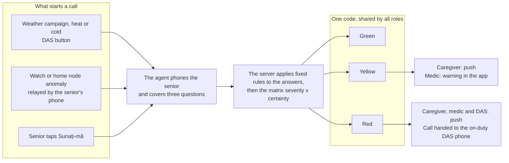

# EchoCare: system specification (MVP)

**Status:** draft for team review · 2026-10-08, revised 2026-10-09 after the review session
**Scope:** how the apps communicate, through which means and interfaces. No code.
**Baseline:** [`../esti-bine-specificatii-v3.md`](../esti-bine-specificatii-v3.md). Where this spec and v3 disagree, this spec wins for the MVP.

## What EchoCare is

An early-warning system for heat and cold illness in seniors who live alone. During a weather warning (heatwave or frost) the system phones each enrolled senior, an AI agent talks with them in Romanian, and the server turns what they said into one of three codes (green, yellow, red) that the caregiver, the medic and DAS all see. A red hands the call to a person at DAS. A senior who also wears a Wear OS watch gets a second trigger: an abnormal reading on the wrist, relayed by their phone, starts the same call. A senior with the optional home node, a small sensor box on a shelf, gets a third: a room that stays too cold or too hot, no movement in the house during a warning, or its SOS button. The room temperature it measures also checks what the senior says on the call: „am căldură” in a room at 14°C does not count as fine **(P19–P22, proposed)**.

The senior needs nothing but a phone, landline included. The watch, the home node and the senior's role in the Android app are optional layers.

## Files

| File | Contents |
|---|---|
| [01-architecture.md](01-architecture.md) | Parts, channels, identity and grants, live updates, inside the FastAPI service, hosting |
| [02-use-cases.md](02-use-cases.md) | Actors, fourteen use cases, sequence diagrams |
| [03-status-model.md](03-status-model.md) | Codes, the answers and the rules, alarm phrases, the matrix, combining rules, lifecycles |
| [04-interfaces.md](04-interfaces.md) | Every interface between parts: endpoints, callbacks, messages, agent tools |
| [05-data-model.md](05-data-model.md) | Entities, relationships, constraints, retention |
| [06-operations.md](06-operations.md) | Failure handling, timers and demo mode, security and privacy, testing, spikes to run before the hackathon |
| [07-dashboard-stitch-spec.md](07-dashboard-stitch-spec.md) | DAS web dashboard, design system (GitHub Projects Kanban style), and Google Stitch prompt package |

## What changed from v3

| Topic | v3 | EchoCare MVP |
|---|---|---|
| Call triggers | Weather warning campaign | Campaign (DAS button, heat or cold), watch event, home node event (proposed), senior request, welcome call |
| Clients | One React project with three zones | One Android app with four roles (senior, caregiver, medic, DAS on duty), a Wear OS app, and a React web dashboard for DAS |
| Medic's and DAS's device | iPad and desktop, web | Medic: Android tablet. DAS: web dashboard at the desk, and the Android app's red-incident view on the on-duty phone |
| Family | Passwordless, QR token opens a web page | Caregiver signs in with phone number and SMS code; the medic's entry of that number is the grant |
| Watch | Apple Watch, talks to the backend | Wear OS watch, talks to the senior's phone app, which talks to the backend |
| Statuses | Five: verde, sarcină, galben, roșu, neclar | Three: green, yellow, red. Neclar folds into yellow; sarcină is dropped |
| Who decides the status | Rules engine over recorded answers | Same principle: the model extracts answers, fixed rules decide. The model may only raise the level. Alarm phrases are matched by the server |
| Consent | Signature on the iPad | Spoken or keyed "yes" on the welcome call; signature optional when the senior is present |
| Family escalation | Push plus automated call, 30-minute confirmation ladder | Push only; the ladder is deferred |
| DAS | Dispatch queue with case workflow, map, tasks, shelters | Web dashboard: all seniors red first, incidents, enrollment requests, campaign button, staff and on duty. Android: red incidents only, with take and resolve, address and access details, "open in maps", call buttons |
| Backend | FastAPI and Postgres, live updates over SSE | FastAPI and Postgres on Railway; live updates through Firebase push; Firebase used only for phone sign-in and push |
| Risk factors and score | Extracted from a document, medic confirms | Deferred; open question 5 |
| Shelters | Shelter finder and map | Deferred |

## Decision log

### Decided in the review session (2026-10-09)

| ID | Decision | Supersedes |
|---|---|---|
| G1 | Goal: win UniHack 8 (13–15 November 2026). Code may be written before the event. A pilot may be a rewrite. The project is also reused for two courses that require a mobile app using hardware sensors | n/a |
| G2 | FastAPI is the only backend and the only part that reads or writes the database. Firebase is used for phone sign-in and push only | D13, P7 |
| G3 | One Android app with four roles: senior, caregiver, medic, DAS. The medic layout targets a tablet. Permissions are enforced in FastAPI; the app only chooses which screens to show. The DAS role is narrowed by G15 | D3 |
| G4 | Live updates: FastAPI sends a Firebase push to every device that can see a change; the app re-reads. A slow timed re-read is the backstop | P6 |
| G5 | The senior role keeps "Sunați-mă", which is also the demo trigger. The watch sends events and check-ins to the senior's phone app, which forwards them to FastAPI. No watch pairing flow | P11 |
| G6 | Sign-in for every role: phone number and SMS code (Firebase phone sign-in). Roles and links come from numbers entered by whoever grants them: the setup script grants DAS, DAS grants medics, medics grant caregivers and seniors. No invites, no QR, no self-chosen roles | D12, P13, P14 |
| G7 | The welcome call confirms identity and records consent, by key or by voice. If an agent runs it, the server confirms the deciding answer by a key press or an exact text match. A signature is optional when the senior is present | P15 |
| G8 | One PostgreSQL database owned by FastAPI (SQLAlchemy 2 async, Alembic, asyncpg). Entities revised: user, grant, consent, watch state, event, answer. Invite and device removed | n/a |
| G9 | Hosting on Railway, EU West: the FastAPI service and Postgres, one replica, no sleeping, the scheduler guarded by a database lock | P17 |
| G10 | Hybrid status model: the model extracts answers per question with a clarity flag; the server derives severity, certainty and whether the orientation answer is correct. The model may raise the level, never lower it | D7 (refined) |
| G11 | Alarm phrases are matched on normalized text. A tier 2 match asks a fixed confirmation question; yes, silence or an unclear answer means red | P4 |
| G12 | Tier 1 phrases (breathing, chest, stroke signs, a call for an ambulance, heavy bleeding, falls and not being able to get up, self-harm) force red and hand-over immediately, with no confirmation | P4 |
| G13 | Location for DAS: a structured address with access details, a landline badge, the phone app's last known location attached to events, and the live hand-over. An "open in maps" button. No continuous tracking | n/a |
| G14 | Both seasons. Watch signals: inactivity during an active warning, high pulse at rest, the "Nu mă simt bine" button. The demo leads with cold | P12 (extended) |
| G15 | DAS has two surfaces. A React web dashboard at the desk does everything: all seniors and codes, incidents, enrollment requests, campaigns, staff and on duty. The DAS role in the Android app, on the on-duty phone, shows only red incidents and their details, with take, resolve, call and "open in maps". The dashboard is another client of the same API and re-reads every few seconds | G3 (DAS part) |
| G16 | Every red opens an incident: `open`, then `in_progress` when someone takes it (answering the hand-over takes it automatically), then `resolved` with an outcome and a note. Taking replaces acknowledging. Resolving does not change the code; campaigns skip seniors with an open or in-progress incident | P9 (acknowledge), open question 3 |

### Decided in the design session

| ID | Decision | Status |
|---|---|---|
| D1 | v3 stays the baseline; the hand-drawn sketch was a draft judged against it | Kept |
| D2 | The watch is a Wear OS watch the team owns. It is optional for a senior | Kept |
| D3 | Clients: Android app for caregiver, medic and optionally senior; Wear OS app; web dashboard for DAS | Refined by G3 and G15: the web dashboard stays for the desk, and DAS also has a red-incident view in the Android app |
| D4 | The watch evaluates thresholds itself and sends anomaly events plus a periodic check-in | Kept; events travel through the phone (G5) |
| D5 | Medic: a yellow shows as a warning in the app; a red sends a push notification | Kept |
| D6 | Three codes only (green, yellow, red). No tasks. All roles see the same code | Kept |
| D7 | Certainty exists only when an agent call happened. Severity comes from external events and from the model | Refined by G10: the server computes both from the model's answers |
| D8 | Red hands a connected call to the on-duty DAS employee's phone and puts the senior at the top of a red-first list. In the demo that phone is the team's | Kept |
| D9 | The senior's phone app can request an agent call. It is the demo fallback for the watch | Kept; extended by G5 |
| D10 | In scope: weather campaign from a DAS button, welcome call. Out of scope: risk factors from a document, shelter finder and map | Kept; risk is open question 5 |
| D11 | Team of four with Android experience | Kept |
| D12 | Scanning the medic's QR creates the caregiver's or senior's account | Superseded by G6 |
| D13 | Firebase from the start: sign-in, SQL Connect, push | Superseded by G2 and G6 |

### Proposed defaults

Each is marked **(proposed)** where it is specified.

| ID | Proposal | Status |
|---|---|---|
| P1 | An unanswered call counts as low certainty | Kept |
| P2 | Retry happens once. A green that is still not high-certainty afterwards becomes yellow | Kept |
| P3 | A high-certainty call result replaces the trigger's starting severity; otherwise the higher of the two wins | Kept |
| P4 | An alarm-word list forces red regardless of the model | Replaced by G11 and G12 |
| P5 | Yellow is a push to the caregiver with no timer | Kept; open question 2 |
| P6 | Screens stay live through timed refresh of SQL Connect queries | Replaced by G4 |
| P7 | Routing rule between SQL Connect and FastAPI | Replaced by G2: everything goes through FastAPI |
| P8 | A trigger's starting severity is provisional | Kept |
| P9 | Red is sticky until a DAS employee acknowledges it | Kept, with acknowledging replaced by resolving the red's incident (G16) |
| P10 | Exactly one DAS employee is on duty at a time | Kept; enforced by a database constraint |
| P11 | A watch is bound by a short code typed by the medic | Removed by G5 |
| P12 | Watch signals: high pulse at rest and a button | Extended by G14 with inactivity |
| P13 | DAS and medic accounts are created by a setup script | Changed by G6: the script grants DAS only; DAS grants medics |
| P14 | The Android app scans the QR with its own scanner | Removed by G6 |
| P15 | The consent signature is stored in the database | Changed by G7: optional, stored as strokes on a consent record |
| P16 | A campaign is one round of calls, started immediately | Kept |
| P17 | FastAPI is hosted on Google Cloud Run | Replaced by G9 |
| P18 | Push messages carry generic text and a senior id, no health details | Kept |
| P19 | The watch also detects falls: free fall, impact, then stillness, followed by the wrist prompt. A fall is one more watch event type | Proposed |
| P20 | An optional home node (ESP32 with a room temperature sensor, a motion sensor and an SOS button) talks over Bluetooth Low Energy to the senior's phone app only, never to FastAPI directly. Like the watch, it has no identity of its own. It serves the two courses that require a mobile app using hardware sensors (G1) | Proposed |
| P21 | FastAPI owns the room temperature thresholds. A room reading that stays out of range for the hold time, no movement in the house during an active warning, or the node's SOS button starts a wellbeing call with starting severity yellow | Proposed |
| P22 | A fresh room reading out of range overrides a "yes" to the shelter question: the server records the shelter answer as worrying. Sensors can only raise the level, like the model | Proposed |

## Deferred past the MVP

- Tasks (medicine, groceries) and the blue status
- The family confirmation ladder and the automated call to the caregiver
- Risk factors from a medical document and a weighted risk score (a simple checklist is open question 5)
- Shelter finder, map, editable shelter list
- Day-over-day trend detection
- Automatic intake of weather warnings (the MVP uses a button)
- Repeated campaign rounds per day and the preferred call window
- Assigning incidents to field teams, reopening a resolved incident, and a full case history (the MVP has take and resolve with an outcome and a note)
- The agent asking where the senior is, and turning a spoken place into coordinates
- Inbound calls to the project's number (needs a Romanian number, or the senior pays an international call)
- Withdrawing consent by voice on any call ("spuneți «stop» sau apăsați 8"); in the MVP the medic or DAS records a withdrawal
- Any channel for a caregiver on an iPhone

## Open questions for review

1. **Watch anomaly and two unanswered calls.** The matrix leaves this at yellow. Two independent signals agree, which argues for red. Default: yellow.
2. **Yellow without a timer (P5).** A caregiver who misses the push is not chased. Acceptable for the MVP?
3. ~~**Sticky red (P9).**~~ Resolved by G16: a red is cleared by resolving its incident, which also returns the senior to campaigns.
4. **Model provider.** Not chosen; spike S4 decides on a real Romanian call, including whether an EU or a US region gives acceptable latency.
5. **Medical depth for the Medical Renaissance track.** Options: (a) six risk checkboxes the medic ticks (cardiovascular disease, medicines that affect temperature regulation, reduced mobility, known cognitive decline, top floor without air conditioning, advanced age), used to call the most vulnerable first and shown to the medic and DAS; (b) keep risk deferred; (c) v3 in full, with document extraction and a weighted score. To be discussed.
6. **Caregivers on an iPhone** have no channel. An automated call to the caregiver on a red would reuse the welcome-call script.
7. **Spoken consent.** Whether a recorded spoken "da" counts as explicit consent for health data is for DAS, as data controller, to confirm before a pilot.
8. **Self-harm hand-over.** Ask DAS whether the on-duty employee needs a separate script, or a referral to a support line.
9. **Falls in the past.** „am căzut ieri, dar sunt bine" now forces red. A medical mentor may want time words (ieri, săptămâna trecută) to move a fall to tier 2.
10. **Caregiver notice by SMS.** Depends on spike S10. Fallback: a caregiver who is present signs in on the spot, which confirms the number.
11. **Room temperature thresholds (P21, P22).** The proposed limits (below 16°C, above 30°C) are orientative and have no medical value. A medical mentor should set them, and say whether an extreme room (below 12°C, above 34°C) should go straight to red. Default: yellow, like every other sensor trigger.
12. **A detected fall, or the home SOS button, and an unanswered call.** Like question 1: both argue for red. Default: yellow.
13. **Editing an active senior's registration.** People move and intercom codes change, and DAS drives to the stored address (G13). The MVP lets the medic edit a draft or a submitted request only. Proposed: the address and access details stay editable in every state; the phone number does not, since a new number needs a new welcome call.

## Glossary

| Term | Meaning |
|---|---|
| Code | The senior's current status: green, yellow or red. One per active senior, shared by all roles |
| Severity | How worrying the situation is: green, yellow or red |
| Certainty | How solid the conversation's result is: high, medium or low. Computed by the server from how many answers were unclear. Exists only for an answered call |
| Answer | A fact the model extracts during a call: how the person feels, the day they named, whether they have water and a cool (or warm) place, each with a clarity flag |
| Alarm phrase | A phrase matched by the server on the senior's words. Tier 1 forces red at once; tier 2 asks a confirmation first |
| Trigger | What caused a call: campaign, watch, home node, manual (senior request) or welcome |
| Starting severity | The severity a trigger carries before anyone has spoken: green for campaign, yellow for watch, home node and manual |
| Active warning | The period a campaign marks as under a heat or cold warning. Inactivity, from the watch or the home node, counts only during one |
| Home node | Optional sensor box in the senior's home: room temperature and humidity, motion, an SOS button, a status light. Talks only to the senior's phone app, over Bluetooth Low Energy (P20) |
| Room reading | The home node's periodic report (temperature, humidity, last motion), relayed by the phone. Only the latest is kept |
| Wellbeing call | An agent call that checks on the senior. Every call except the welcome call |
| Welcome call | The first call after DAS accepts a senior: confirms identity and records consent |
| Check-in | The watch's periodic report (battery, worn or not, last pulse), relayed by the phone. Not a call |
| Grant | A role given to a phone number by someone allowed to give it, with the senior it applies to where relevant |
| Hand-over | Connecting a live call to the on-duty DAS employee's phone |
| Incident | DAS's handling of one red: `open`, `in_progress` (taken by someone), `resolved` (with an outcome and a note) |
| Take | A DAS employee claiming an open incident; answering the hand-over does it automatically |
| On duty | The one DAS employee whose phone receives hand-overs |
