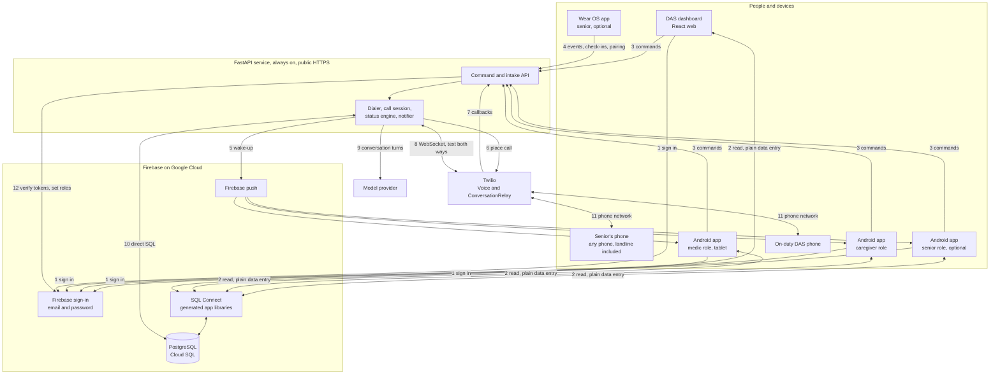
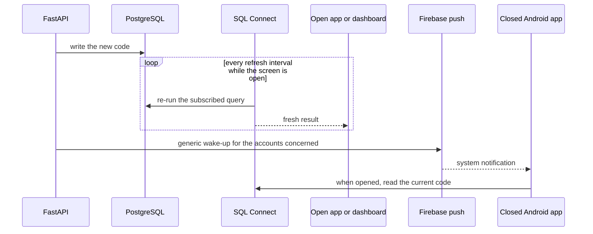
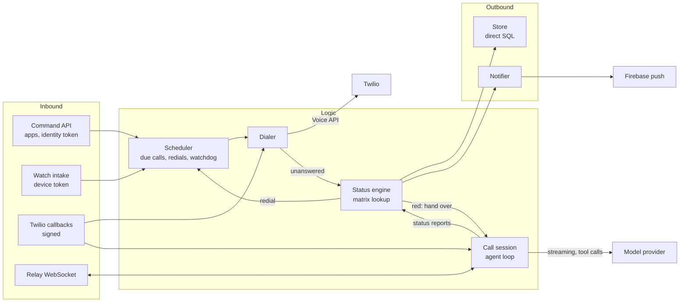

# 01 · Architecture

Part of the [Sentinela specification](README.md). IDs such as D13 and P7 refer to the decision log there.

## 1. Shape

Firebase holds identity and data access. One FastAPI service holds everything that has consequences: phone calls, timers, watch intake and the status matrix. Apps talk to Firebase for sign-in and data, and to FastAPI for a short list of commands. Apps never talk to each other, to Twilio or to the model.

## 2. System overview

Numbers on the arrows match the channel table in section 4.

## 3. Parts

| Part | Role | Notes |
|---|---|---|
| Firebase sign-in | Accounts for every person | Email and password. The account carries a role: `das`, `medic`, `caregiver` or `senior` |
| SQL Connect | The apps' door to the database | Table definitions, named queries and mutations, and per-operation permission rules live here. It generates the libraries the Android app (Kotlin) and the dashboard (web, React) use |
| PostgreSQL | The single store | A Cloud SQL instance. Reached by apps only through SQL Connect, and by FastAPI directly |
| Firebase push | Wakes closed Android apps | Delivery only. No health details in the message (P18) |
| FastAPI service | Calls, scheduling, watch intake, the matrix | The only part that changes a code or makes a phone ring |
| Android app | One app, three roles | The role on the account decides which screens appear. Medic layout targets a tablet; the same medic login works on a phone |
| Wear OS app | Senior's watch | One screen and one background job. Talks only to FastAPI |
| DAS dashboard | Web app for DAS employees | React |
| Twilio | Phone network edge | Places calls, turns speech into text and text into speech (ConversationRelay), bridges the hand-over |
| Model provider | The language model behind the agent | Not yet chosen; see [04-interfaces.md](04-interfaces.md) section 5 |

## 4. Channels

| # | From → to | Means | Carries | Caller proves identity with |
|---|---|---|---|---|
| 1 | Apps → Firebase sign-in | Firebase sign-in library | Sign-up, login, session renewal | Email and password |
| 2 | Apps ↔ SQL Connect | Generated libraries; subscribed queries on a timed refresh | Reading codes, seniors, requests, history. Plain data entry | Identity token from channel 1 |
| 3 | Apps → FastAPI | Web requests, JSON over HTTPS | Five commands with consequences | Identity token from channel 1 |
| 4 | Watch → FastAPI | Web requests, JSON over HTTPS | Pairing, anomaly events, check-ins | Device token issued at pairing |
| 5 | FastAPI → Firebase push → Android app | Firebase server library for Python | Generic wake-up | Service credentials |
| 6 | FastAPI → Twilio | Twilio Voice API | "Call this number" | Twilio account credentials |
| 7 | Twilio → FastAPI | Web callbacks | Call answered, call status, voicemail detection, hand-over, hand-over result | Twilio request signature |
| 8 | Twilio ↔ FastAPI | WebSocket (ConversationRelay) | Senior's words as text in; agent's words as text out | Twilio request signature on connect, plus a one-time call id in the address |
| 9 | FastAPI → model provider | Streaming API with tool calls | Conversation turns and tool results | Provider API key |
| 10 | FastAPI ↔ PostgreSQL | Direct database connection | Codes, calls, events, transcripts | Database credentials, private connection |
| 11 | Twilio ↔ phones | Ordinary phone network | Voice | n/a |
| 12 | FastAPI → Firebase sign-in | Firebase server library for Python | Checking identity tokens, setting an account's role | Service credentials |

## 5. The routing rule (P7, proposed)

> **Apps read and enter plain data through SQL Connect. Anything that makes a phone ring or changes a code goes to FastAPI. Only FastAPI writes codes.**

An app developer deciding where a new action belongs asks one question: does this have a consequence beyond storing what the user typed? If yes, it is a FastAPI command.

| Action | Channel | Why |
|---|---|---|
| Read a senior's code, history, enrollment requests | 2 | Read |
| Fill in the registration form, save the consent signature | 2 | Plain data entry |
| Create an invite (the QR content) | 2 | Plain data entry; the row's generated id is the token |
| Submit an enrollment to DAS | 2 | A state change with no side effect |
| Acknowledge a red | 2 | Records who saw it; does not change the code |
| Register a DAS employee's phone, set who is on duty | 2 | Plain data entry |
| Save the device's push token | 2 | Plain data entry |
| Redeem an invite | 3 | Sets a role on an account, which needs server privileges |
| Pair a watch | 3 | Issues a device token |
| Accept a patient | 3 | Starts the welcome call |
| Start a weather campaign | 3 | Starts calls |
| "Check on me" | 3 | Starts a call |

**Who writes what in the database**

| Data | Written by |
|---|---|
| Registration details, consent, invites, enrollment state up to `submitted` | Medic's app, through SQL Connect |
| Acknowledgement of a red, DAS employees, on-duty flag | DAS dashboard, through SQL Connect |
| Push tokens | Each signed-in app, through SQL Connect |
| Account rows and roles, caregiver links, devices, enrollment state `active` | FastAPI |
| Calls, transcripts, status reports, watch events, the current code | FastAPI only |

## 6. Identity and permissions

**People.** Every person has a Firebase account with email and password. The app stays signed in. The account's role is set by FastAPI (channel 12) and travels inside the identity token.

- DAS employees and medics get their accounts from a setup script before the event **(P13, proposed)**.
- Caregivers and seniors create their own by scanning the medic's QR (D12). A freshly created account has no role and can read nothing until the invite is redeemed.
- After FastAPI sets a role, the app must renew its identity token before the role takes effect.

**The watch** is a device, not a person. It holds a device token issued when it is paired, uses channel 4 only, and never touches Firebase.

**Twilio** signs every callback; FastAPI rejects unsigned or wrongly signed requests.

**Two places enforce permissions, with a clean split:**

| Place | Enforces | Based on |
|---|---|---|
| SQL Connect rules, one per query and mutation | Who may read or enter which rows | Role and account id in the identity token |
| FastAPI | Who may run each command | Role and account id in the identity token, checked through channel 12 |

**Who sees which seniors**

| Role | Sees |
|---|---|
| Medic | Seniors they registered |
| Caregiver | Seniors they are linked to |
| Senior | Themselves |
| DAS | All seniors that are submitted or active |

**Who sees how much** (kept from v3 §11.4)

| Information | Caregiver | Medic | DAS |
|---|---|---|---|
| Code and reason | Yes | Yes | Yes |
| Call history, short form | Yes | Yes | Yes |
| Full transcript | No | Yes | Yes |
| Watch state (worn, battery, last check-in) | Yes | Yes | No |

## 7. Live updates and push

Two mechanisms, for two situations.

| Situation | Mechanism | Used by |
|---|---|---|
| The screen is open | Subscribed SQL Connect query on a timed refresh **(P6, proposed)** | Android app, dashboard |
| The app is closed | Firebase push | Android app |

The dashboard needs no push: a dispatcher's dashboard is open, and a red also rings the on-duty phone.

**Why timed refresh.** SQL Connect refreshes a subscribed query when a change is made through SQL Connect, or on a timer. In Sentinela the codes are written by FastAPI over a direct database connection, which SQL Connect does not observe, and the documented server library for SQL Connect is for Node.js only. A timer works regardless of who wrote the change. The interval is short in demo mode; see [06-operations.md](06-operations.md) section 3. Spike S2 there tests whether an instant refresh is reachable.

**When a push is sent.** On a change of code into yellow or red, not on every report during a call. Recipients are fixed per code; see [03-status-model.md](03-status-model.md) section 7.

## 8. Inside the FastAPI service

One process, several modules with narrow jobs. They are separate so that the dialer, the notifier and the call sessions can later become separate workers without a rewrite.

| Module | Job | Depends on |
|---|---|---|
| Command API | Receives the five commands, checks role, turns them into queued work | Firebase sign-in (to check tokens), Store |
| Watch intake | Receives pairing, events and check-ins; drops duplicates; applies the cooldown | Store |
| Scheduler | On a short tick: finds calls that are due, watches for silent watches. All timers are rows with a due time, so a restart loses nothing | Store |
| Dialer | Places a call through Twilio and tracks its lifecycle from the status callbacks | Twilio, Store |
| Call session | One per live call. Holds the WebSocket, checks alarm words, runs the conversation with the model, executes hand-over | Twilio, model provider |
| Status engine | Takes status reports and unanswered outcomes, applies the matrix, decides the code and the actions. Pure logic with no outside calls | Nothing |
| Notifier | Sends pushes through interchangeable channels. One channel in the MVP | Firebase push |
| Store | All reads and writes to PostgreSQL | PostgreSQL |

The status engine has no dependencies on purpose: every cell of the matrix can be tested without a phone, a model or a database.

## 9. Hosting (P17, proposed)

| Part | Where | Requirement |
|---|---|---|
| FastAPI service | Google Cloud Run, EU region | At least one instance kept running with CPU always available, because open calls and the scheduler live in the process. Public HTTPS and secure WebSocket address for Twilio |
| PostgreSQL | Cloud SQL, same region, created through SQL Connect | Private connection from the FastAPI service |
| DAS dashboard | Firebase Hosting | Static site |
| Android and Wear OS apps | Installed directly on the demo devices | n/a |

A public address is needed during development as well, since Twilio must reach channels 7 and 8. A tunnel to a laptop is enough before deployment.

## 10. Deliberately absent

- **No message broker or worker pool.** Nothing in the MVP needs one. The module boundaries in section 8 keep that door open.
- **No file storage.** With document upload deferred, the only binary is the consent signature, which is stored in the database (P15).
- **No app-to-app channel.** The medic's tablet and the caregiver's phone never connect directly; the QR is read by a camera.
- **No audio anywhere in our systems.** Twilio handles speech in both directions; FastAPI sees and stores text only.
