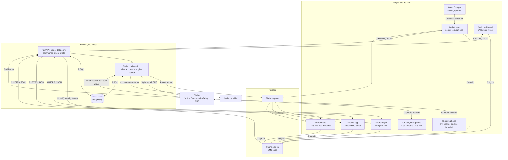
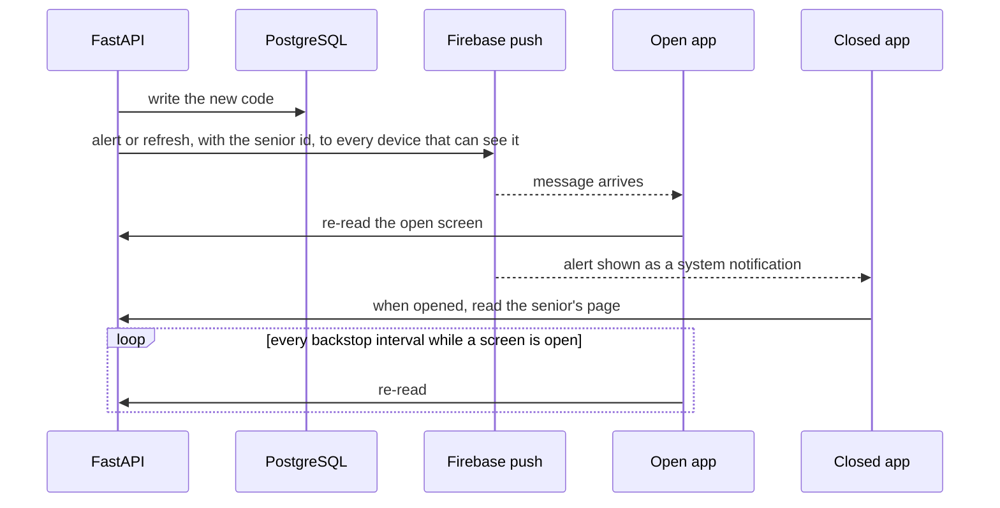
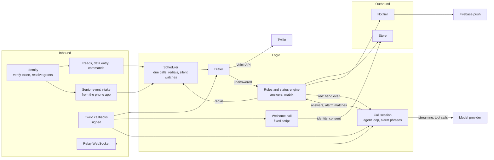

# 01 · Architecture

Part of the [Sentinela specification](README.md). IDs such as G2 and P10 refer to the decision log there.

## 1. Shape

One FastAPI service holds all data and everything that has consequences: phone calls, timers, events from the senior's phone, the rules and the matrix (G2). Every app, the DAS web dashboard included, talks only to FastAPI. Firebase does two narrow jobs: it proves that a person owns a phone number, and it delivers pushes. Apps never talk to each other, to Twilio or to the model. The watch talks only to the senior's phone.

## 2. System overview

Numbers on the arrows match the channel table in section 4.

## 3. Parts

| Part | Role | Notes |
|---|---|---|
| Firebase phone sign-in | Proves a person owns a phone number | Holds no roles and no application data. A Firebase account is created automatically at first sign-in |
| Firebase push | Delivers alerts and refresh signals to Android apps | No health details in any message (P18) |
| FastAPI service | All reads and writes, calls, scheduling, event intake, the rules and the matrix | The only part that changes a code, makes a phone ring or touches the database |
| PostgreSQL | The single store | Reached only by FastAPI, over Railway's private network |
| Android app | One app, four roles | The roles granted to the signed-in number decide which screens appear. The medic layout targets a tablet and also works on a phone. The DAS role shows only red incidents (G15) |
| Web dashboard | DAS at the desk | React, built into a static site. Everything a dispatcher does: all seniors, incidents, enrollment requests, campaigns, staff and on duty. Re-reads every few seconds instead of receiving pushes |
| Wear OS app | Senior's watch | One screen and one background job. Talks only to the senior's phone app |
| Twilio | Phone network edge | Places calls, turns speech into text and text into speech (ConversationRelay), runs the welcome call's key-and-voice questions, bridges the hand-over, sends the caregiver notice SMS |
| Model provider | The language model behind the agent | Not yet chosen; see [04-interfaces.md](04-interfaces.md) section 5 |

## 4. Channels

| # | From → to | Means | Carries | Caller proves identity with |
|---|---|---|---|---|
| 1 | Watch ↔ senior's phone app | Wear OS Data Layer messages | Anomaly events, check-ins, acknowledgements | Same app, same signing key, paired devices |
| 2 | Apps and dashboard → Firebase sign-in | Firebase sign-in library, phone provider (with reCAPTCHA in the browser) | Phone number, SMS code, token renewal | The SMS code |
| 3 | Apps and dashboard → FastAPI | Web requests, JSON over HTTPS. The API accepts browser requests only from the dashboard's own address | Reads, data entry, commands, the senior's events and check-ins | Firebase identity token |
| 4 | FastAPI → Firebase push → Android app | Firebase server library for Python | Alert or refresh, with a senior id | Service credentials |
| 5 | FastAPI → Twilio | Twilio Voice and Messaging APIs | "Call this number", the caregiver notice SMS | Twilio account credentials |
| 6 | Twilio → FastAPI | Web callbacks | Call answered, call status, voicemail detection, welcome-call answers, hand-over, hand-over result | Twilio request signature |
| 7 | Twilio ↔ FastAPI | WebSocket (ConversationRelay) | Senior's words as text in; agent's words as text out | Twilio request signature on connect, plus a one-time call id in the address |
| 8 | FastAPI → model provider | Streaming API with tool calls | Conversation turns and tool results | Provider API key |
| 9 | FastAPI ↔ PostgreSQL | Private network | Everything | Database credentials |
| 10 | Twilio ↔ phones | Ordinary phone network | Voice | n/a |
| 11 | FastAPI → Firebase sign-in | Firebase server library for Python | Checking identity tokens | Service credentials |

## 5. One door (G2)

> **Every read and every write goes through FastAPI. Firebase never holds application data.**

There is no second path to the database, so there is one place that checks permissions, one schema and one writer. A change of code, a new call or a new grant is written by FastAPI, which therefore knows the moment to send a refresh (section 7).

## 6. Identity and permissions

**People** sign in with their phone number and an SMS code (G6), in the Android app or the dashboard. The Firebase library on Android reads the code automatically when it can. The client then sends its Firebase identity token with every request to FastAPI. FastAPI verifies the token, reads the phone number from it, and looks it up.

Nobody chooses a role. A role is a **grant** made by someone allowed to make it, by entering the person's phone number:

| Who grants | Grants | How |
|---|---|---|
| The setup script, run by the team | DAS employees | Name and phone number |
| A DAS employee | Medics, and other DAS employees | Name, phone number, practice (for a medic) |
| A medic | A senior, and the senior's caregivers | The registration form: the senior's own number, and each caregiver's name, relation and number |

A grant creates the person's user row immediately, before they ever sign in. At first sign-in FastAPI attaches the Firebase account to that row.

| When a number signs in | Result |
|---|---|
| It has one grant | The app opens the screens for that role. The dashboard accepts DAS grants only |
| It has several grants (for example a caregiver who is also a medic, or a senior who uses a relative's phone) | The app asks which role to use, listing only the granted ones |
| It has none | „Numărul nu este înregistrat. Contactați medicul de familie." Nothing is stored |

Phone numbers are normalized to the international format (+40…) on every write and every lookup, so "0722 123 456" typed by a medic matches the number Firebase reports.

**The watch** has no identity of its own. Its messages reach FastAPI only through the senior's phone app, which is signed in as that senior (G5).

**Twilio** signs every callback; FastAPI rejects unsigned or wrongly signed requests.

**One place enforces permissions: FastAPI.** Every endpoint checks the caller's grants and, where a senior is involved, that the grant covers that senior. The app's role screens are a convenience, not a protection.

**Who sees which seniors**

| Role | Sees |
|---|---|
| Medic | Seniors they registered |
| Caregiver | Seniors whose registration lists their number |
| Senior | Themselves |
| DAS | All seniors that are submitted or further along |

**Who sees how much** (kept from v3 §11.4, extended)

| Information | Caregiver | Medic | DAS |
|---|---|---|---|
| Code and reason | Yes | Yes | Yes |
| Call history, short form | Yes | Yes | Yes |
| Full transcript | No | Yes | Yes |
| Address and access details | Yes | Yes | Yes |
| Location attached to an event **(proposed)** | Yes | No | Yes |
| Watch state (worn, battery, last check-in) | Yes | Yes | No |
| Consent record | No | Yes | Yes |

## 7. Live updates and push (G4)

One mechanism serves open and closed Android apps. When FastAPI writes something a person can see in the app, it sends a Firebase push to every device of every account that can see it.

The web dashboard receives no pushes. A dispatcher's dashboard is always open, so it re-reads every few seconds (interval in [06-operations.md](06-operations.md) section 3). A new red plays an audible cue; browsers allow sound only after a click on the page, so the dashboard asks for one click after sign-in („Pornește alertele sonore”).

| Kind | Sent when | What the app does |
|---|---|---|
| Alert | A code changes into yellow or red (recipients in [03-status-model.md](03-status-model.md) section 7) | Shows a system notification with generic text; tapping it opens the senior's page. If the app is open, it also re-reads |
| Refresh | Any other visible change: a code into green, a call starting or ending, an enrollment state, a watch state, a new grant | Silent. If the app is open, it re-reads the screen; if closed, nothing |

A slow timed re-read while a screen is open is the backstop for a lost push. Its interval is in [06-operations.md](06-operations.md) section 3.

## 8. Inside the FastAPI service

One process, several modules with narrow jobs. They are separate so that the dialer, the notifier and the call sessions can later become separate workers without a rewrite.

| Module | Job | Depends on |
|---|---|---|
| Identity | Verifies the Firebase identity token, normalizes the phone number, loads the caller's grants, attaches the Firebase account at first sign-in | Firebase sign-in, Store |
| Reads, data entry, commands | The endpoints in [04-interfaces.md](04-interfaces.md) sections 1 and 2; checks grants on each | Store |
| Senior event intake | Receives events and check-ins forwarded by the senior's phone app; drops duplicates; applies the cooldown and the active-warning rule | Store |
| Scheduler | On a short tick: finds calls that are due, marks silent watches. All timers are rows with a due time, so a restart loses nothing. Each tick first takes a database lock, so a second running copy of the service skips the tick | Store |
| Dialer | Places a call through Twilio and tracks its lifecycle from the status callbacks | Twilio, Store |
| Welcome call | Answers the welcome call's callbacks with fixed questions and records identity and consent | Store |
| Call session | One per live wellbeing call. Holds the WebSocket, matches alarm phrases, asks the confirmation question, runs the conversation with the model, executes hand-over | Twilio, model provider |
| Rules and status engine | Turns answers into severity and certainty, applies the matrix, decides the code and the actions. Pure logic with no outside calls | Nothing |
| Notifier | Sends alerts and refreshes through Firebase push; the caregiver notice SMS through Twilio | Firebase push, Twilio |
| Store | All reads and writes to PostgreSQL, asynchronous | PostgreSQL |

The rules and status engine has no dependencies on purpose: every rule and every cell of the matrix can be tested without a phone, a model or a database.

**The agent loop is written directly against the model provider's library (proposed)**, not inside an agent framework. The server refuses tool calls, matches alarm phrases before the model sees a sentence, and cuts the model's reply short on an interruption; a framework's own loop would be in the way.

**Everything in the request path is asynchronous.** One blocking database call or web request in this process would pause every live conversation.

## 9. Hosting (G9)

| Part | Where | Requirement |
|---|---|---|
| FastAPI service | Railway, EU West, built from a Dockerfile | Exactly one replica; sleeping when idle turned off; a health check at `/api/health`. Railway's public HTTPS address also serves the secure WebSocket Twilio needs |
| PostgreSQL | Railway, same project and region | Reached over the private network |
| Web dashboard | Railway, a separate static-site service in the same project | Its own service, so that changing the dashboard never redeploys FastAPI and drops live calls. The API allows browser requests from this address only |
| Android and Wear OS apps | Installed directly on the demo devices | n/a |

A new deploy starts before the old one stops, so for a few seconds two copies run. The scheduler's database lock keeps one of them idle. Calls live on the old copy drop, so nothing is deployed after the Sunday-morning freeze.

During development Twilio must still reach channels 6 and 7: a tunnel to a laptop, or a Railway environment per branch.

## 10. Deliberately absent

- **No message broker or worker pool.** Nothing in the MVP needs one. The module boundaries in section 8 keep that door open.
- **One web client only**, for DAS at the desk. Seniors, caregivers and medics use the Android app.
- **No second path to the database.** No SQL Connect, no Firestore, no live queries.
- **No file storage.** The only image-like item, the optional signature, is stored as strokes on a consent record.
- **No app-to-app channel** between people's devices. The watch talks to the senior's phone, which is one person's two devices.
- **No audio anywhere in our systems.** Twilio handles speech in both directions; FastAPI sees and stores text only.
