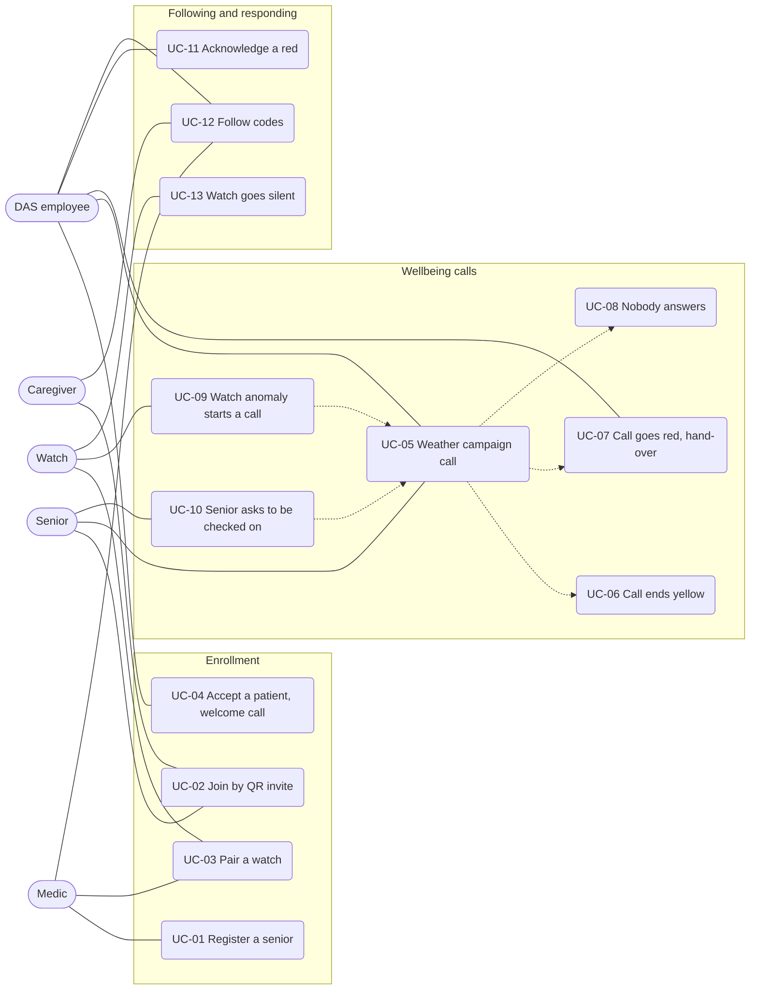
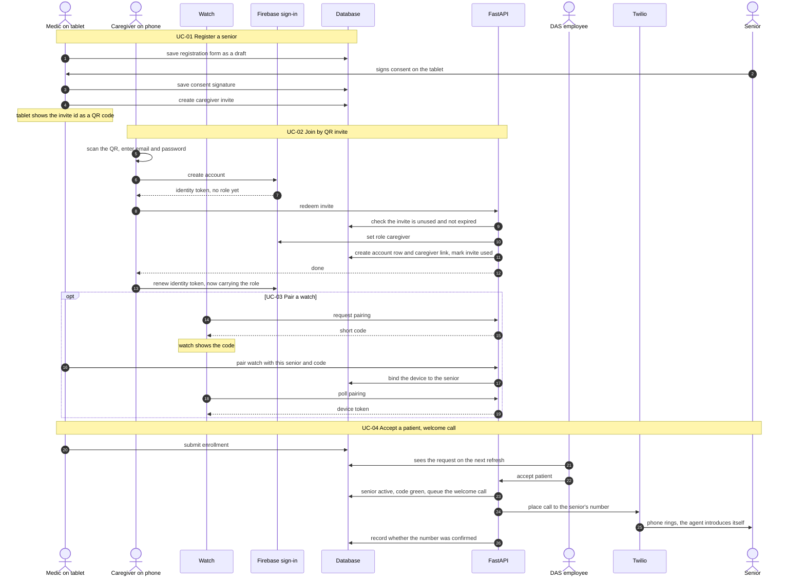
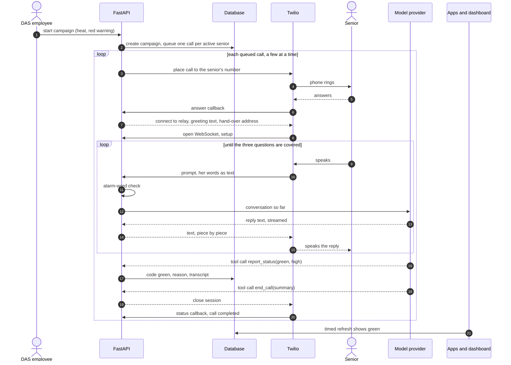
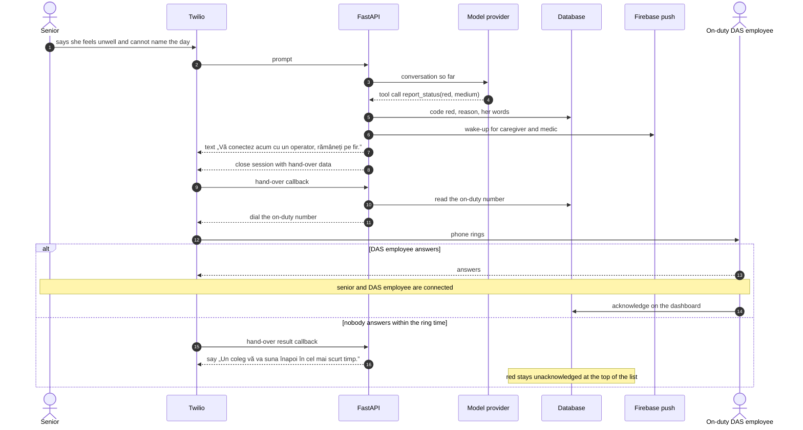
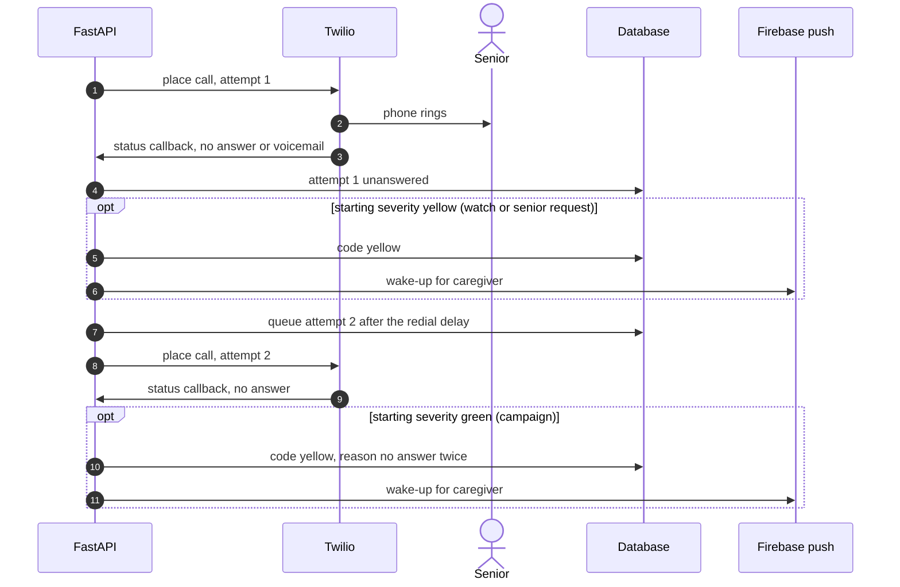
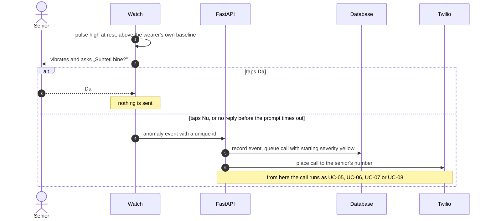

# 02 · Use cases

Part of the [Sentinela specification](README.md). Each use case names who is involved, what starts it, the steps, and what is true afterwards. The channels and interface names used here are defined in [01-architecture.md](01-architecture.md) and [04-interfaces.md](04-interfaces.md); how a call becomes a code is in [03-status-model.md](03-status-model.md).

In the sequence diagrams, "Database" stands for PostgreSQL. Apps reach it through SQL Connect; FastAPI reaches it directly.

## 1. Actors

| Actor | Uses | Role in the system |
|---|---|---|
| Senior | Any phone. Optionally a Wear OS watch and the Android app | Receives calls and talks with the agent |
| Caregiver | Android app on a phone | Follows one or more seniors; is notified at yellow and red |
| Medic | Android app on a tablet (and optionally a phone) | Registers seniors; follows their own patients; is notified at red |
| DAS employee | Web dashboard; a phone when on duty | Accepts patients, starts campaigns, takes over reds |
| Watch | Device actor | Detects anomalies, reports check-ins |

## 2. Overview

Dotted arrows mean "continues as": a watch anomaly or a senior's request starts the same call a campaign does, and that call ends in one of three ways.

## 3. Enrollment

### UC-01 Register a senior

| | |
|---|---|
| Actors | Medic, senior (present in the cabinet) |
| Starts when | The medic opens "Pacient nou" on the tablet |
| Before | The medic is signed in |
| After | A senior exists in state `submitted`, with consent, waiting for DAS |

1. The medic enters the senior's name, form of address („doamna Maria”), phone number (mobile or landline), address and preferred call window.
2. The medic enters one or two caregiver contacts: name, relation, phone.
3. The senior reads the consent text and signs on the tablet. Consent covers the calls, the processing of what is said, and sharing the code with the caregiver, the medic and DAS.
4. The medic creates an invite for each caregiver, and one for the senior if the senior will use the app. The tablet shows each as a QR code.
5. Optionally, the medic pairs a watch (UC-03).
6. The medic submits. The senior moves from `draft` to `submitted`.

Variations:
- **Caregiver not present.** The invite stays valid for its validity period; the medic can show the QR again from the patient's page.
- **Form left unfinished.** The draft is saved and visible only to that medic.

Everything in this use case is plain data entry through SQL Connect. Nothing rings and no code exists yet.

### UC-02 Join by QR invite

| | |
|---|---|
| Actors | Caregiver, or senior |
| Starts when | They tap "Am o invitație" in the Android app and scan the medic's QR **(P14, proposed)** |
| Before | The app is installed; the invite is unused and not expired |
| After | An account exists with the invite's role, linked to the senior; the app is signed in |

1. The app reads the invite id from the QR.
2. The person chooses an email and a password. Firebase sign-in creates the account. It has no role yet and can read nothing.
3. The app sends "redeem invite" to FastAPI.
4. FastAPI checks the invite, sets the role on the account, creates the link to the senior (a caregiver link, or the senior-account link), and marks the invite used.
5. The app renews its identity token and opens the screens for its role.
6. The app saves the device's push token.

Variations:
- **Invite already used or expired.** FastAPI refuses; the app shows why. The account remains without a role and can try another invite.
- **Person already has an account with a role.** Refused in the MVP: one account, one role, and a caregiver's further seniors are a later extension.

DAS employees and medics do not use this flow; their accounts are created before the event **(P13, proposed)**.

### UC-03 Pair a watch

| | |
|---|---|
| Actors | Medic, watch |
| Starts when | The Wear OS app is opened for the first time |
| Before | The senior is registered (any enrollment state); the watch has a connection |
| After | The watch holds a device token and reports for that senior |

1. The watch asks FastAPI for a pairing. FastAPI creates a pending device and returns a short code, which the watch displays.
2. The medic types the code on the senior's page **(P11, proposed)**.
3. FastAPI binds the device to the senior.
4. The watch, which has been polling, receives its device token and starts monitoring.

Variations:
- **Code expired.** The watch requests a new one.
- **Senior already has a watch.** The new one replaces it; the old device token stops working.

The watch is bound to the senior's record, not to the medic. Typing the code only tells the system whose wrist it is on. A watch has no camera, which is why it cannot use the QR.

### UC-04 Accept a patient, welcome call

| | |
|---|---|
| Actors | DAS employee, senior |
| Starts when | A DAS employee opens "Cereri de înrolare" |
| Before | The senior is `submitted` |
| After | The senior is `active` with code green, and has been called once |

1. The DAS employee reviews the registration and presses "Acceptă".
2. FastAPI sets the senior to `active`, creates the code (green), and queues the welcome call.
3. The agent calls, greets the senior by their form of address, says it is the DAS assistant, says it never asks for money or personal data, and asks them to save the number.
4. FastAPI records whether the number was confirmed.

Variations:
- **Welcome call not answered.** One redial. If still unanswered, the senior stays active with "number not confirmed" shown to the medic and DAS.

A welcome call never changes the code.

## 4. Wellbeing calls

### UC-05 Weather campaign call (green path)

| | |
|---|---|
| Actors | DAS employee, senior |
| Starts when | A DAS employee presses "Simulează cod roșu" |
| Before | At least one active senior |
| After | Every active senior has been called once; each has a fresh code |

1. FastAPI creates the campaign and queues one wellbeing call per active senior, with starting severity green. Seniors with an unacknowledged red, or with a call already queued or live, are skipped. The campaign is one round, started immediately **(P16, proposed)**.
2. The dialer places a few calls at a time.
3. When the senior answers, Twilio connects the call to the agent. The greeting names the senior and the reason for the call.
4. Each thing the senior says arrives as text. FastAPI checks it against the alarm words, then passes the conversation to the model, and streams the reply back to be spoken.
5. The agent covers the three questions: how they feel, what day it is, whether they have water and a cool place.
6. The model reports green with high certainty. FastAPI writes the code.
7. The agent closes the call with a short piece of advice.

The other endings are UC-06, UC-07 and UC-08.

### UC-06 Call ends yellow

| | |
|---|---|
| Actors | Senior, caregiver, medic |
| Starts when | During a wellbeing call, the model reports yellow, or the call ends uncertain |
| After | Code yellow; caregiver notified; medic sees a warning |

1. The model reports yellow (one worrying answer), or reports green without high certainty.
2. If certainty is not high and the re-ask has not been used, the agent re-asks the unclear question once.
3. FastAPI writes code yellow with the reason and the senior's words. For a reported yellow this happens at the report; for an uncertain green it happens when the call ends.
4. The notifier pushes to the caregiver's devices. The medic's app shows a warning on that patient, with no push.
5. The call continues to its normal close.

Nothing follows up if the caregiver does not open the app **(P5, proposed)**.

### UC-07 Call goes red, hand-over

| | |
|---|---|
| Actors | Senior, on-duty DAS employee, caregiver, medic |
| Starts when | An alarm word is heard, or the model reports red |
| Before | A DAS employee is marked on duty, with a phone number |
| After | Code red; senior connected to a person at DAS; red at the top of the DAS list until acknowledged |

1. Red is established, by an alarm word (before the model sees the sentence) or by the model's report.
2. FastAPI writes code red immediately and pushes to the caregiver and the medic.
3. The agent tells the senior they are being connected to a person.
4. FastAPI closes the agent session with hand-over data. Twilio asks FastAPI what to do next; FastAPI answers "dial the on-duty number".
5. The on-duty phone rings. On answer, the senior and the DAS employee are talking directly. The dashboard already shows the senior at the top with the reason, the senior's words and the transcript so far.

Variations:
- **Senior asks for a person, or presses 9.** Same hand-over; the code becomes at least yellow.
- **On-duty phone not answered.** The senior hears that someone will call back. The red stays at the top of the list, unacknowledged, with its audible cue.
- **Nobody is on duty.** No dial is attempted; same message to the senior; the dashboard shows the red with a "nobody on duty" warning.
- **Red with no call left to hand over.** Under the defaults this happens only if the line drops between the red and the hand-over. The red appears on the list and DAS phones the senior. (It would become a regular case if open question 1 in the README is resolved as red.)

### UC-08 Nobody answers

| | |
|---|---|
| Actors | Senior, caregiver |
| Starts when | A wellbeing call is not answered, is busy, or reaches voicemail |
| After | One redial has been made; if still unanswered, code yellow |

1. Twilio reports the outcome. Voicemail detection runs in the background so that a person who answers does not hear silence; if a machine answered, the call is ended and counted as unanswered.
2. If the trigger carried a starting severity of yellow, the code becomes yellow now and the caregiver is pushed.
3. One redial is queued after the redial delay.
4. If the redial is also unanswered and the code is still green, it becomes yellow with the reason "no answer twice".

If the redial is answered, the call proceeds as UC-05, UC-06 or UC-07, and its result replaces the yellow from step 2 under the usual rules.

### UC-09 Watch anomaly starts a call

| | |
|---|---|
| Actors | Senior, watch |
| Starts when | The watch detects a pulse well above the wearer's resting level while they are not moving, or the senior taps "Nu mă simt bine" **(P12, proposed)** |
| Before | The watch is paired and worn |
| After | A wellbeing call has been queued with starting severity yellow |

1. The watch compares the pulse with the wearer's own resting level and with movement. A high pulse during a walk is ignored.
2. The watch vibrates and asks „Sunteți bine?” with Da and Nu.
3. Da ends it. Nu, or no reply before the prompt times out, sends an anomaly event.
4. The "Nu mă simt bine" button skips the prompt and sends the event at once.
5. FastAPI records the event and queues a wellbeing call. The code does not change yet (P8).
6. The senior's phone rings. If the watch is paired to that phone, the call also shows on the wrist, which Wear OS does without any work from us.

Variations:
- **No connection.** The event waits on the watch and is sent when the connection returns. An event older than the stale limit is recorded and starts no call.
- **A call is already queued or live for this senior, or one just ended.** The event is attached to that call; no second call is started.
- **Same event delivered twice.** Ignored by its id.

The watch never places a call. It sends a small message over the internet (through its paired phone, home Wi-Fi, or its own mobile data), and FastAPI asks Twilio to ring the senior's phone number.

### UC-10 Senior asks to be checked on

| | |
|---|---|
| Actors | Senior |
| Starts when | The senior taps "Sunați-mă" in the Android app |
| Before | The senior has an account (UC-02) |
| After | A wellbeing call has been queued with starting severity yellow |

1. The app sends "check on me" to FastAPI.
2. FastAPI records it as an event and queues a wellbeing call, exactly as for a watch anomaly.
3. The call proceeds as UC-05, UC-06, UC-07 or UC-08.

This is also the demo fallback for UC-09: it enters the same path, so it exercises the same code (D9).

## 5. Following and responding

### UC-11 Acknowledge a red

| | |
|---|---|
| Actors | DAS employee |
| Starts when | A red appears at the top of the list |
| After | The red is marked as seen, with who and when |

1. The dashboard shows the senior first, with the reason, the senior's words, the transcript, and whether the hand-over was answered.
2. The DAS employee handles it by phone, then presses "Am preluat".
3. The acknowledgement is stored. The audible cue stops. The senior stays shown as red, marked seen, until the next wellbeing call gives a new result (P9).

Acknowledging is plain data entry through SQL Connect; it does not change the code.

### UC-12 Follow codes

| | |
|---|---|
| Actors | Caregiver, medic, DAS employee |
| Starts when | They open the app or dashboard, or tap a push |
| After | They have seen the current code and its reason |

| Role | Sees |
|---|---|
| Caregiver | Their senior's code, the reason in a sentence, short call history, the watch's state |
| Medic | A panel of all their patients with codes, yellow and red highlighted; per patient: registration details, call history, full transcripts, the watch's state |
| DAS employee | All active seniors, red first; enrollment requests; per senior: code, reason, call history, full transcripts |

Open screens update on the timed refresh. A call that is ringing or live shows a "call in progress" badge.

### UC-13 Watch goes silent

| | |
|---|---|
| Actors | Watch, caregiver, medic |
| Starts when | No check-in has arrived for longer than the silence limit, or a check-in says the watch is not worn |
| After | The watch's state is `offline` or `not_worn`, visible as a device warning |

1. The scheduler notices the missing check-ins and marks the device `offline`. A check-in that reports "not worn" marks it `not_worn`.
2. The caregiver and the medic see a device warning beside the senior. There is no push and the code does not change.
3. The next normal check-in sets the state back to `ok`.

A silent watch is not evidence about the senior; it is evidence about the watch. Weather campaigns still reach that senior by phone.
