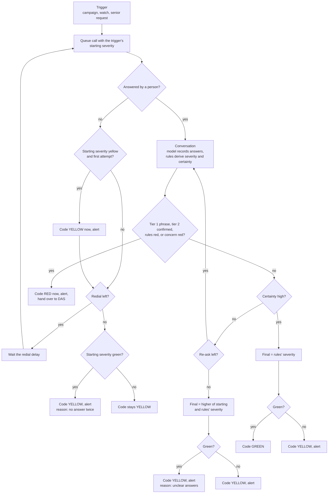
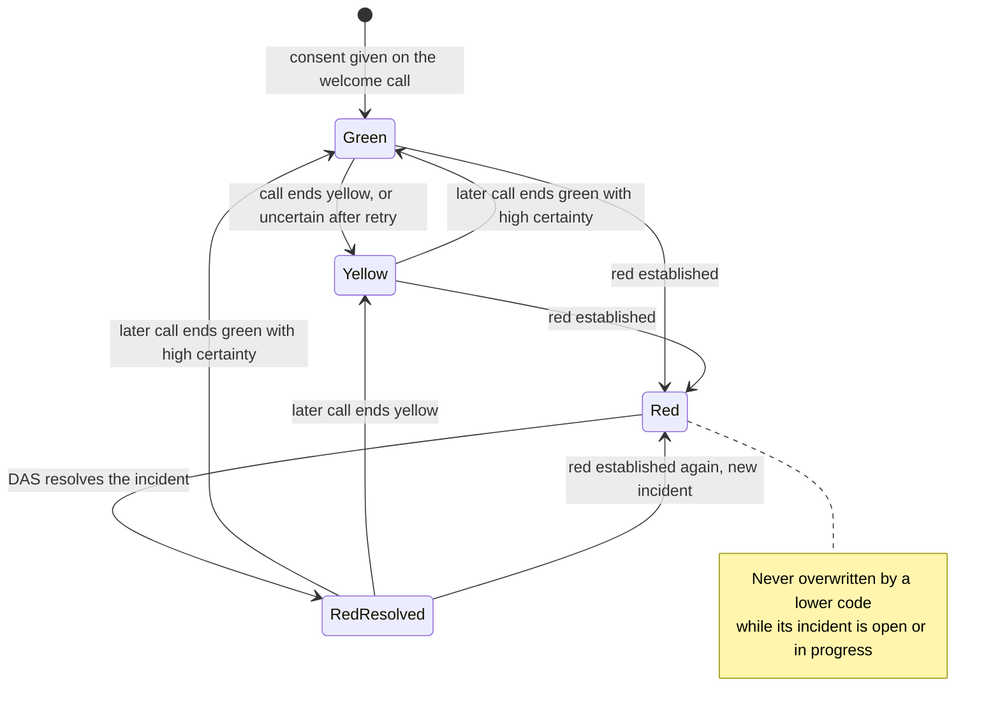
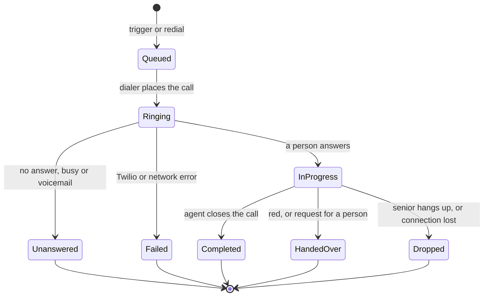

# 03 · Status model

Part of the [Sentinela specification](README.md). This file defines the three codes, how a conversation becomes severity and certainty, the alarm phrases, and the fixed table that turns a call into actions.

The principle, kept from v3: **the model converses and extracts facts; fixed rules decide** (G10). The model can raise the level, never lower it.

## 1. The code

Every active senior has exactly one **code**: `green`, `yellow` or `red`. The caregiver, the medic and DAS all see the same code (D6). What differs per role is the reaction, in section 7.

A senior becomes active, at green, when consent is given on the welcome call ([02-use-cases.md](02-use-cases.md) UC-04).

## 2. Two axes

| Axis | Values | Comes from |
|---|---|---|
| Severity | green, yellow, red | The trigger (starting severity), the rules applied to the answers, the latest room reading where there is a home node (P22), the alarm phrases, and the model's `raise_concern` |
| Certainty | high, medium, low | Computed by the server from how many answers were unclear, and only when a call was answered (D7) |

**Starting severity by trigger**

| Trigger | Starting severity |
|---|---|
| Weather campaign | green |
| Watch: high pulse at rest, inactivity during a warning, a fall (P19), or the button | yellow |
| Home node: room out of range for the hold time, no motion during a warning, or the SOS button (P21, proposed) | yellow |
| Senior pressed "Sunați-mă" | yellow |
| Welcome call | none; a welcome call never changes the code |

**The starting severity is provisional (P8, proposed).** When a watch event arrives, the code does not change yet. It changes when the rules give a result during the call, when the call ends, or when the call goes unanswered. A pulse that rose on the stairs therefore never turns a card yellow or notifies anyone, provided the senior picks up and says so clearly. While the phone is ringing or the call is live, apps show a "call in progress" badge, which is not a code.

**Certainty when nobody answers (P1, proposed).** No answered call means no answers. That case is treated as `low`.

## 3. What the model extracts, and what the server decides (G10)

The model does not choose a severity, a certainty or recipients. During the conversation it records what the senior said about each of the three questions, through one tool.

| Field | Question | Values the model records |
|---|---|---|
| `feeling` | How do you feel right now? | `ok` or `unwell` |
| `orientation` | What day of the week is it? | The day the senior named, or `unknown` if they said they do not know |
| `shelter` | Do you have water and a cool place (heat), or a warm place (cold)? | `yes` or `no` |

Each record also carries `clear` (true when the answer was unambiguous) and the senior's exact words.

**The server checks the orientation answer itself.** It compares the named day with today's weekday in `Europe/Bucharest`. A different day, or `unknown`, is a wrong answer. The model is never asked to judge whether the day is correct.

**The server checks the shelter answer against the room (P22, proposed).** When the senior has a home node whose latest reading is fresh (the node is not `offline`), and the temperature is below the cold limit or above the heat limit, a `shelter` answer of `yes` is recorded as worrying, as if it were `no`. The senior's words are kept unchanged, and a status report with source `home_temperature` names the reading, for example „spune că are căldură, senzorul arată 14°C”. This is the same rule as for the model: a sensor can make an answer worrying, never make a worrying answer fine. A `shelter` of `no` stays `no` whatever the room shows.

The limits are in [06-operations.md](06-operations.md) section 3. They are orientative, not medical (README open question 11).

**Rules for severity** (from v3 §9.2)

| Severity | When |
|---|---|
| red | `feeling` unwell, and also either `orientation` wrong or `shelter` no |
| yellow | Any one worrying answer on its own: unwell, wrong day, no water or no cool (warm) place |
| green | All three recorded and fine |

**Rule for certainty**

| Certainty | When |
|---|---|
| high | All three answers clear |
| medium | One answer unclear |
| low | Two or more unclear |

**Overwriting an answer.** A field may be recorded again only if its earlier record was unclear; that is what the re-ask is for. A clear worrying answer („cam amețită”) is never replaced by a later „acum mi-e mai bine”. Severity therefore never falls within a call, as in v3 §9.3.

**Raising a concern.** For something that sounds serious but falls outside the three questions („de două zile nu-mi găsesc pastilele de inimă”), the model calls `raise_concern` with yellow or red, a reason and the senior's words. It can only raise the call's severity. A red acts at once.

The three questions the conversation must cover are the three fields above.

## 4. Alarm phrases (G11, G12)

Before a transcribed sentence reaches the model, the server checks it against a fixed list of phrases. This is the one severity source that does not depend on the model, so it keeps working if the model is slow, wrong or down.

**Normalization.** The sentence is lowercased; diacritics are removed (ă and â become a, î becomes i, ș and ş become s, ț and ţ become t, since transcriptions use both forms); punctuation is removed except hyphens, which carry meaning in „n-am”, „mi-e”, „nu-mi”; spaces are collapsed. Phrases are matched on word stems, so „leșin”, „leșinat” and „lesinat” all match.

**Tier 1: red and hand-over at once, no confirmation.**

| Condition | Examples of what seniors say |
|---|---|
| Breathing | „nu pot respira”, „nu mai pot respira”, „mă sufoc”, „n-am aer”, „mă înec” |
| Chest and heart | „durere în piept”, „mă doare pieptul”, „mă apasă pe piept”, „mă strânge în piept”, „mă arde în piept”, „mă doare mâna stângă” |
| Stroke signs | „nu-mi simt mâna / piciorul / fața”, „mi-a amorțit o parte”, „nu pot mișca mâna”, „mi s-a strâmbat gura”, „văd dublu”, „nu mai văd” |
| A call for an ambulance | „chemați salvarea”, „sunați la 112”, „vreau ambulanța”, „trimiteți pe cineva” |
| Heavy bleeding | „sângerez”, „îmi curge sânge” |
| Falls | „am căzut”, „am căzut din picioare”, „nu mă pot ridica”, „stau pe jos”, „sunt pe podea”, „mi-am rupt…” |
| Self-harm | „vreau să mor”, „nu mai vreau să trăiesc”, „să se termine odată”, „mă omor” |

For self-harm the agent's only words before the hand-over are „Vă fac legătura acum cu cineva cu care puteți vorbi.” Whether DAS needs its own script for these calls is open question 8 in the README.

**Tier 2: confirm first.**

| Condition | Examples of what seniors say |
|---|---|
| Fainting | „am leșinat”, „mi s-a făcut negru în fața ochilor”, „am picat”, „mi-am pierdut cunoștința” |
| Heat | „ard tot”, „nu mai transpir”, „am febră mare”, „nu mai pot de cald” |
| Cold | „nu-mi simt degetele”, „tremur tot”, „nu am căldură”, „s-a oprit căldura”, „înghețăm” |
| Strong dizziness, vomiting | „se învârte camera”, „mă învârt”, „vomit”, „am vărsat de mai multe ori” |
| A general call for help | „ajutor”, „mi-e foarte rău”, „mi-e rău de tot”, „mor” |

Common everyday words sit in tier 2 on purpose: „nu am nevoie de ajutor” and „mor de cald” are ordinary speech.

On a tier 2 match the server, not the model, asks a fixed question that names what was said: „Ați spus că [...]. Aveți nevoie de ajutor acum? Spuneți «da» sau apăsați 1. Dacă nu, spuneți «nu» sau apăsați 2.”

| Reply | Result |
|---|---|
| 1, or „da” | Red, hand-over |
| Silence, an unclear answer, or a hang-up | Red, hand-over |
| 2, or a clear „nu” | No forced change. The sentence and the reply go to the model, which continues and may still raise a concern. The match is stored for review |

**How the list is built and kept honest.** The examples above are a draft for a medical mentor to review. The final variants come from real transcriptions (spike S2 in [06-operations.md](06-operations.md)): every phrase must match its recorded transcripts, and a list of harmless sentences („n-am căzut azi”, „mor de cald”, „nu am nevoie de ajutor”) must not reach tier 1. Indicative patterns are in the appendix.

## 5. The matrix

The server looks up the action from the pair (severity, certainty), both now computed by the rules in section 3. This is the hand-drawn "Coduri" grid, with "retry" given an exit.

| Severity ↓ / Certainty → | High | Medium | Low, or nobody answered |
|---|---|---|---|
| **Green** | Close the call. Code green | Retry once. If still not high: code yellow | Retry once. If still not high: code yellow |
| **Yellow** | Code yellow, alert | Code yellow, alert, retry once | Code yellow, alert, retry once |
| **Red** | Code red, alert, hand over to a person | Same | Same |

**What "retry" means (P2, proposed)**

| Situation | Retry is |
|---|---|
| The call was answered | The agent re-asks the question whose answer was unclear, once, more slowly. The server names that question in the tool result |
| Nobody answered | One redial after the redial delay |

Each call gets one retry of each kind at most. An uncertain green that survives its retry becomes yellow: unclear never counts as fine.

**What "alert" means.** A change of code into yellow or red, with the alerts listed in section 7. The red row ignores certainty by design.

## 6. Combining the sources

The final severity of a call is decided when the call ends or goes unanswered for the last time.

| Case | Final severity |
|---|---|
| Tier 1 alarm phrase at any point | red |
| Tier 2 phrase confirmed, or its confirmation not answered | red |
| `raise_concern` during the call | At least the level raised |
| Answered, final certainty high | The rules' severity for that call **(P3, proposed)**. This is how a clear „sunt bine, am urcat scările” cancels a watch trigger's starting yellow |
| Answered, final certainty medium or low after the re-ask | The higher of the starting severity and the rules' severity. If that is green, yellow |
| Never answered, redial used up | The starting severity. If that is green, yellow |
| Senior hung up early, or the connection dropped | Treated as answered with low certainty |
| Senior asked for a person, or pressed 9 | Hand over; at least yellow |

Two orderings matter:

- **Red acts immediately.** The moment red is established by any route, the code becomes red, alerts go out and the hand-over starts. Nothing waits for the end of the call.
- **A trigger's yellow acts on the first unanswered attempt.** A watch or manual trigger whose first call is not answered sets the code to yellow and alerts at once, then redials. A campaign's green waits for the redial before becoming yellow.

The diagram shows where the final code is settled. A yellow from a worrying answer or a raised concern takes effect at the moment it is recorded, as the matrix says, and from then on that call can only stay yellow or become red.

## 7. Reaction per role

The code is shared; the reaction is fixed per role and per code. Nothing here is chosen per call.

| Code | Caregiver | Medic | DAS |
|---|---|---|---|
| Green | Shown | Shown | Shown |
| Yellow | Alert **(P5, proposed: no timer, no follow-up)** | Warning in the app, no alert (D5) | Shown |
| Red | Alert | Alert (D5) | An incident opens (G16): at the top of the dashboard with an audible cue, and an alert to the DAS app on DAS phones; a connected call is handed to the on-duty phone (D8) |

Alerts go to every device where the account is signed in. Nothing in the flow waits for the medic or the caregiver to react.

## 8. Lifecycle of a code

Rules **(P9, proposed; G16)**:

- A yellow is replaced by the result of the next wellbeing call.
- A red opens an incident. The red stays red while the incident is open or in progress; a later call cannot lower it before the incident is resolved.
- A resolved red is still displayed as red, marked resolved, until the next wellbeing call produces a new result.
- Campaigns skip seniors with an open or in-progress incident; DAS is already dealing with them.
- The incident lifecycle (open, in progress, resolved) is in [02-use-cases.md](02-use-cases.md) UC-11. It records what DAS did and never changes the code.

## 9. Lifecycle of a call

Each attempt is its own call record. A redial creates a new record that points to the previous attempt.

| End state | Counts as |
|---|---|
| Completed | Answered, with the certainty the rules last computed |
| HandedOver | Answered; code already set when the hand-over began |
| Dropped | Answered with low certainty |
| Unanswered, Failed | Nobody answered |

## 10. Worked examples

| # | Trigger | What happens | Outcome |
|---|---|---|---|
| 1 | Campaign | Answers clearly: fine, names today's day, has water and a warm place | Rules green, high. Code green, nobody notified |
| 2 | Campaign | „Cam amețită”; other answers fine and clear | Rules yellow, high. Code yellow, caregiver alert, medic warning |
| 3 | Campaign | Vague answers, still vague after the re-ask, nothing worrying said | Rules green, low. Code yellow, reason "unclear answers" |
| 4 | Campaign | Unwell, and says „luni” on a Thursday | Rules red. Code red, alerts, hand-over |
| 5 | Any | Says „am căzut și nu mă pot ridica” | Tier 1. Red at once, before the model sees the sentence |
| 6 | Watch | Answers „am urcat scările, sunt bine”, clear on all three questions | Starting yellow, rules green and high. Code stays green, nobody notified |
| 7 | Watch | First call not answered | Code yellow and caregiver alert at once; one redial |
| 8 | Campaign | Two calls not answered | Code yellow after the second, reason "no answer twice" |
| 9 | Any | Presses 9 or asks for a person | Hand-over; code at least yellow |
| 10 | Campaign | Senior's red from this morning still has an open or in-progress incident | No call is placed |
| 11 | Campaign, heat | „Mor de cald!” Tier 2 confirmation; answers „nu, sunt bine, doar e cald” | No forced change; the call continues and ends green if the answers are fine |
| 12 | Campaign, cold | „Tremur tot.” Tier 2 confirmation; no reply | Red, hand-over |
| 13 | Campaign | Answers fine, then „de două zile nu-mi găsesc pastilele de inimă” | `raise_concern(yellow)`. Code yellow, caregiver alert |
| 14 | Campaign, cold | Fine, names today's day, „da, am căldură”, all clear; the home node reads 14°C | Shelter recorded as worrying (P22). Rules yellow, high. Code yellow, reason names the reading |
| 15 | Campaign, cold | Unwell and „am căldură”; the home node reads 14°C | Unwell plus shelter worrying: rules red. Code red, hand-over |
| 16 | Home node | The room stays at 14°C for the hold time; the senior answers „s-a stricat centrala, dar sunt bine” clearly | Starting yellow; shelter worrying by the reading. Code yellow, caregiver alert |
| 17 | Watch | A fall, no reply to the wrist prompt; on the call the senior says „am căzut” | Tier 1. Red at once, hand-over |

## 11. What is not in the model

- No blue "task" status and no white "unclear" status (D6). Unclear outcomes become yellow.
- No timer on yellow and no automated call to the caregiver (P5).
- No comparison with previous days.
- No risk score; a campaign calls active seniors in a plain order (open question 5 in the README).

## Appendix: indicative patterns

Matched on normalized text. These fix the approach; the final patterns are built from the transcripts collected in spike S2.

| Condition | Tier | Patterns |
|---|---|---|
| Breathing | 1 | `nu (mai )?pot (sa )?respir` · `ma sufoc` · `n(-\| )?am aer` · `ma inec` |
| Chest and heart | 1 | `(dure\w*\|doare\|dor\|apasa\|strange\|arde\|junghi).{0,15}piept` · `piept\w*.{0,10}(doare\|dor\|apasa\|strange)` · `(mana\|bratul) stang` |
| Stroke signs | 1 | `nu-?mi simt (mana\|bratul\|piciorul\|fata)` · `amort\w*.{0,15}(parte\|mana\|fata\|piciorul)` · `nu pot misca` · `stramb\w*.{0,10}gura` · `vad dublu` · `nu (mai )?vad` |
| Ambulance | 1 | `salvare\w*` · `ambulant\w*` · `112` · `unu unu doi` · `trimite\w* pe cineva` |
| Heavy bleeding | 1 | `sanger\w*` · `curge sange` |
| Falls | 1 | `am cazut` · `nu ma pot (ridica\|scula)` · `(stau\|sunt) (pe jos\|pe podea)` · `mi-?am rupt` |
| Self-harm | 1 | `vreau sa mor` · `nu (mai )?vreau sa (mai )?traiesc` · `sa se termine` · `ma omor` |
| Fainting | 2 | `lesin\w*` · `negru in fata ochilor` · `am picat` · `pierdut cunostint` |
| Heat | 2 | `ard tot` · `nu (mai )?transpir` · `febra mare` · `nu (mai )?pot de cald` |
| Cold | 2 | `nu-?mi simt degetele` · `tremur tot` · `n(-\| )?am caldura` · `oprit caldura` · `inghet` |
| Dizziness, vomiting | 2 | `se invarte` · `ma invart` · `vom\w*` · `varsat` |
| Call for help | 2 | `ajutor` · `(mi-?e\|imi e) (foarte\|tare\|asa de) rau` · `rau de tot` · `\bmor\b` |
