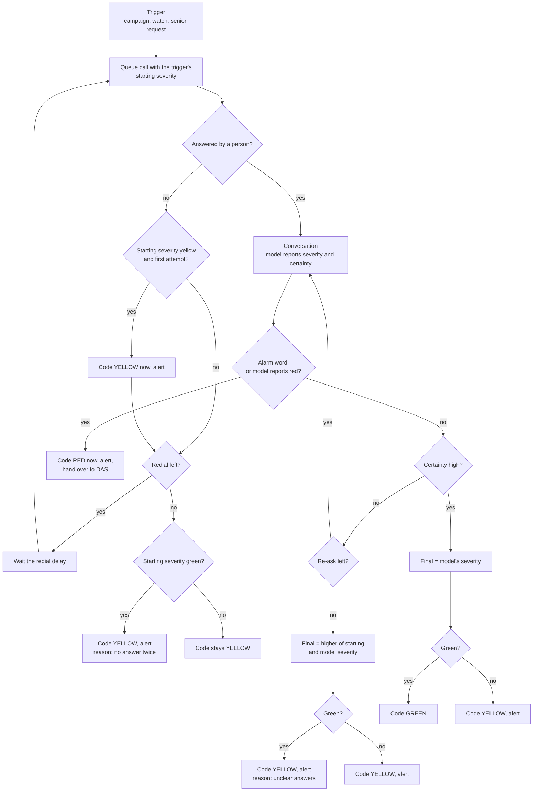
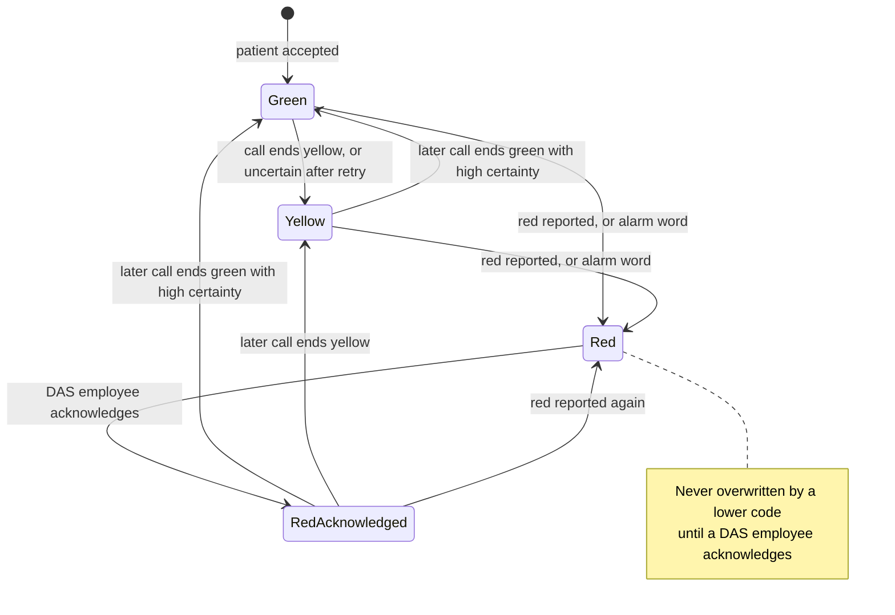
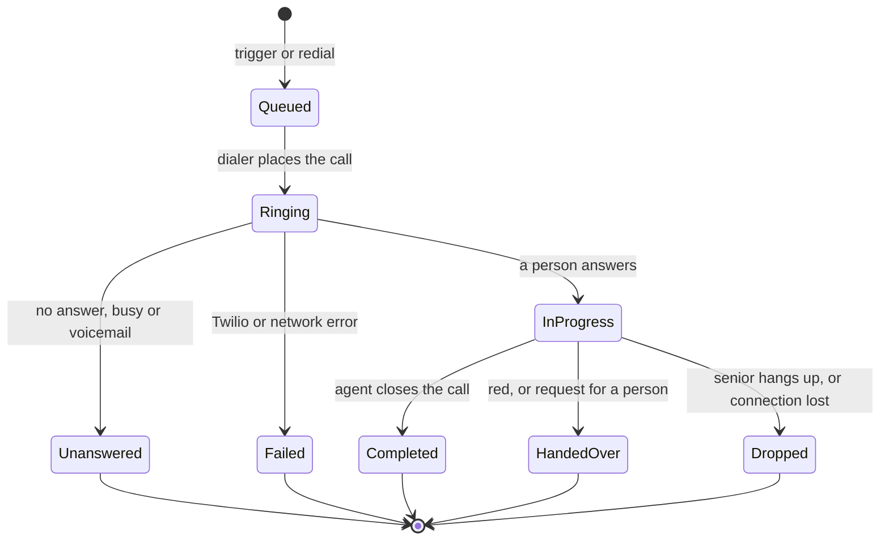

# 03 · Status model

Part of the [Sentinela specification](README.md). This file defines the three codes, the two axes behind them, and the fixed table that turns a call into actions.

## 1. The code

Every active senior has exactly one **code**: `green`, `yellow` or `red`. The caregiver, the medic and DAS all see the same code (D6). What differs per role is the reaction, in section 7.

A newly accepted senior starts at green **(proposed)**.

## 2. Two axes

| Axis | Values | Comes from |
|---|---|---|
| Severity | green, yellow, red | The trigger (starting severity), the model during a call, and the alarm-word check |
| Certainty | high, medium, low | The model, and only when a call was answered (D7) |

**Starting severity by trigger**

| Trigger | Starting severity |
|---|---|
| Weather campaign | green |
| Watch anomaly or watch button | yellow |
| Senior pressed "check on me" | yellow |
| Welcome call | none; a welcome call never changes the code |

**The starting severity is provisional (P8, proposed).** When a watch event arrives, the code does not change yet. It changes when the model reports during the call, when the call ends, or when the call goes unanswered. A pulse that rose on the stairs therefore never turns a card yellow or notifies anyone, provided the senior picks up and says so clearly. While the phone is ringing or the call is live, apps show a "call in progress" badge, which is not a code.

**Certainty when nobody answers (P1, proposed).** No answered call means no certainty from the model. That case is treated as `low`.

## 3. What the model reports

The model does not choose recipients and does not send alerts. It reports, through one tool, a severity, a certainty, a short reason and the senior's exact words. It may report more than once in a call; the engine keeps the **highest severity the model has reported in that call**.

**Severity guide given to the model** (from v3 §9.2)

| Severity | When |
|---|---|
| red | Signs of danger: unwell and also disoriented; unwell and without water or a cool place (a warm place in cold weather); anything that sounds like an emergency |
| yellow | One worrying answer on its own: unwell, wrong answer to the orientation question, no water or cool place |
| green | Feels fine, oriented, has water and a cool place |

**Certainty guide given to the model**

| Certainty | When |
|---|---|
| high | All three questions were answered and each answer was clear |
| medium | One answer was vague, contradictory or needed re-asking |
| low | Two or more answers were unclear, or the person was barely responsive or hard to understand |

**The three questions** the conversation must cover: how the person feels right now; what day of the week it is; whether they have water and a cool place (a warm place during cold warnings).

## 4. The alarm-word check (P4, proposed)

Before a transcribed sentence reaches the model, the server compares it with a fixed list: „am căzut”, „durere în piept”, „nu pot respira”, „leșin”. A match forces red immediately, whatever the model says. This is a plain text match and is the one severity source that does not depend on the model.

## 5. The matrix

The server looks up the action from the pair (severity, certainty). This is the hand-drawn "Coduri" grid, with "retry" given an exit.

| Severity ↓ / Certainty → | High | Medium | Low, or nobody answered |
|---|---|---|---|
| **Green** | Close the call. Code green | Retry once. If still not high: code yellow | Retry once. If still not high: code yellow |
| **Yellow** | Code yellow, alert | Code yellow, alert, retry once | Code yellow, alert, retry once |
| **Red** | Code red, alert, hand over to a person | Same | Same |

**What "retry" means (P2, proposed)**

| Situation | Retry is |
|---|---|
| The call was answered | The agent re-asks the unclear question once, more slowly |
| Nobody answered | One redial after the redial delay |

Each call gets one retry of each kind at most. An uncertain green that survives its retry becomes yellow: unclear never counts as fine.

**What "alert" means.** A change of code into yellow or red, with the pushes listed in section 7. The red column ignores certainty by design.

## 6. Combining the sources

The final severity of a call is decided when the call ends or goes unanswered for the last time.

| Case | Final severity |
|---|---|
| Alarm word at any point | red |
| Answered, final certainty high | The highest severity the model reported in that call **(P3, proposed)**. This is how a clear "sunt bine, am urcat scările" cancels a watch trigger's starting yellow |
| Answered, final certainty medium or low after the re-ask | The higher of the starting severity and the model's severity. If that is green, yellow |
| Never answered, redial used up | The starting severity. If that is green, yellow |
| Senior hung up early, or the connection dropped | Treated as answered with low certainty |
| Senior asked for a person, or pressed 9 | Hand over; at least yellow |

Two orderings matter:

- **Red acts immediately.** The moment red is reported or an alarm word matches, the code becomes red, pushes go out and the hand-over starts. Nothing waits for the end of the call.
- **A trigger's yellow acts on the first unanswered attempt.** A watch or manual trigger whose first call is not answered sets the code to yellow and alerts at once, then redials. A campaign's green waits for the redial before becoming yellow.

The diagram shows where the final code is settled. A yellow that the model reports takes effect at the moment of the report, as the matrix says, and from then on that call can only stay yellow or become red.

## 7. Reaction per role

The code is shared; the reaction is fixed per role and per code. Nothing here is chosen per call.

| Code | Caregiver | Medic | DAS |
|---|---|---|---|
| Green | Shown | Shown | Shown |
| Yellow | Push **(P5, proposed: no timer, no follow-up)** | Warning in the app, no push (D5) | Shown |
| Red | Push | Push (D5) | Senior moves to the top of the red-first list with an audible cue in the dashboard; a connected call is handed to the on-duty phone (D8) |

Pushes go to every device where the account is signed in. Nothing in the flow waits for the medic or the caregiver to react.

## 8. Lifecycle of a code

Rules **(P9, proposed)**:

- A yellow is replaced by the result of the next wellbeing call.
- A red stays red until a DAS employee acknowledges it. A later call cannot lower it before that.
- An acknowledged red is still displayed as red, marked as seen, until the next wellbeing call produces a new result.
- Campaigns skip seniors whose red is not yet acknowledged; DAS is already dealing with them.

## 9. Lifecycle of a call

Each attempt is its own call record. A redial creates a new record that points to the previous attempt.

| End state | Counts as |
|---|---|
| Completed | Answered, with the certainty the model last reported |
| HandedOver | Answered; code already set when the hand-over began |
| Dropped | Answered with low certainty |
| Unanswered, Failed | Nobody answered |

## 10. Worked examples

| # | Trigger | What happens | Outcome |
|---|---|---|---|
| 1 | Campaign | Answers clearly: fine, names the day, has water | Green, high. Code green, nobody notified |
| 2 | Campaign | „Cam amețită”; other answers fine and clear | Yellow, high. Code yellow, caregiver push, medic warning |
| 3 | Campaign | Vague answers, still vague after the re-ask, nothing worrying said | Green, low. Code yellow, reason "unclear answers" |
| 4 | Campaign | Unwell and cannot say what day it is | Red. Code red, pushes, hand-over |
| 5 | Any | Says „am căzut” | Alarm word. Red at once, before the model sees the sentence |
| 6 | Watch | Answers „am urcat scările, sunt bine”, clear on all three questions | Starting yellow, model green and high. Code stays green, nobody notified |
| 7 | Watch | First call not answered | Code yellow and caregiver push at once; one redial |
| 8 | Campaign | Two calls not answered | Code yellow after the second, reason "no answer twice" |
| 9 | Any | Presses 9 or asks for a person | Hand-over; code at least yellow |
| 10 | Campaign | Senior's red from this morning is not acknowledged | No call is placed |

## 11. What is not in the model

- No blue "task" status and no white "unclear" status (D6). Unclear outcomes become yellow.
- No timer on yellow and no automated call to the caregiver (P5).
- No comparison with previous days.
- No risk score; a campaign calls active seniors in a plain order.
