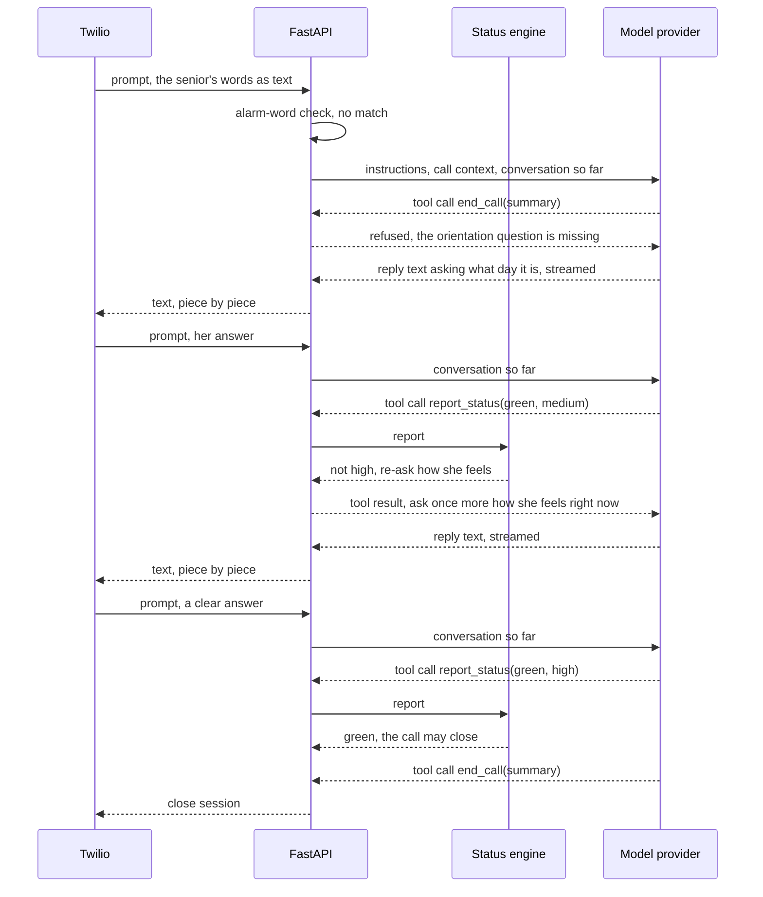

# 04 · Interfaces

Part of the [Sentinela specification](README.md). This file lists every interface between parts: what it is called, who may use it, what goes in and what comes out. Channel numbers refer to [01-architecture.md](01-architecture.md) section 4.

Names and addresses are indicative. They fix the shape of each interface, not its final spelling.

## 0. Conventions

- **Format.** JSON everywhere except the phone network.
- **Ids.** Unique ids are generated by whoever creates the thing: the database for rows, the watch for its events.
- **Time.** UTC. The watch sends the time a reading was taken; FastAPI adds the time it arrived.
- **Repeat-safe.** Every command and every watch message can be sent twice without a second effect. Commands that queue a call return the existing call if one is already queued or live for that senior.
- **Refusals.** A refused command says why in a short machine-readable reason: not signed in, not allowed, not found, wrong state, already done.

## 1. Apps ↔ SQL Connect (channel 2)

Queries and mutations are defined once in SQL Connect; the Android app and the dashboard call them through generated libraries. Each has its own permission rule. No operation is available to a signed-out caller, and an account without a role can run none of them.

### Queries

| Query | Who may run it | Returns | Refresh |
|---|---|---|---|
| ListSeniors | Medic: seniors they registered, drafts included. Caregiver: seniors linked to them. Senior: themselves. DAS: seniors that are submitted or active | Per senior: name, form of address, enrollment state, code, reason, since when, acknowledged or not, call in progress or not. For caregiver and medic also the watch state | Timed |
| GetSenior | Same scoping | Registration details, caregivers, current code. For caregiver and medic also the watch | Timed |
| ListCalls | Same scoping | Per call: time, trigger, final severity and certainty, reason, summary | Timed |
| GetCallTranscript | Medic for their own seniors; DAS | The turns and status reports of one call | When opened |
| ListEnrollmentRequests | DAS | Seniors in `submitted` | Timed |
| ListDasEmployees | DAS | Name, hand-over phone, on duty or not | Timed |
| GetMyProfile | Any account with a role | Role and display name | When opened |

"Timed" means the query is subscribed with a refresh interval (P6). The interval is a setting; see [06-operations.md](06-operations.md) section 3.

### Mutations

| Mutation | Who may run it | Effect |
|---|---|---|
| SaveSeniorDraft | Medic | Creates or updates a senior in `draft`, owned by that medic |
| SaveConsent | Medic, own senior | Stores the signature and the time |
| CreateInvite | Medic, own senior | Creates an invite for a `caregiver` or a `senior`; returns its id, which the tablet shows as a QR |
| SubmitEnrollment | Medic, own senior in `draft` with consent saved | `draft` → `submitted` |
| AcknowledgeRed | DAS | Sets who acknowledged and when on a senior's current red. Touches no other field |
| SaveDasEmployee | DAS | Adds or edits a name and hand-over phone |
| SetOnDuty | DAS | Marks one employee on duty and clears the flag on all others **(P10, proposed)** |
| SavePushToken | Any account with a role | Stores this device's push token for the account |
| RemovePushToken | Any account with a role | Removes it on sign-out |

No mutation can write a code, a call, a transcript or a watch event.

## 2. Apps → FastAPI: commands (channel 3)

Every command carries the caller's identity token. FastAPI checks it and reads the role from it.

| Command | Indicative address | Who | Input | Effect | Refused when |
|---|---|---|---|---|---|
| Redeem invite | `POST /invites/{inviteId}/redeem` | A signed-in account with no role | None beyond the address | Creates the account's row, sets its role from the invite, links it to the senior, marks the invite used | The invite is unknown, used or expired; the account already has a role |
| Pair watch | `POST /seniors/{seniorId}/watch` | Medic, own senior | The pairing code | Binds the pending device to the senior, replacing any previous watch | The code is unknown or expired |
| Accept patient | `POST /seniors/{seniorId}/accept` | DAS | None | `submitted` → `active`; creates the code as green; queues the welcome call | The senior is not `submitted` |
| Start campaign | `POST /campaigns` | DAS | Kind (heat or cold), warning level (yellow or red) | Creates the campaign; queues one wellbeing call per active senior, skipping unacknowledged reds and seniors with a call already queued or live. Kind and level are used in the greeting | Never, for a DAS caller |
| Check on me | `POST /me/check-on-me` | Senior | None | Records a `manual_request` event; queues a wellbeing call with starting severity yellow | Never; returns the existing call if one is queued or live |

A command answers as soon as the work is queued. Results show up through the queries in section 1.

## 3. Watch → FastAPI (channel 4)

| Request | Indicative address | Proof | Input | Output |
|---|---|---|---|---|
| Request pairing | `POST /watch/pairings` | None; the device is new | Device model | Device id, short code, when the code expires, a one-time polling secret |
| Poll pairing | `GET /watch/pairings/{deviceId}` | The polling secret | None | "Pending", or "bound" with the device token |
| Send event | `POST /watch/events` | Device token | Event id generated on the watch, type (`high_pulse_at_rest` or `sos_button`), time measured, snapshot (pulse, resting baseline, moving or not, battery) | Recorded; whether a call was queued |
| Send check-in | `POST /watch/check-ins` | Device token | Time measured, battery, worn or not, last pulse | Recorded |

**Intake rules**

| Rule | Behaviour |
|---|---|
| Duplicates | An event id seen before is acknowledged and ignored |
| Cooldown | While a call is queued or live for the senior, or within the cooldown after one ended, a new event is attached to that call and starts no second call |
| Stale events | An event measured longer ago than the stale limit is recorded and starts no call **(proposed)** |
| Unbound device | A device token whose device was replaced is refused; the watch returns to pairing |

## 4. FastAPI ↔ Twilio (channels 6, 7, 8)

The telephony design is v3 §7 and §12, unchanged. Exact parameter and field names are to be confirmed against Twilio's documentation at implementation, as v3 notes.

### 4.1 Placing a call (channel 6)

FastAPI asks Twilio's Voice API to place a call with:

| Parameter | Value |
|---|---|
| To | The senior's phone number |
| From | The project's Twilio number |
| Answer callback | FastAPI's answer address, carrying the call id |
| Status callback | FastAPI's status address |
| Voicemail detection | On, in the background, reporting to its own callback |
| Ring time limit | A fixed number of seconds |

### 4.2 Callbacks (channel 7)

All are signed by Twilio and verified by FastAPI.

| Callback | Indicative address | Twilio calls it when | FastAPI answers with |
|---|---|---|---|
| Answer | `POST /voice/answer` | The call is picked up | Instructions to connect the call to ConversationRelay: the WebSocket address, language `ro-RO`, the voice, the greeting text, and the hand-over address |
| Status | `POST /voice/status` | The call rings, is answered, completes, is not answered, is busy, or fails | Nothing. Updates the call record; an unanswered or failed result goes to the status engine |
| Voicemail detection | `POST /voice/amd` | Detection finishes, shortly after pickup | Nothing. If a machine answered, FastAPI ends the call and counts it as unanswered |
| Hand-over | `POST /voice/handoff` | The relay session was closed with hand-over data | Instructions to dial the on-duty number with a ring time limit and the result address. If nobody is on duty: a spoken message, then hang up |
| Hand-over result | `POST /voice/handoff-result` | The dial to DAS finished | If DAS did not answer: a spoken message that someone will call back, then hang up |

**The greeting** is built per call from the senior's form of address, the trigger and, for campaigns, the warning. Example for a campaign, from v3: „Bună ziua, doamna Maria. Sunt asistentul DAS Timișoara. Vă sun pentru că azi e cod roșu de caniculă. Nu vă cer niciodată bani sau date. Cum vă simțiți azi?”

### 4.3 WebSocket messages (channel 8)

One WebSocket per live call. FastAPI never receives or sends audio.

| Direction | Message | Meaning | FastAPI's reaction |
|---|---|---|---|
| Twilio → FastAPI | `setup` | Session opened; carries Twilio's call id | Binds the session to the call record and loads the senior's context |
| Twilio → FastAPI | `prompt` | What the senior said, as text | Stores the turn, runs the alarm-word check, then passes the conversation to the model |
| Twilio → FastAPI | `dtmf` | A key was pressed | Key 9 starts a hand-over |
| Twilio → FastAPI | `interrupt` | The senior spoke over the agent | Stops sending the current reply and records how much of it was heard |
| Twilio → FastAPI | `error` | A problem on Twilio's side | Logged; if the session cannot continue, the call counts as dropped |
| FastAPI → Twilio | `text` | A piece of the agent's reply; the last piece is flagged | n/a |
| FastAPI → Twilio | `end` | Close the session, optionally with hand-over data | n/a |

### 4.4 Hand-over, step by step

1. FastAPI sends a last `text` telling the senior they are being connected.
2. FastAPI sends `end` with hand-over data (the call id and the reason).
3. Twilio calls the hand-over callback.
4. FastAPI looks up the on-duty employee and answers with a dial instruction to that number.
5. Twilio rings the number and, on answer, connects the two parties.
6. When the dial finishes, Twilio calls the hand-over result callback.

## 5. FastAPI ↔ model provider (channel 9)

**The provider is not chosen.** Requirements: output that streams as it is generated, tool calls, natural Romanian, and a short wait before the first word. A sensible starting point is a small, fast model such as Claude Haiku 4.5; judge candidates on a real test call in Romanian for naturalness and time to first word.

### What the model is given on every turn

| Part | Content |
|---|---|
| Fixed instructions | Who it is (the DAS Timișoara phone assistant), tone (warm, slow, simple Romanian, at most two short sentences), the three questions to cover, the severity and certainty guides from [03-status-model.md](03-status-model.md) section 3, and the limits below |
| Call context | The senior's form of address, the trigger and why the call is happening, the kind of weather warning, whether this is a welcome call |
| Conversation | Everything said so far, including how much of an interrupted reply was heard |
| Tool results | What the server answered to each tool call |

**Limits written into the instructions** (from v3 §8.6): no medical advice beyond water, shade and rest; no promises; never ask for money, codes or personal data; ask for confirmation when an answer is ambiguous; if the person asks for a human, request a hand-over.

### Tools

| Tool | Input | Meaning | Server's rule |
|---|---|---|---|
| `report_status` | Severity, certainty, a short reason, the senior's exact words | "This is my current reading of the situation" | Stored as a status report. The status engine applies the matrix. Red acts immediately. If certainty is not high and the re-ask is unused, the tool result tells the agent which question to ask again |
| `request_human` | A short reason | "The senior asked for a person" | Starts a hand-over. The code becomes at least yellow |
| `end_call` | A one-sentence summary | "The conversation is finished" | Refused until a status has been reported after all three questions, or the call length limit is reached. A refusal names the missing question |

In a welcome call the model has `request_human` and `end_call` only. `end_call` then also carries whether the senior confirmed the number, and is not subject to the three-question rule.

### One conversation, as messages

The exchange below shows the three interfaces working together: Twilio's messages (channel 8), the model's tool calls (channel 9), and the status engine's answers. It includes a refused `end_call` and one re-ask.

### What the server enforces regardless of the model

| Rule | Effect |
|---|---|
| Alarm words | Checked on every `prompt` before the model sees it. A match forces red and starts the hand-over |
| Key 9 | Starts a hand-over at any time |
| Call length limit | At the limit the call is closed and its last reported status is final |
| Severity never falls within a call | The engine keeps the highest severity the model has reported in that call |
| Recipients | Chosen by the server from the code; the model has no tool that notifies anyone |

## 6. FastAPI → Firebase push → Android app (channel 5)

| Field | Content |
|---|---|
| Title | „Sentinela” |
| Text | Generic: „O persoană pe care o urmăriți are nevoie de atenție.” |
| Data | Type `code_changed`, and the senior's id |

The message carries no name, no code and no reason **(P18, proposed)**. Tapping it opens the senior's page, where the app reads the code through SQL Connect.

| Change of code | Push goes to |
|---|---|
| Into yellow | The senior's caregivers |
| Into red | The senior's caregivers and medic |
| Into green | Nobody |

A push goes to every device token stored for the account. A token that Firebase reports as invalid is removed.

## 7. FastAPI → Firebase sign-in (channel 12)

| Use | When |
|---|---|
| Check an identity token and read its role | On every command |
| Set a role on an account | When an invite is redeemed |
| Create accounts with the `das` or `medic` role | In the setup script, before the event (P13) |
