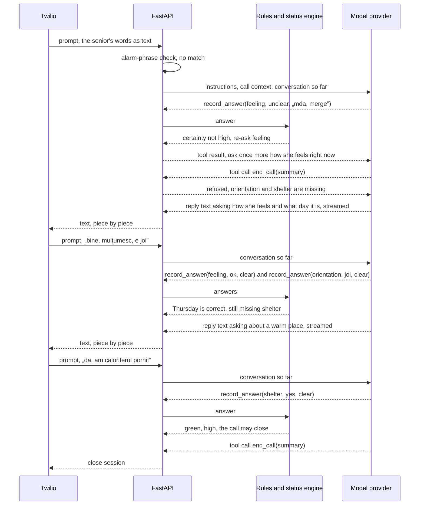

# 04 · Interfaces

Part of the [Sentinela specification](README.md). This file lists every interface between parts: what it is called, who may use it, what goes in and what comes out. Channel numbers refer to [01-architecture.md](01-architecture.md) section 4.

Names and addresses are indicative. They fix the shape of each interface, not its final spelling.

## 0. Conventions

- **Format.** JSON everywhere except the phone network.
- **Identity.** Every request from the Android app or the dashboard carries its Firebase identity token. FastAPI verifies it, reads the phone number and loads the caller's grants. A request without a valid token is refused.
- **One API for every client.** The dashboard uses the same endpoints as the Android app. Browser requests are accepted only from the dashboard's own address.
- **Phone numbers.** Normalized to the international format (+40…) on every write and every lookup.
- **Ids.** Unique ids are generated by whoever creates the thing: the database for rows, the watch or the phone app for events.
- **Time.** UTC. Devices send the time a reading was taken; FastAPI adds the time it arrived.
- **Repeat-safe.** Every command and every event can be sent twice without a second effect. Commands that queue a call return the existing call if one is already queued or live for that senior.
- **Refusals.** A refused request says why in a short machine-readable reason: not signed in, not allowed, not found, wrong state, already done.

## 1. Apps → FastAPI: reads (channel 3)

Each read is scoped by the caller's grants as in [01-architecture.md](01-architecture.md) section 6.

| Read | Indicative address | Who | Returns |
|---|---|---|---|
| My profile | `GET /me` | Any signed-in number | Display name and grants (role, and the senior for caregiver and senior grants). Whether a warning is active |
| Seniors | `GET /seniors` | Medic: seniors they registered, drafts included. Caregiver: seniors linked to them. Senior: themselves. DAS: seniors submitted or further along | Per senior: name, form of address, enrollment state, code, reason, since when, acknowledged or not, call in progress or not. For caregiver and medic also the watch state |
| One senior | `GET /seniors/{id}` | Same scoping | Registration details, address and access details, landline or not, caregivers, current code, consent state, latest event location (caregiver and DAS). For caregiver and medic also the watch |
| Calls | `GET /seniors/{id}/calls` | Same scoping | Per call: time, trigger, final severity and certainty, reason, summary |
| Transcript | `GET /calls/{id}/transcript` | Medic for their own seniors; DAS | The turns, answers and status reports of one call |
| Incidents | `GET /incidents?status=open,in_progress` | DAS | Per incident: senior's name and form of address, status, who took it and when, reason, when it opened, whether the hand-over was answered. The DAS app asks for open and in progress; the dashboard for any status |
| One incident | `GET /incidents/{id}` | DAS | The incident, the senior's full data with address and access details and landline or not, the location from the triggering event if any, the calls with their transcripts, the caregivers' names and numbers |
| Enrollment requests | `GET /enrollments` | DAS | Seniors in `submitted` |
| Staff | `GET /staff` | DAS | DAS employees and medics: name, phone, practice, on duty or not |

## 2. Apps → FastAPI: data entry and commands (channel 3)

A command answers as soon as its work is stored or queued. Results show up through the reads in section 1, prompted by a refresh push.

| Request | Indicative address | Who | Effect | Refused when |
|---|---|---|---|---|
| Grant staff | `POST /staff` | DAS | Creates the user row and a `medic` or `das` grant for the number | The number already has that grant |
| Set on duty | `PUT /staff/on-duty` | DAS | Marks one DAS employee on duty and clears all others **(P10, proposed)** | The person is not a DAS employee |
| Save senior draft | `POST /seniors`, `PUT /seniors/{id}` | Medic, own senior | Creates or updates a senior in `draft`. A mobile number for the senior creates the senior grant | The senior is past `draft` |
| Add or remove a caregiver | `POST /seniors/{id}/caregivers`, `DELETE /seniors/{id}/caregivers/{userId}` | Medic, own senior | Creates or removes the caregiver grant. On add, sends the notice SMS **(proposed)** | n/a |
| Save signature | `POST /seniors/{id}/signature` | Medic, own senior | Stores the strokes as a consent record with method `signature` (optional, G7) | n/a |
| Submit enrollment | `POST /seniors/{id}/submit` | Medic, own senior | `draft` → `submitted` | Not in `draft`, or required fields missing |
| Accept patient | `POST /seniors/{id}/accept` | DAS | `submitted` → `accepted`; queues the welcome call | Not `submitted` |
| Call again | `POST /seniors/{id}/welcome-call` | Medic, own senior | Queues a new welcome call after a corrected number or an `unreachable` | Not `wrong_number` or `unreachable` |
| Record withdrawal | `POST /seniors/{id}/consent-withdrawn` | Medic, own senior | Adds a consent record `withdrawn`; the senior leaves campaigns | The senior is not `active` |
| Take an incident | `POST /incidents/{id}/take` | DAS | `open` → `in_progress`, with who and when. Changes nothing else | Not `open`; the refusal names who has it |
| Resolve an incident | `POST /incidents/{id}/resolve` | DAS | Outcome (`senior_ok`, `team_sent`, `called_112`, `not_reached`, `false_alarm`) and a short note. `in_progress` → `resolved`. The code is unchanged; the senior returns to campaigns | Not `in_progress` |
| Start campaign | `POST /campaigns` | DAS | Kind (heat or cold), warning level (yellow or red). Creates the campaign and its active-warning period; queues one wellbeing call per active senior, skipping seniors with an open or in-progress incident and seniors with a call already queued or live | Never, for a DAS caller |
| Save push token | `PUT /me/push-tokens/{token}`, `DELETE …` | Any signed-in number | Stores or removes this device's push token | n/a |

## 3. Senior's phone app → FastAPI, and the watch (channels 1 and 3)

### Watch ↔ phone app (Wear OS Data Layer)

| Message | Direction | Content |
|---|---|---|
| Event | Watch → phone | Event id generated on the watch, type (`high_pulse_at_rest`, `inactivity`, `sos_button`), time measured, snapshot (pulse, resting baseline, moving or not, minutes without steps, battery) |
| Check-in | Watch → phone | Time measured, battery, worn or not, last pulse |
| Received | Phone → watch | The event id, once FastAPI has recorded it. Until then the watch keeps the event and sends it again |

### Phone app → FastAPI

| Request | Indicative address | Who | Input | Output |
|---|---|---|---|---|
| Send event | `POST /me/events` | Senior | Event id, type (the watch's types, or `manual_request` for "Sunați-mă"), time measured, snapshot if any, last known location (latitude, longitude, accuracy, when) if the app has one | Recorded; whether a call was queued; the existing call if one was |
| Send check-in | `POST /me/check-ins` | Senior | The watch's check-in, as relayed | Recorded |

**Intake rules**

| Rule | Behaviour |
|---|---|
| Duplicates | An event id seen before is acknowledged and ignored |
| Cooldown | While a call is queued or live for the senior, or within the cooldown after one ended, a new event is attached to that call and starts no second call |
| Stale events | An event measured longer ago than the stale limit is recorded and starts no call **(proposed)** |
| Inactivity outside a warning | An `inactivity` event while no warning is active is recorded and starts no call (G14) |
| Not active | An event for a senior who is not `active` is recorded and starts no call |

## 4. FastAPI ↔ Twilio (channels 5, 6, 7)

The wellbeing-call design is v3 §7 and §12. Exact parameter and field names are to be confirmed against Twilio's documentation at implementation, as v3 notes.

### 4.1 Placing a call (channel 5)

FastAPI asks Twilio's Voice API to place a call with:

| Parameter | Value |
|---|---|
| To | The senior's phone number |
| From | The project's Twilio number |
| Answer callback | The welcome-call address or the wellbeing answer address, carrying the call id |
| Status callback | FastAPI's status address |
| Voicemail detection | On, in the background, reporting to its own callback |
| Ring time limit | A fixed number of seconds |

### 4.2 Callbacks (channel 6)

All are signed by Twilio and verified by FastAPI.

| Callback | Indicative address | Twilio calls it when | FastAPI answers with |
|---|---|---|---|
| Wellbeing answer | `POST /voice/answer` | A wellbeing call is picked up | Instructions to connect the call to ConversationRelay: the WebSocket address, language `ro-RO`, the voice, the greeting text, and the hand-over address |
| Welcome answer | `POST /voice/welcome` | A welcome call is picked up | The identity question, accepting keys and speech (`<Gather>`) |
| Welcome identity | `POST /voice/welcome/identity` | The identity question has an answer, or timed out | The consent text and question, a polite goodbye, or a repeat |
| Welcome consent | `POST /voice/welcome/consent` | The consent question has an answer, or timed out | The anti-scam close, a repeat, or a goodbye. Records the consent with the key or words, Twilio's confidence and the consent text version |
| Status | `POST /voice/status` | The call rings, is answered, completes, is not answered, is busy, or fails | Nothing. Updates the call record; an unanswered or failed result goes to the status engine |
| Voicemail detection | `POST /voice/amd` | Detection finishes, shortly after pickup | Nothing. If a machine answered, FastAPI ends the call and counts it as unanswered |
| Hand-over | `POST /voice/handoff` | The relay session was closed with hand-over data | Instructions to dial the on-duty number with a ring time limit and the result address. If nobody is on duty: a spoken message, then hang up |
| Hand-over answered | `POST /voice/handoff-answered` | The on-duty phone picked up | Nothing to say; connect. Marks the incident `in_progress`, taken by the on-duty employee, and sets the call's `handover_answered` |
| Hand-over result | `POST /voice/handoff-result` | The dial to DAS finished | If DAS did not answer: a spoken message that someone will call back, then hang up |

**The greeting** is built per call from the senior's form of address, the trigger and, for campaigns, the warning. Example for a cold campaign: „Bună ziua, doamna Maria. Sunt asistentul DAS Timișoara. Vă sun pentru că azi e cod roșu de ger. Nu vă cer niciodată bani sau date. Cum vă simțiți azi?”

**The welcome call's wording** is in [02-use-cases.md](02-use-cases.md) UC-04. The consent text carries a version, stored with every consent record.

### 4.3 WebSocket messages (channel 7)

One WebSocket per live wellbeing call. FastAPI never receives or sends audio.

| Direction | Message | Meaning | FastAPI's reaction |
|---|---|---|---|
| Twilio → FastAPI | `setup` | Session opened; carries Twilio's call id | Binds the session to the call record and loads the senior's context |
| Twilio → FastAPI | `prompt` | What the senior said, as text | Stores the turn and checks alarm phrases. Tier 1: red and hand-over. Tier 2: sends the confirmation question and waits for its reply. Otherwise, or after a clear "no", passes the conversation to the model |
| Twilio → FastAPI | `dtmf` | A key was pressed | Key 9 starts a hand-over. During a tier 2 confirmation, 1 means yes and 2 means no |
| Twilio → FastAPI | `interrupt` | The senior spoke over the agent | Stops sending the current reply and records how much of it was heard |
| Twilio → FastAPI | `error` | A problem on Twilio's side | Logged; if the session cannot continue, the call counts as dropped |
| FastAPI → Twilio | `text` | A piece of the agent's reply, or a fixed sentence; the last piece is flagged | n/a |
| FastAPI → Twilio | `end` | Close the session, optionally with hand-over data | n/a |

### 4.4 Hand-over, step by step

1. FastAPI sends a last `text` telling the senior they are being connected.
2. FastAPI sends `end` with hand-over data (the call id and the reason).
3. Twilio calls the hand-over callback.
4. FastAPI looks up the on-duty DAS employee's phone and answers with a dial instruction to that number.
5. Twilio rings the number and, on answer, tells FastAPI that the dialed number answered (Twilio's on-answer hook for a dialed number; exact mechanism to confirm in its documentation). FastAPI marks the incident `in_progress`, taken by the on-duty employee, and Twilio connects the two parties.
6. When the dial finishes, Twilio calls the hand-over result callback.

### 4.5 Caregiver notice SMS (channel 5, proposed)

When a medic adds a caregiver, FastAPI sends one SMS from the project's number: „Ați fost adăugat ca aparținător pentru [form of address] în Sentinela. Instalați aplicația și intrați cu acest număr.” It carries no health details. It depends on spike S10; without it, the caregiver signs in on the spot.

## 5. FastAPI ↔ model provider (channel 8)

**The provider is not chosen.** Requirements: output that streams as it is generated, tool calls, natural Romanian, and a short wait before the first word. A sensible starting point is a small, fast model such as Claude Haiku 5.5; judge candidates on a real test call in Romanian for naturalness and time to first word (spike S4).

### What the model is given on every turn

| Part | Content |
|---|---|
| Fixed instructions | Who it is (the DAS Timișoara phone assistant), tone (warm, slow, simple Romanian, at most two short sentences), the three questions to cover, how to record answers and when an answer counts as clear, when to raise a concern, and the limits below |
| Call context | The senior's form of address, the trigger and why the call is happening, the kind of weather warning (heat or cold) |
| Conversation | Everything said so far, including how much of an interrupted reply was heard |
| Tool results | What the server answered to each tool call |

**Limits written into the instructions** (from v3 §8.6): no medical advice beyond water, shade or warmth, and rest; no promises; never ask for money, codes or personal data; ask for confirmation when an answer is ambiguous; if the person asks for a human, request a hand-over.

### Tools

| Tool | Input | Meaning | Server's rule |
|---|---|---|---|
| `record_answer` | Field (`feeling`, `orientation`, `shelter`), value, clear or not, the senior's exact words | "This is what they said about this question" | Stored as an answer. The rules recompute severity and certainty ([03-status-model.md](03-status-model.md) section 3). A clear answer cannot be overwritten. Red acts immediately. If certainty is not high and the re-ask is unused, the tool result names the question to ask again |
| `raise_concern` | Level (yellow or red), a short reason, the senior's exact words | "Something serious outside the three questions" | Raises the call's severity, never lowers it. Red acts immediately |
| `request_human` | A short reason | "The senior asked for a person" | Starts a hand-over. The code becomes at least yellow |
| `end_call` | A one-sentence summary | "The conversation is finished" | Refused until all three fields are recorded, or the call length limit is reached. A refusal names the missing question |

### One conversation, as messages

The exchange below shows the three interfaces working together: Twilio's messages (channel 7), the model's tool calls (channel 8), and the rules' answers. It includes a refused `end_call` and one re-ask.

### What the server enforces regardless of the model

| Rule | Effect |
|---|---|
| Alarm phrases | Checked on every `prompt` before the model sees it. Tier 1 forces red and starts the hand-over; tier 2 asks the fixed confirmation |
| Orientation | The server decides whether the named day is correct |
| Key 9 | Starts a hand-over at any time |
| Call length limit | At the limit the call is closed and the rules' last result is final |
| Severity never falls within a call | Clear answers cannot be overwritten; `raise_concern` only raises |
| Recipients | Chosen by the server from the code; the model has no tool that notifies anyone |

## 6. FastAPI → Firebase push → Android app (channel 4)

| Field | Alert | Refresh |
|---|---|---|
| Visible notification | Title „Sentinela”; text „O persoană pe care o urmăriți are nevoie de atenție.” | None |
| Data | Type `code_changed` (or `incident` for DAS), the senior's id, and the incident's id for DAS | Type `refresh`, what changed (`senior`, `incidents`), the senior's or incident's id |

Messages carry no name, no code and no reason **(P18, proposed)**. Tapping an alert opens the senior's page, or for DAS the incident, which the app reads from FastAPI.

Pushes go to Android devices only. The dashboard re-reads on a timer and receives none.

| Change | Alert goes to | Refresh goes to |
|---|---|---|
| Code into yellow | The senior's caregivers | The medic |
| Code into red, incident opened | The senior's caregivers, the medic, every DAS employee's phone | n/a |
| Incident taken or resolved | Nobody | Every DAS employee's phone |
| Code into green, a call starting or ending, a watch state change | Nobody | The senior's caregivers, the medic, the senior |
| A caregiver grant made or removed | Nobody | The medic |

A message goes to every device token stored for each recipient. A token that Firebase reports as invalid is removed.

## 7. FastAPI → Firebase sign-in (channel 11)

| Use | When |
|---|---|
| Verify an identity token and read its phone number | On every request from the Android app or the dashboard |

FastAPI never sets roles or claims in Firebase. Roles live in FastAPI's own grants. The setup script writes user rows and grants to the database only; the matching Firebase account is created the first time that number signs in.
