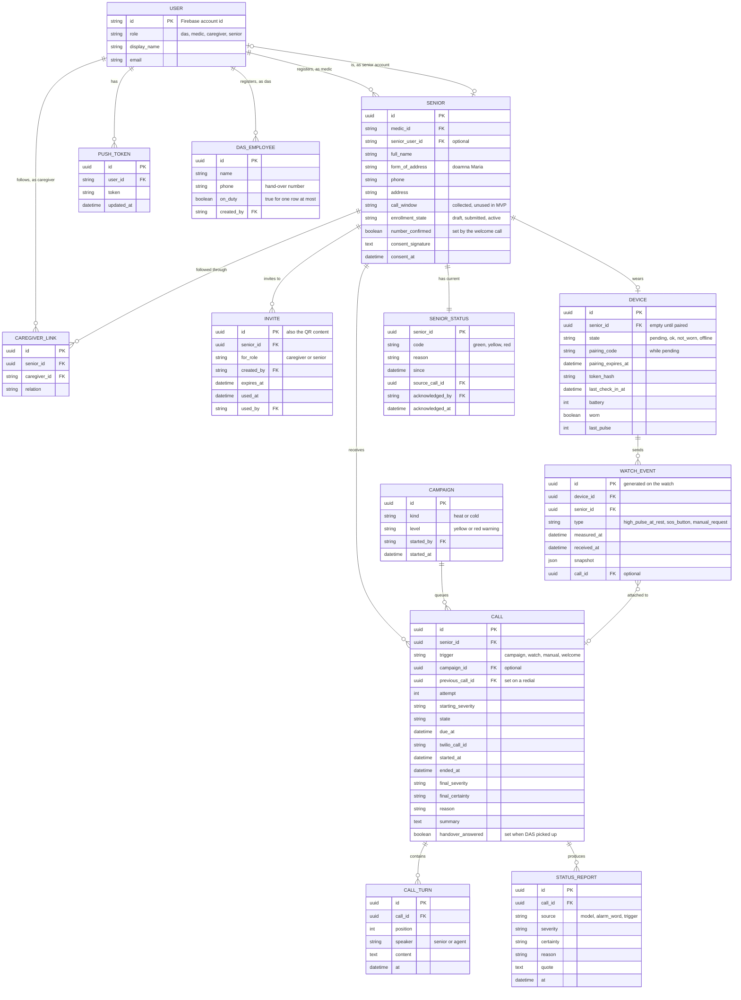

# 05 · Data model

Part of the [Sentinela specification](README.md). One PostgreSQL database holds everything. Its table definitions are owned by SQL Connect; FastAPI uses the same tables over a direct connection and never changes their structure.

Field lists are indicative: they show what each entity must carry, not final column names.

## 1. Entities and relationships

## 2. What each entity is for

| Entity | Purpose | Written by |
|---|---|---|
| User | One row per Firebase account, with its role | FastAPI |
| DasEmployee | A person at DAS who can receive hand-overs: a name, a phone number, and whether they are on duty. Separate from accounts, so a phone can be registered from the dashboard without creating a login (D8) | DAS dashboard, through SQL Connect |
| Senior | The enrolled person, their registration details, consent and enrollment state | Medic's app up to `submitted`; FastAPI sets `active` and `number_confirmed` |
| CaregiverLink | Which caregiver follows which senior | FastAPI, when an invite is redeemed |
| Invite | A single-use invitation; its id is what the QR encodes | Medic's app creates; FastAPI marks it used |
| Device | A watch, pending or bound to a senior, with its latest check-in | FastAPI |
| WatchEvent | An anomaly, a button press, or a "check on me" request | FastAPI |
| Campaign | One press of the weather-warning button | FastAPI |
| Call | One attempt to reach a senior, with its outcome. Also the scheduler's queue: a queued call with a due time is a pending timer | FastAPI |
| CallTurn | The transcript, one row per utterance | FastAPI |
| StatusReport | Every severity and certainty reported during a call, with its source and the senior's words. The audit trail behind a code | FastAPI |
| SeniorStatus | The current code, one row per senior, with its acknowledgement | FastAPI writes the code; a DAS employee writes the acknowledgement through SQL Connect |
| PushToken | Where to deliver pushes for an account, one row per device | Each app, through SQL Connect |

## 3. Notes on specific choices

**The current code is its own row.** Apps read `SeniorStatus` constantly and `Call` rarely. Keeping the code separate makes the most frequent query a single-row lookup, and makes "only FastAPI writes codes" a rule about one table.

**The acknowledgement lives beside the code but is a different field.** A DAS employee may write `acknowledged_by` and `acknowledged_at` and nothing else on that row. The SQL Connect mutation for acknowledging exposes only those two fields.

**The call table is the timer store.** Redials and campaign rounds are rows in `queued` state with a `due_at`. Nothing is held only in memory, so a restart of the FastAPI service picks up where it left off.

**"Check on me" is stored as a watch event without a device.** It enters the same path as a watch anomaly (D9), so it shares the entity, with type `manual_request` and an empty `device_id`.

**Only the latest check-in is kept (proposed).** Check-ins overwrite four fields on `Device`. There is no history of pulse readings; the system stores the minimum health data that serves its purpose.

**The consent signature is stored as text in the database (P15, proposed).** With document upload deferred, this avoids adding file storage for a single small image.

**The call window is collected and unused.** v3's registration form asks for it and campaigns will need it later; the MVP's single immediate round ignores it.

## 4. Retention

| Data | Kept | Reason |
|---|---|---|
| Audio | Never stored | Twilio handles speech; FastAPI receives text only |
| Transcripts and status reports | Kept | Medic and DAS review; audit of how a code was reached |
| Watch events | Kept | They explain why a call was placed |
| Check-ins | Latest only | Data minimisation |
| Used and expired invites | Kept, inert | Audit of who joined through which invite |
| Pending devices past their pairing window | Removed | They were never bound to anyone |

The demo uses fictitious people only. Retention periods for a real pilot are out of scope here and need a decision with DAS as data controller.
