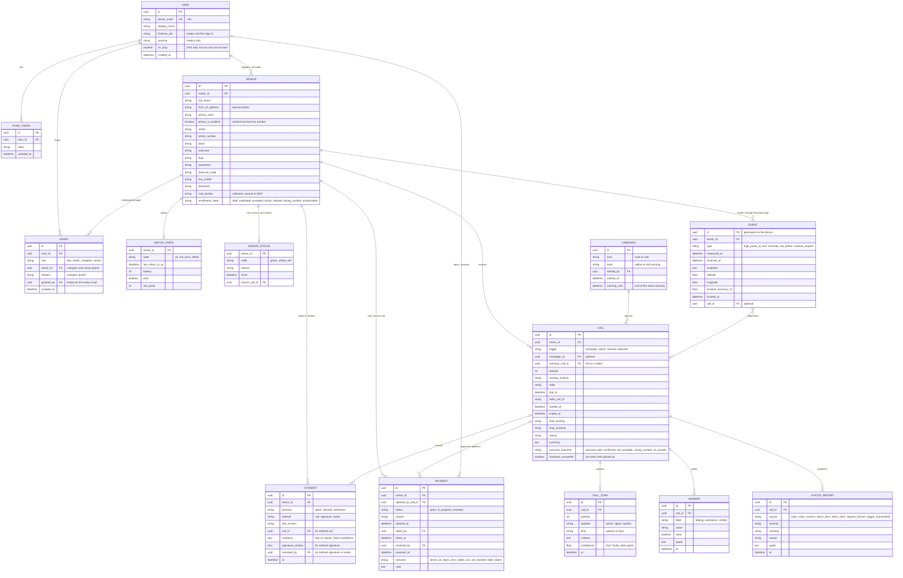

# 05 · Data model

Part of the [Sentinela specification](README.md). One PostgreSQL database holds everything, and only FastAPI reaches it (G2, G8). Tables are defined in FastAPI's models (SQLAlchemy 2) and changed through migrations (Alembic).

Field lists are indicative: they show what each entity must carry, not final column names.

## 1. Entities and relationships

## 2. What each entity is for

| Entity | Purpose |
|---|---|
| User | One row per phone number that has been granted anything. Created at grant time, before the person signs in; the Firebase account is attached at first sign-in. A DAS user's phone is also their hand-over number |
| Grant | One role for one user, and for caregiver and senior grants the senior it applies to. A user may hold several. Replaces the earlier role field, caregiver link and invite |
| Senior | The enrolled person, registration details, structured address and enrollment state |
| Consent | Every consent decision as a history: given or refused on the welcome call, an optional signature, a withdrawal recorded by the medic |
| WatchState | The watch's latest check-in, one row per senior |
| Event | A watch anomaly, a button press, or a "Sunați-mă" request, with the phone's last known location if it had one |
| Campaign | One press of the weather-warning button, and the active-warning period it opens |
| Call | One attempt to reach a senior, with its outcome. Also the scheduler's queue: a queued call with a due time is a pending timer |
| CallTurn | The transcript, one row per utterance or key press |
| Answer | What the model extracted for one of the three questions |
| StatusReport | Every severity reached during a call, with its source and the senior's words. The audit trail behind a code |
| SeniorStatus | The current code, one row per active senior |
| Incident | DAS's handling of one red: opened when the red is established, taken by a person, resolved with an outcome and a note (G16). A later red while it is still open is added to it, through the call |
| PushToken | Where to deliver pushes for a user, one row per device |

FastAPI writes every entity. Apps change data only through the endpoints in [04-interfaces.md](04-interfaces.md).

## 3. Constraints in the database

Several rules from the other files are enforced by the database itself, so they hold even if the code has a bug.

| Rule | Constraint |
|---|---|
| One person per phone number | Unique `user.phone_e164` |
| At most one DAS employee on duty (P10) | A unique index over `user` limited to rows where `on_duty` is true |
| Never two live calls for one senior | A unique index over `call.senior_id` limited to rows in `queued`, `ringing` or `in_progress`. A command that hits it returns the existing call |
| An event is processed once | `event.id` is the primary key; inserts ignore a duplicate |
| One grant per role and senior | Unique (`user_id`, `role`, `senior_id`) |
| One current code per senior | `senior_status.senior_id` is the primary key |
| At most one unresolved incident per senior | A unique index over `incident.senior_id` limited to rows in `open` or `in_progress` |
| An incident is taken once | Taking updates the row only where `status` is still `open`; a second taker changes nothing and is told who has it |

## 4. Notes on specific choices

**The user row exists before sign-in.** Signing in is a lookup by phone number that fills `firebase_uid` the first time. A number with no row is refused and nothing is stored.

**The current code is its own row.** Apps read `SeniorStatus` constantly and `Call` rarely. Keeping the code separate makes the most frequent read a single-row lookup.

**The call table is the timer store.** Redials, welcome-call retries and campaign calls are rows in `queued` state with a `due_at`. Nothing is held only in memory, so a restart of the FastAPI service picks up where it left off.

**"Sunați-mă" is stored as an event.** It enters the same path as a watch anomaly (D9), with type `manual_request`.

**The code and the incident are separate.** The code is what the rules concluded about the senior; the incident is what DAS did about it. Only the rules write the code; only DAS employees move an incident, apart from the automatic take when the hand-over is answered.

**Answers and status reports are separate.** An answer is what the senior said; a status report is what the rules concluded from it. Both are kept, so a code can be explained from the senior's words.

**Consent is a history, not a field.** A withdrawal is a new row, and the text version shows exactly what was agreed to.

**Only the latest check-in is kept (proposed).** There is no history of pulse readings; the system stores the minimum health data that serves its purpose.

**Location is stored only with an event.** There is no location history apart from the moments the senior's phone reported an event.

**The call window is collected and unused.** v3's registration form asks for it and campaigns will need it later; the MVP's single immediate round ignores it.

**Risk factors are not stored.** Open question 5 in the README.

## 5. Retention

| Data | Kept | Reason |
|---|---|---|
| Audio | Never stored | Twilio handles speech; FastAPI receives text only |
| Transcripts, answers and status reports | Kept | Medic and DAS review; audit of how a code was reached |
| Consent records | Kept | Proof of what was agreed and when |
| Incidents | Kept | What DAS did about each red, by whom, and the outcome |
| Events, with any location | Kept | They explain why a call was placed and where the senior was |
| Check-ins | Latest only | Data minimisation |
| Grants | Removed when revoked | A removed caregiver loses access at once |

The demo uses fictitious people only. Retention periods for a real pilot are out of scope here and need a decision with DAS as data controller.
