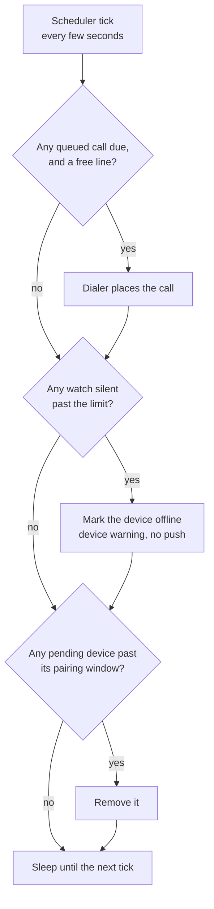

# 06 · Operations

Part of the [Sentinela specification](README.md). What happens when things fail, the timers and how demo mode shortens them, security and privacy, how each part is tested, and what to try before the hackathon.

## 1. Failure handling

One principle covers most rows: **a failure is treated as uncertainty, and uncertainty only moves a code up.** A call that could not happen or could not finish is never recorded as fine.

| Failure | What the system does | What people see |
|---|---|---|
| Twilio cannot place the call | The attempt is marked failed and counts as unanswered; the redial rule applies | Same as "nobody answers" |
| No answer, busy, or voicemail | Redial rule ([03-status-model.md](03-status-model.md) section 5) | Yellow per the matrix |
| Senior hangs up, or the connection to Twilio drops mid-call | The call is marked dropped and counts as answered with low certainty | Usually yellow |
| Model provider fails or is too slow during a call | The agent says a fixed apology, the call is closed and counts as dropped | Usually yellow; the failure is logged |
| Red, but nobody is marked on duty | No dial is attempted; the senior hears a fixed message; the red stays unacknowledged | Red at the top of the dashboard with a "nobody on duty" warning |
| On-duty phone does not answer the hand-over | After the ring time the senior hears that someone will call back; the red stays unacknowledged | Red at the top of the dashboard, audible cue continues |
| A push cannot be delivered | An invalid token is removed; there is no retry | The code is still correct on any open screen |
| FastAPI restarts | Queued calls and redials are database rows with a due time, so they resume. Live calls drop and count as dropped | A short gap; affected calls usually end yellow |
| Database unreachable | No new calls are placed. Twilio callbacks get a safe answer: a polite message, then hang up. The health check fails | Dashboards stop updating |
| A callback or watch event arrives twice | Ignored by its id | Nothing |
| Watch has no connection | Events wait on the watch and are sent later with their measured time. Stale ones start no call. Missed check-ins mark the device offline | A device warning, no push |
| Watch is not worn | The check-in says so; thresholds are not evaluated | A device warning, no push |
| A command arrives with an expired identity token | Refused | The app renews the token and retries once |
| An invite is scanned a second time | The second redeem is refused | "Invitația a fost deja folosită" |

## 2. The scheduler

Every timer in the system is a row with a due time. The scheduler is a short loop inside FastAPI that looks for rows that have come due. Nothing is waiting only in memory.

"A free line" is the limit on calls in progress at once. It keeps a campaign from opening more conversations than the model provider and the Twilio account allow.

## 3. Timers and demo mode

Demo mode is one setting on FastAPI and one on each client. It shortens waits so that a full story fits in three minutes; it changes no logic.

| Timer | Normal | Demo mode |
|---|---|---|
| Redial delay | 20 minutes | 20 seconds |
| Call length limit | 3 minutes | 3 minutes |
| Wrist prompt timeout | 2 minutes | 15 seconds |
| Watch check-in interval | 15 minutes | 30 seconds, with the watch app's monitoring screen open |
| Watch counted as silent after | 45 minutes | 90 seconds |
| Screen refresh interval | 10 seconds | 2 seconds |
| Cooldown between calls to one senior | 10 minutes | 30 seconds |
| Stale event limit | 30 minutes | 30 minutes |
| Pairing code validity | 10 minutes | 10 minutes |
| Invite validity | 24 hours | 24 hours |
| On-duty phone ring time | 30 seconds | 15 seconds |
| Calls in progress at once | 3 | 3 |

All values are proposals. The 20-minute redial and the 3-minute call limit come from v3.

**Demo controls**

| Control | Where | Stands in for |
|---|---|---|
| "Simulează cod roșu" | DAS dashboard | A real weather warning |
| "Sunați-mă" | Senior's Android app | A watch anomaly, if the watch misbehaves on stage (D9) |
| A hidden "force anomaly" action | Wear OS app | Waiting for a real pulse spike |

## 4. Security and privacy

**Access**

| Measure | Detail |
|---|---|
| Every caller is identified | People by identity token, the watch by device token, Twilio by request signature. Nothing is open |
| Roles are set only by the server | An account cannot give itself a role; a new account can read nothing until an invite is redeemed |
| Every SQL Connect operation has a rule | No query or mutation is public; each is scoped by role and by the caller's own account |
| Device tokens and invites | Device tokens are stored hashed. Invites are single-use and expire |
| Secrets | Twilio, model provider and Firebase service credentials live in the hosting platform's secret store, never in an app |
| The on-duty number | Read from the database at hand-over time; only a DAS account can change it |

**Data**

| Measure | Detail |
|---|---|
| Consent | Signed at registration; covers calls, processing of what is said, and sharing the code with caregiver, medic and DAS |
| Minimum per role | The caregiver sees the code and a reason, not the transcript ([01-architecture.md](01-architecture.md) section 6) |
| No audio stored | Speech stays inside Twilio; FastAPI handles text only |
| Minimal watch data | Only the latest check-in is kept; there is no pulse history |
| Push carries no health details | Generic text and an id (P18) |
| Region | Database and FastAPI in an EU region |
| Demo data | Fictitious people only |

**Honest limits for a real pilot.** Transcripts pass through the model provider, speech passes through Twilio, and the database sits on Google Cloud. A pilot needs data-processing agreements with all three and a named data controller (v3 §14 assigns this to the medic and DAS). None of that is needed to demo with fictitious data.

**Telephony constraints** are unchanged from v3 §12: a US Twilio number for the hackathon, Romania enabled in geographic permissions, the AI features addendum accepted, and a test on each mobile network for how the number is displayed and whether it is flagged as spam.

## 5. Testing

| What | How | Needs |
|---|---|---|
| Status engine | A table of cases: every cell of the matrix, every row of the combining table, every lifecycle rule, every worked example in [03-status-model.md](03-status-model.md) section 10 | Nothing outside the module |
| Call session | A scripted stand-in for Twilio's messages and a scripted stand-in for the model. Scripts: green, yellow, red, alarm word, key 9, interruption, hang-up, model failure, call length limit | No phone, no model |
| Twilio callbacks | Recorded real requests replayed against FastAPI, including one with a bad signature | Recordings from spike S4 |
| Commands | Each command called as each role, and signed out | A local FastAPI |
| SQL Connect rules | Each query and mutation run as each role in Firebase's local emulator; the refused combinations are asserted | The emulator |
| Watch | The threshold logic fed synthetic readings: high at rest, high while walking, not worn. Pairing run end to end against a local FastAPI | An emulator or the watch |
| Whole system | A rehearsal of the demo with real phones on each network, with the latency of every agent turn logged (v3 §8.9) | Everything deployed |

The first two rows cover the logic that decides a person's code. They run without any outside service, so they can run on every change.

## 6. Spikes to run before the hackathon

Each is a small experiment whose answer changes the plan. They are ordered by how much depends on them.

| ID | Question | If the answer is no |
|---|---|---|
| S1 | Can FastAPI connect directly to the SQL Connect database and read and write its tables, while SQL Connect owns the table definitions? | The routing rule (P7) cannot hold as written. Fallback: FastAPI owns its own tables for calls and codes, and apps read those through FastAPI |
| S2 | Can a write made by the server trigger an instant refresh of subscribed queries? | Keep timed refresh (P6). Nothing else changes |
| S3 | Is a 2-second timed refresh smooth on the tablet and the dashboard, and what does it cost in operations over two days? | Lengthen the interval, or send a "re-read now" push to open Android apps |
| S4 | Does a first ConversationRelay call in `ro-RO` with the chosen voice work end to end from our service? | Fall back to v3's question-by-question call flow |
| S5 | On the team's actual watch, how often does background pulse sampling deliver readings, and what does continuous monitoring cost in battery? | Demo with the monitoring screen open; treat the background case as best-effort |
| S6 | Does a push reach the demo phones when the app is closed, including after the phone has been idle? | Exempt the app from battery saving on the demo phones; note the limit |
| S7 | Does the FastAPI service hold a WebSocket for a full call on the chosen host, and stay running between calls? | Host it on an ordinary virtual machine |
| S8 | Which model gives natural Romanian with the shortest wait before the first word? | Use more fixed sentences for the routine turns |
| S9 | How does the US number appear on Orange, Vodafone and Digi phones, and is it flagged as spam? | Call a team phone in the demo, as v3 §12.5 already plans |

## 7. Demo walk-through

Adapted from v3 §16 to the MVP's scope.

| Step | On the table | Use cases |
|---|---|---|
| 1 | The medic registers a fictitious patient on the tablet; the "caregiver" scans the QR with a phone; DAS accepts on the laptop; the senior's phone rings with the welcome call | UC-01, UC-02, UC-04 |
| 2 | DAS presses "Simulează cod roșu"; the senior's phone, on speaker, has a natural conversation and ends green on all three screens | UC-05, UC-12 |
| 3 | The watch detects an anomaly and the wrist prompt is ignored; the phone rings; the "senior" is dizzy and cannot name the day; all screens turn red; the caregiver's and medic's phones buzz; the on-duty phone rings and the two are connected; DAS acknowledges | UC-09, UC-07, UC-11 |
| 4 | A second patient does not answer; after the short redial the card turns yellow and the caregiver's phone buzzes | UC-08, UC-06 |
| Fallback | If the watch misbehaves, the "senior" taps "Sunați-mă" and step 3 continues from the phone ringing | UC-10 |

v3's backups still apply: a team phone as the senior's phone, and a recorded video of a full run.

## 8. Main risks

| Risk | Why it matters | Mitigation |
|---|---|---|
| Three client codebases in 48 hours | v3 cut native apps for this reason | Four people with Android experience (D11); the Wear OS app is one screen and one job; all logic sits in FastAPI |
| SQL Connect is new, and its live queries are about six months old | The demo's key moment is every screen changing together | Spikes S1 to S3 before the event; timed refresh as the default |
| Delay between the senior speaking and the agent answering | Long pauses confuse an elderly listener; the international route adds to it | Short replies, streaming, fixed sentences for routine turns, measured in the rehearsal |
| Background pulse sampling on Wear OS | The watch trigger depends on it | Spike S5; the "Sunați-mă" fallback |
| A caregiver on an iPhone has no channel | The automated family call was deferred | Stated as a known gap; first item to restore after the MVP |
| The model misjudges severity | The model now sets severity, unlike v3 | Alarm words force red; uncertainty moves codes up; every report is stored with the senior's words for review |
