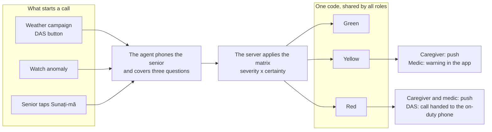

# Sentinela: system specification (MVP)

**Status:** draft for team review · 2026-10-08
**Scope:** how the apps communicate, through which means and interfaces. No code.
**Baseline:** [`../esti-bine-specificatii-v3.md`](../esti-bine-specificatii-v3.md). Where this spec and v3 disagree, this spec wins for the MVP.

## What Sentinela is

An early-warning system for heat and cold illness in seniors who live alone. During a weather warning the system phones each enrolled senior, an AI agent talks with them in Romanian, and the result is one of three codes (green, yellow, red) that the caregiver, the medic and DAS all see. A red hands the call to a person at DAS. A senior who also wears a Wear OS watch gets a second trigger: an abnormal reading on the wrist starts the same call.

The senior needs nothing but a phone. The watch and the senior's phone app are optional layers.

## Files

| File | Contents |
|---|---|
| [01-architecture.md](01-architecture.md) | Parts, channels, the routing rule, identity, live updates, inside the FastAPI service, hosting |
| [02-use-cases.md](02-use-cases.md) | Actors, thirteen use cases, sequence diagrams |
| [03-status-model.md](03-status-model.md) | Codes, severity and certainty, the matrix, combining rules, lifecycles |
| [04-interfaces.md](04-interfaces.md) | Every interface between parts: operations, commands, callbacks, messages, agent tools |
| [05-data-model.md](05-data-model.md) | Entities, relationships, who writes what, retention |
| [06-operations.md](06-operations.md) | Failure handling, timers and demo mode, security and privacy, testing, spikes to run before the hackathon |

## What changed from v3

| Topic | v3 | Sentinela MVP |
|---|---|---|
| Call triggers | Weather warning campaign | Campaign (DAS button), watch event, senior request, welcome call |
| Clients | One React project with three zones | Android app with three roles, Wear OS app, React dashboard for DAS |
| Medic's device | iPad, web | Android tablet, same Android app |
| Family | Passwordless, QR token opens a web page | "Caregiver": QR creates an account in the Android app |
| Statuses | Five: verde, sarcină, galben, roșu, neclar | Three: green, yellow, red. Neclar folds into yellow; sarcină is dropped |
| Who decides the status | Rules engine over recorded answers | The model reports severity and certainty; the server applies a fixed matrix; an alarm-word list forces red |
| Family escalation | Push plus automated call, 30-minute confirmation ladder | Push only; the ladder is deferred |
| DAS | Dispatch queue with case workflow, map, tasks, shelters | Red-first list with acknowledge, enrollment requests, campaign button, on-duty phone |
| Backend | FastAPI and Postgres, live updates over SSE | FastAPI for calls, scheduling, watch intake and the matrix; Firebase for sign-in, database access (SQL Connect on PostgreSQL) and push |
| Risk factors and score | Extracted from a document, medic confirms | Deferred |
| Shelters | Shelter finder and map | Deferred |

## Decision log

### Decided in the design session

| ID | Decision |
|---|---|
| D1 | v3 stays the baseline; the hand-drawn sketch was a draft judged against it |
| D2 | The watch is a Wear OS watch the team owns. It is optional for a senior |
| D3 | Clients: Android app for caregiver, medic (on a tablet, whole flow) and optionally senior; Wear OS app for the senior; web dashboard for DAS |
| D4 | The watch evaluates thresholds itself and sends anomaly events plus a periodic check-in |
| D5 | Medic: a yellow shows as a warning in the app; a red sends a push notification |
| D6 | Three codes only (green, yellow, red). No tasks. All roles see the same code |
| D7 | Certainty exists only when an agent call happened. Severity comes from external events and from the model |
| D8 | Red hands a connected call to the phone of the on-duty DAS employee registered in the dashboard, and puts the senior at the top of a red-first list. In the demo that phone is the team's |
| D9 | The senior's phone app is a small companion that can request an agent call. It is the demo fallback for the watch |
| D10 | In scope: weather campaign from a DAS button, welcome call. Out of scope: risk factors from a document, shelter finder and map |
| D11 | Team of four with Android experience |
| D12 | Scanning the medic's QR creates the caregiver's or senior's account, already linked to the patient |
| D13 | Firebase from the start: Firebase sign-in, SQL Connect as the database layer, Firebase push. FastAPI keeps calls, scheduling, watch events and the matrix |

### Proposed defaults, not yet confirmed

These fill gaps the session did not settle. Each is marked **(proposed)** where it is specified. P1 to P6 were presented in the session and not vetoed; the rest are new in this spec.

| ID | Proposal | Specified in |
|---|---|---|
| P1 | An unanswered call counts as low certainty | 03 |
| P2 | Retry happens once. A green that is still not high-certainty afterwards becomes yellow | 03 |
| P3 | A high-certainty call result replaces the trigger's starting severity; otherwise the higher of the two wins | 03 |
| P4 | An alarm-word list forces red regardless of the model | 03 |
| P5 | Yellow is a push to the caregiver with no timer | 03 |
| P6 | Screens stay live through timed refresh of SQL Connect queries | 01 |
| P7 | Routing rule: apps read and enter plain data through SQL Connect; anything that makes a phone ring or changes a code goes to FastAPI; only FastAPI writes codes | 01 |
| P8 | A trigger's starting severity is provisional: the code changes only when the model reports, the call ends, or the call goes unanswered | 03 |
| P9 | Red is sticky until a DAS employee acknowledges it, and is never overwritten by a lower code before that | 03 |
| P10 | Exactly one DAS employee is on duty at a time | 04 |
| P11 | A watch is bound by a short code shown on the watch and typed by the medic | 02 |
| P12 | Watch signals in the MVP: high pulse at rest, and a "Nu mă simt bine" button. A wrist prompt precedes the anomaly event | 02 |
| P13 | DAS and medic accounts are created ahead of time by a setup script | 02 |
| P14 | The Android app scans the QR with its own scanner | 02 |
| P15 | The consent signature is stored in the database, not in file storage | 05 |
| P16 | A campaign is one round of calls, started immediately | 02 |
| P17 | FastAPI is hosted on Google Cloud Run in an EU region | 01 |
| P18 | Push messages carry generic text and a senior id, no health details | 04 |

## Deferred past the MVP

- Tasks (medicine, groceries) and the blue status
- The family confirmation ladder and the automated call to the caregiver
- Risk factors from a medical document, the risk score, risk-ordered calling
- Shelter finder, map, editable shelter list
- Day-over-day trend detection
- Automatic intake of weather warnings (the MVP uses a button)
- Repeated campaign rounds per day and the preferred call window
- DAS case workflow (assign, team sent, close with note)
- "Request changes" on an enrollment
- Inactivity detection on the watch
- Any channel for a caregiver on an iPhone

## Open questions for review

1. **Watch anomaly and two unanswered calls.** The matrix as drawn leaves this at yellow. Two independent signals agree (abnormal reading, unresponsive person), which argues for red. Default in this spec: yellow.
2. **Timed refresh (P6).** Depends on spike S2 in [06-operations.md](06-operations.md). If server-side writes can trigger an instant refresh, switch.
3. **Yellow without a timer (P5).** A caregiver who misses the push is not chased. Acceptable for the MVP?
4. **Sticky red (P9).** Confirm that only a DAS employee clears a red.
5. **Hosting (P17) and model provider.** Neither was discussed. See 01 and 04.
6. **Email, not username.** Firebase sign-in has no plain usernames. Confirm email and password is acceptable.

## Glossary

| Term | Meaning |
|---|---|
| Code | The senior's current status: green, yellow or red. One per senior, shared by all roles |
| Severity | How worrying the situation is: green, yellow or red |
| Certainty | How solid the conversation's result is: high, medium or low. Exists only for a call |
| Trigger | What caused a call: campaign, watch, manual (senior request) or welcome |
| Starting severity | The severity a trigger carries before anyone has spoken: green for campaign, yellow for watch and manual |
| Wellbeing call | An agent call that checks on the senior. Every call except the welcome call |
| Check-in | The watch's periodic report (battery, worn or not, last pulse). Not a call |
| Hand-over | Connecting a live call to the on-duty DAS employee's phone |
| Acknowledge | A DAS employee confirming they have seen a red |
| On duty | The one DAS employee whose phone receives hand-overs |
| Routing rule | Reads and plain data entry go to SQL Connect; consequences go to FastAPI |
